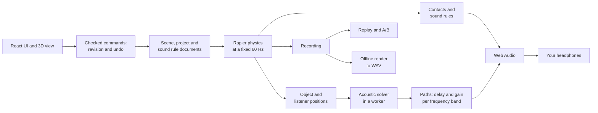
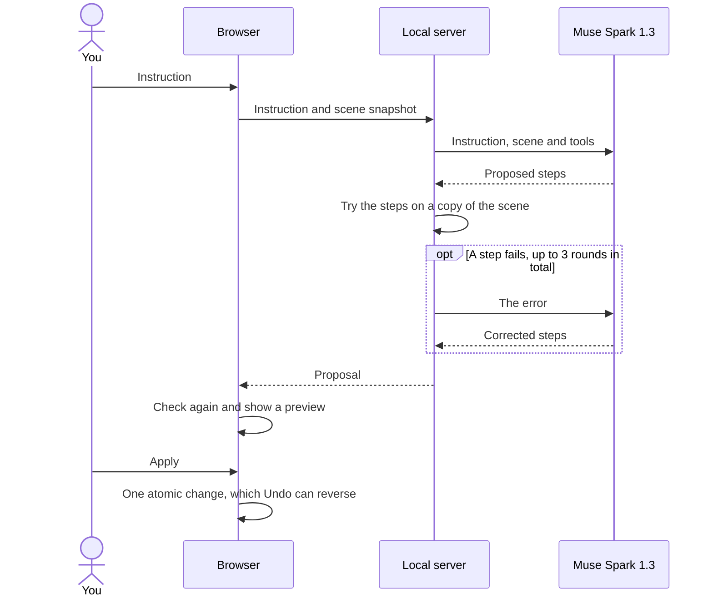

<!-- english-source: {"path":"README.md","sha256":"65108c93e2d1d53c2d4cc3fa7192d61dbf5e116f7ee2f249e5e745118748e42d","translated_at":"2026-11-04T16:33:00.448Z","executor":"Claude Code","model_id":"claude-opus-5-5","links":"english-relative"} -->
<!-- english-notice:start -->
> English translation of [`README.md`](README.md). Source SHA-256: `65108c93e2d1d53c2d4cc3fa7192d61dbf5e116f7ee2f249e5e745118748e42d`. Executor: Claude Code; model ID claude-opus-5-5. Translation is not new implementation or validation evidence. Canonical sources and shared task/contract/result files retain their authority. Verbatim technical examples may retain their original language.
<!-- english-notice:end -->

<!-- english-original-anchor --> <a id="reflection-lab"></a>
# Reflection Lab

Hear a room while you design it. Reflection Lab is a browser-based 3D room with real-time physics that traces how sound reflects off its surfaces. Describe a room in plain words and Muse, Meta's model, builds it: you get a preview, nothing changes until you press Apply, and the surfaces it adds change the sound.

It's for sound designers, game audio teams and architects who want to try a space early. The acoustics are a real-time approximation, not a measurement.

[](https://youtu.be/PHnT8HdyHCw)

**[Watch the demo video](https://youtu.be/PHnT8HdyHCw)**

[Traditional Chinese README](docs/en/README.zh-TW.md) · [MIT License](LICENSE) · [User guide](docs/11-v1/USER_GUIDE.en.md)

Built for the Meta Global AI Developer Hackathon. This repository is a public source snapshot, and its [note](docs/00-project/PUBLIC_SNAPSHOT_20261104.md) explains what's included.

<!-- english-original-anchor --> <a id="contents"></a>
## Contents

- [What it does](#what-it-does)
- [What you need](#what-you-need)
- [Run it without a key](#run-it-without-a-key)
- [Run it with Muse](#run-it-with-muse)
- [First steps](#first-steps)
- [Build a room with Muse](#build-a-room-with-muse)
- [Walk around in first person](#walk-around-in-first-person)
- [Draw a path by hand](#draw-a-path-by-hand)
- [What the tabs do](#what-the-tabs-do)
- [Listening and audio settings](#listening-and-audio-settings)
- [Save your work](#save-your-work)
- [How it works](#how-it-works)
- [How Muse fits in](#how-muse-fits-in)
- [Known limits](#known-limits)
- [Troubleshooting](#troubleshooting)
- [Commands](#commands)
- [Run the checks](#run-the-checks)
- [Project layout](#project-layout)
- [Documentation](#documentation)
- [Built with](#built-with)
- [Licence](#licence)

<!-- english-original-anchor --> <a id="what-it-does"></a>
## What it does

| Feature | What you get |
| --- | --- |
| **Build by describing** | One instruction becomes up to 32 checked steps that add, move, resize and remove objects, set materials, configure sound sources and write paths |
| **Sound paths you can see** | Lines in the room show the direct sound and the first-order reflections the solver found, and each line changes what you hear |
| **Real-time physics** | Rigid bodies at a fixed 60 Hz, which can be dynamic with or without gravity, fixed, or kinematic |
| **Sound rules** | Objects can play a continuous sound or react to impacts, grabs and throws, using an oscillator or an imported WAV |
| **First-person play** | Walk the room, then grab, throw, rotate and place objects with the mouse |
| **Motion paths** | Draw a path in the editor or in first person, and move a sound around the listener |
| **Record and replay** | Capture a take and replay its motion, events and sound |
| **A/B comparison** | Change one condition, then re-evaluate the same recorded motion against it |
| **Audio export** | Render short takes to a WAV mix and stems |
| **Two languages** | The interface runs in English and Traditional Chinese |

<!-- english-original-anchor --> <a id="what-you-need"></a>
## What you need

- **Node 22.17.0 and npm 11.4.2.** These exact versions are pinned in `package.json`.
- **A desktop Chromium browser,** such as Chrome. This is what the project was tested in, on Windows.
- **Headphones,** so you can hear the direction of a sound.
- **A Meta Model API key,** only for the Muse features. Everything else runs without one.

<!-- english-original-anchor --> <a id="run-it-without-a-key"></a>
## Run it without a key

```powershell
npm ci
npm run dev
```

Open http://127.0.0.1:5173. Meta requests are off in this mode and nothing is spent. The agent panel only offers offline tools, which are not a language model. Run only one Reflection Lab server at a time, because this and the Muse launcher both use port 8787.

<!-- english-original-anchor --> <a id="run-it-with-muse"></a>
## Run it with Muse

Put your key in a file outside the repository, then run:

```powershell
npm ci
npm run build
npm run demo:live -- --key-file "<path to the server-only key file>"
```

Open http://127.0.0.1:4173. Press Ctrl+C in the terminal to stop.

- **Your key** stays on the local server and never reaches the browser.
- **Spending** only happens when someone submits an instruction with Meta Model API selected. A typical proposal costs a few cents at list price.
- **The budget record** is `research/v1/meta-live-budget-20261104-limits.json`. The launcher stops at US$5 or 200 requests, and that count already includes this project's bench and rehearsal requests.

<!-- english-original-anchor --> <a id="first-steps"></a>
## First steps

1. Set **Interface language** to English in the top bar.
2. Click **Enable listening**. Start with your device volume low.
3. Press **Start simulation**. The ball drops, the speaker plays a tone, and the lines in the room show the sound's paths.
4. Move the camera: right-drag to orbit, middle-drag to pan, and scroll to zoom.

The room is open at one end. If a wall blocks your view, orbit until you can look in through the open end.

<!-- english-original-anchor --> <a id="build-a-room-with-muse"></a>
## Build a room with Muse

Open the **Meta experiment agent** tab and choose **Meta Model API**. Press **Pause** before each instruction. Paste an instruction, press **Generate action preview**, and wait. Most take under a minute. Check the preview, then press **Apply actions**.

These four worked in our rehearsals, in this order:

**1. Build a recital room**

```text
Turn this room into a small recital room: a raised wooden stage across the back wall, a grand-piano-sized box on the stage, and twelve chairs in three rows facing the stage.
```

**2. Add to it.** Afterwards, press **Reset** and **Start simulation**, then open the **Acoustic paths** tab to find reflections off the new wall panels.

```text
Now make it feel like a real concert space: add three slim metal columns, floor to ceiling height, along each side wall, evenly spaced from the stage to the open end of the room. Add two soft wall panels at ear height on each side wall, between the columns. Add a 4-step wooden staircase leading up to the left end of the stage. Don't change anything that's already here.
```

**3. Change a sound.** Afterwards, press **Reset** and **Start simulation** to hear the ball's next impact.

```text
Raise the pitch of the ball's impact sound by 7 semitones.
```

**4. Move a sound around you.** Afterwards, press **Resume simulation**, open the **Motion** tab and press **Run**. Don't press Reset first.

```text
Move the listener to the middle of the room at ear height, then move the speaker in a slow circle around the listener at 1.5 m height, radius 2 m, over 8 seconds, ending where it started.
```

To take back a proposal, press **Undo last AI apply** straight after Apply, before you start or reset the simulation.

<!-- english-original-anchor --> <a id="walk-around-in-first-person"></a>
## Walk around in first person

Press **Enter first person** and click the view.

| Input | Action |
| --- | --- |
| W, A, S, D | Move |
| Shift | Sprint |
| Mouse | Look around |
| Left click | Grab the object you're aiming at, then left click again to throw it |
| Right button | Hold to preview a new object, release to place it. While holding an object, put it down |
| Mouse wheel | Change the distance of a held object or preview |
| R | Rotate a held object or preview |
| L | Open the object library |
| Enter | Pause or resume |
| Esc | Release the mouse |

Leaving first person resets the camera, so orbit back into the room afterwards.

<!-- english-original-anchor --> <a id="draw-a-path-by-hand"></a>
## Draw a path by hand

Only objects with sound can have a path.

- **In the editor:** select the object and press **T**. Click surfaces to add points, click a point to select it, then drag it. **Delete** removes the selected point. Press **T** or **Esc** to finish.
- **In first person:** aim at the object, hold **Ctrl** and press the left mouse button, then drag through the room and release. Press **Enter** or click to start the take.

Press **Shift+T** to show the path curves in the view.

<!-- english-original-anchor --> <a id="what-the-tabs-do"></a>
## What the tabs do

| Tab | Use it to |
| --- | --- |
| Events & recording | See collisions and sound decisions, and record or replay a take |
| Acoustic paths | List the direct path and reflections reaching the listener |
| Experiment comparison | Compare two takes |
| Meta experiment agent | Give Muse instructions, or use the offline tools |
| Motion | Run, edit and remove object paths |
| Audio export | Capture and render audio files |
| Performance | Check timing and audio dropouts |
| Zones | Add zones that trigger sound rules |

The [user guide](docs/11-v1/USER_GUIDE.en.md) covers the rest of the app. Its agent section was written before the multi-step builder, so use this page for Muse. Its note that only boxes take part in acoustics is also out of date: spheres and capsules now block and reflect sound too.

<!-- english-original-anchor --> <a id="listening-and-audio-settings"></a>
## Listening and audio settings

These controls are in the Monitor strip at the bottom and the top bar.

- **Enable listening** turns on audio output. It doesn't start the physics, so press **Start simulation** as well.
- **Monitor** is a gain slider that runs from -40 to +12 dB and defaults to 0 dB. It's digital gain, not calibrated sound pressure.
- **Mute monitor** only silences your output. The experiment keeps running, so use **Pause** to stop it.
- **Audio buffer** defaults to **Stable**. **Balanced** and **Low latency** respond faster but are more likely to drop out, like a smaller buffer in a music app.
- **Output underruns** counts the dropouts the browser reports.

<!-- english-original-anchor --> <a id="save-your-work"></a>
## Save your work

Pause the simulation before you import or save.

- **Save project** stores the scene in this browser. Ctrl+S or ⌘+S does the same.
- **Export project** and **Import project JSON** move a project between browsers. An import shows a review dialog before anything changes.
- **Import audio** accepts PCM and float WAV files. A project pins each file's identity and hash, so renaming a different file doesn't make it the same sound.
- **A project file isn't a full backup.** Audio and recordings stay in browser storage, so keep your original WAV files and export recordings separately.

<!-- english-original-anchor --> <a id="how-it-works"></a>
## How it works



<!-- english-original-anchor --> <a id="scene-and-physics"></a>
### Scene and physics

Scenes are plain, serializable documents with stable IDs and SI units. Every change goes through a revision check, validation and an all-or-nothing command that can be undone, whether it comes from you or from Muse. Engine objects, such as physics handles and audio nodes, are never saved into a scene.

Physics runs at a fixed 60 Hz on the main thread, driven by browser frames, and the view interpolates between steps. Fixed steps don't pass through React state.

<!-- english-original-anchor --> <a id="acoustics"></a>
### Acoustics

Each layer is labelled with what it actually is:

| Layer | What happens | What it is |
| --- | --- | --- |
| Paths | A worker finds the direct path, what blocks it, and first-order reflections off flat and curved surfaces | Numerical approximation |
| Path sound | Each path gets its own delay and a gain per frequency band, from distance, the surface's reflection coefficient and air loss | Numerical approximation |
| Materials | Each material splits energy into absorption, reflection and transmission per band | Synthetic demonstration values, not measurements |
| Direction | The browser's HRTF on the direct path, and equal-power panning on reflections | Perceptual approximation |
| Reverb tail | A synthetic late reverb | Perceptual approximation |
| Levels | Shown in dBFS | Digital level, not calibrated dB SPL |

It doesn't model diffraction, reflections beyond the first order, or wave effects, and it doesn't produce a phase-correct room impulse response. The lines in the room only ever come from solver results.

The live limits are 8 paths per source and 256 acoustic surfaces per source. The audio engine plays up to 24 voices, and sound rules can start up to 16 of them. Propagation is limited to 2 seconds by default, with a hard limit of 5 seconds.

<!-- english-original-anchor --> <a id="clocks"></a>
### Clocks

Physics, the renderer, the solver, audio and the AI each keep their own clock. Audio never waits for the AI, geometry or physics, and a path's propagation delay is applied only once. Updating acoustics 10 to 20 times a second is an engineering target that hasn't been validated yet.

<!-- english-original-anchor --> <a id="how-muse-fits-in"></a>
## How Muse fits in

Muse only proposes changes. Physics and acoustic results always come from the app's own code.



1. Muse Spark 1.3 gets your instruction, the current scene and a set of tools. It can create a scene, add, move, resize and remove objects, set materials and physics modes, configure sound sources, move the listener and write paths.
2. The server tries the proposal on a copy of the scene, using the app's real scene rules, physics and motion code. If a step fails, Muse gets the error and tries again, up to three rounds.
3. The browser checks the proposal again and shows a preview. Nothing changes until you press Apply.

Sound rule changes, like prompt 3, go through a separate planner.

**Settings the launcher uses:** model `muse-spark-1.3`, parallel tool calls, medium thinking, up to 16,000 output tokens per request, no automatic retries and Standard data mode. Only one request runs at a time.

**Results in the real app.** These are small samples from rehearsals, not a reliability figure:

| Instruction | Worked | Time | Result |
| --- | --- | --- | --- |
| Recital room | 6 of 6 | 32–43 s | 14 new objects |
| Concert space | 4 of 4 | 39–59 s | 14 new objects, no overlaps in the 3 runs checked |
| Ball impact pitch +7 semitones | 3 of 3 | 9–16 s | Two sound actions, applied |
| Speaker circling the listener | 1 of 1 | 38 s | Output level swung between about -28 and -34 dBFS, with 3–5 paths |

In a separate bench, medium thinking was the best value: a typical build took 7 to 45 seconds and cost US$0.01 to US$0.04. The full results, limits and evidence are in the [scene builder record](docs/00-project/MUSE_SCENE_BUILDER_20261104.md).

<!-- english-original-anchor --> <a id="known-limits"></a>
## Known limits

- **Undo** only works straight after Apply, and it only goes back one proposal.
- **Reset after a Muse path** greys out Run until you press **Rebind to current scene**.
- **Recording** stalled in both of our tries with a Muse path in a 34-object scene. Screen-record large scenes instead.
- **Recording can pause when it starts** if it can't keep up. No data is lost, and **Resume simulation** continues it.
- **Proposal size** is capped at 32 steps. Very long paths can run out of model output.
- **Sound stops above 256 acoustic surfaces per source.** A box counts as 6 and a sphere or capsule as 1. Muse sees this limit, and the app refuses proposals that go over it.
- **Paths don't avoid objects.** The app refuses a path that runs through something.
- **Scenes use simple shapes:** boxes, spheres and capsules.
- **A path on the ball is silent.** Put the path on the speaker to hear it move.
- **Some crackle remains** while sound paths change, mostly with moving sources. Using HRTF only on the direct path reduced it a lot but didn't remove it.
- **"Acoustics stale" or "Acoustics pending"** shows while things move. It means the screen shows the last finished calculation.
- **Nobody has formally listened to the Muse-built scenes yet,** and this is not a complete first version. Full performance and listening checks are still open.

The [limits record](docs/en/KNOWN_LIMITATIONS.md) has the longer history.

<!-- english-original-anchor --> <a id="troubleshooting"></a>
## Troubleshooting

| Problem | Try this |
| --- | --- |
| No sound | Click **Enable listening**, press **Start simulation**, and check that the monitor isn't muted |
| The sound breaks up | Keep **Audio buffer** on **Stable**, close other heavy tabs, and watch **Output underruns** |
| Meta Model API is blocked | You're probably on `npm run dev`. Use `npm run demo:live`, then read the status line in the agent panel |
| A port is already in use | The app uses fixed ports 5173, 4173 and 8787. Stop the other Reflection Lab server first |
| Undo shows `REVISION_CONFLICT` | Undo only works straight after Apply, before you start or reset |
| Run is greyed out after Reset | Press **Rebind to current scene** in the **Motion** tab |
| Recording paused by itself | It paused to avoid skipping physics steps. Press **Resume simulation**, or stop to keep what it captured |
| You can't see inside the room | Orbit until you're looking in through the open end |

<!-- english-original-anchor --> <a id="commands"></a>
## Commands

| Command | What it does |
| --- | --- |
| `npm run dev` | Starts the web app on port 5173 and the local API on port 8787, with Meta requests off |
| `npm run build` | Type-checks and builds to `dist` |
| `npm run demo:live -- --key-file "<path>"` | Serves the build on port 4173 with Muse turned on |
| `npm run check` | Runs research regressions, runtime tests, the build, the licence inventory and the English document check |
| `npm test` | Runs the acoustic and integration tests |
| `npm run test:runtime` | Runs the app's runtime tests |
| `npm run test:browser:ui` | Runs the interface tests in a real browser |
| `npm run test:browser:storage` | Runs the browser storage tests |
| `npm run test:browser:physics` | Runs the browser physics lifecycle tests |
| `npm run benchmark` | Runs the offline analytic reference benchmarks |
| `npm run lint`, `npm run typecheck`, `npm run format:check` | Runs the static checks |
| `npm run wiki -- status` | Shows the state of the project notes |

<!-- english-original-anchor --> <a id="run-the-checks"></a>
## Run the checks

```powershell
npm ci
npm ci --prefix experiments/physics-spike --ignore-scripts
npm run check
npm run benchmark
```

`npm run check` takes about 10 minutes. It doesn't run browser, native or listening tests.

The last full run was on a clean clone of commit `613b2f97`, and the details are in the [validation record](artifacts/public-snapshot-20261104/verification.json):

| Check | Result |
| --- | --- |
| `npm run check` | Passed, including 2,522 of 2,522 runtime tests and 1,889 of 1,889 `npm test` tests |
| Browser tests, run locally | 56 of 62 passed. The 6 failures aren't fixed, and the tests weren't relaxed |
| Secret scan | 14 hits, all of them test fixtures |

GitHub's browser job currently fails on 5 older tests, so the commit shows a red X. We haven't investigated all of them, and they're listed in the validation record.

<!-- english-original-anchor --> <a id="project-layout"></a>
## Project layout

| Folder | Contents |
| --- | --- |
| `src` | The web app, described below |
| `server` | Local API server and Meta Model API integration |
| `tests`, `benchmarks` | Automated tests and reference benchmarks |
| `schemas` | Data and AI tool contracts |
| `scripts` | Launchers, setup and validation tools |
| `docs` | Architecture, design and validation documents, with English copies in `docs/en` |
| `knowledge` | Project notes and task records |
| `research` | Sources, formulas and evidence records |
| `experiments` | Isolated research spikes, separate from the product |
| `artifacts` | Evidence from test runs and reviews |
| `third_party` | Records and licence text for pinned upstream material |

Inside `src`:

| Folder | Contents |
| --- | --- |
| `app` | The runtime that ties everything together, plus the workers |
| `scene` | Scene documents and commands |
| `physics`, `interaction`, `motion` | Rapier world, first-person input and object paths |
| `acoustics` | The geometric solver |
| `audio`, `audio-behavior` | Web Audio engine, offline rendering and sound rules |
| `ai` | Tool definitions, validation, the Host and the offline tools |
| `experiments`, `persistence` | Recording, comparison and browser storage |
| `ui` | The React interface and both languages |

<!-- english-original-anchor --> <a id="documentation"></a>
## Documentation

| Topic | Document |
| --- | --- |
| Everything in English | [Documentation index](docs/en/index.md) |
| Using the app | [User guide](docs/11-v1/USER_GUIDE.en.md), [parameter reference](docs/en/11-v1/PARAMETER_REFERENCE.md) |
| System design | [Architecture](docs/en/02-architecture/ARCHITECTURE.md), [audio runtime](docs/en/02-architecture/AUDIO_RUNTIME.md), [data contracts](docs/en/02-architecture/DATA_CONTRACTS.md) |
| Decisions | [Decision records](docs/en/02-architecture/ADR_INDEX.md) |
| Muse | [Scene builder record](docs/00-project/MUSE_SCENE_BUILDER_20261104.md), [agent tools](docs/en/08-ai/AI_TOOL_SCHEMAS.md), [scene control](docs/en/08-ai/AI_SCENE_CONTROL.md) |
| Limits | [Known limitations](docs/en/KNOWN_LIMITATIONS.md) |
| Licences | [Licence register](docs/en/01-compliance/LICENSE_REGISTER.md), [third-party notices](docs/en/01-compliance/V1_THIRD_PARTY_NOTICES.md) |

<!-- english-original-anchor --> <a id="built-with"></a>
## Built with

| Project | Version | Licence |
| --- | --- | --- |
| [React](https://react.dev) | 19.3.1 | MIT |
| [React Three Fiber](https://r3f.docs.pmnd.rs) | 9.8.2 | MIT |
| [Three.js](https://threejs.org) | 0.186.1 | MIT |
| [Rapier](https://rapier.rs) (compat WASM build) | 0.21.0 | Apache-2.0 |
| [Vite](https://vite.dev) | 8.3.5 | MIT |
| [TypeScript](https://www.typescriptlang.org) | 5.9.3 | Apache-2.0 |
| [Ajv](https://ajv.js.org) | 8.20.0 | MIT |
| [Playwright](https://playwright.dev) | 1.64.1 | Apache-2.0 |

Audio runs on the browser's Web Audio API, and the acoustic solver is this project's own code. Muse Spark 1.3 is reached through the Meta Model API.

<!-- english-original-anchor --> <a id="licence"></a>
## Licence

Reflection Lab's own code and documents are released under the [MIT License](LICENSE). Other material keeps its own terms:

- **npm packages** aren't stored in this repository. They're listed in the [licence register](docs/en/01-compliance/LICENSE_REGISTER.md).
- **The upstream skills in `.agents/skills`** by Emil Kowalski are MIT-licensed under their own copyright. See [their licence](third_party/emil-skills.LICENSE) and [manifest](third_party/emil-skills.manifest.json).
- **Steam Audio** is an optional research spike. Only its notes and manifest are stored here, and its SDK has its own terms.
- **Compiled builds** contain third-party code. If you distribute one, include those packages' notices. The [third-party notices](docs/en/01-compliance/V1_THIRD_PARTY_NOTICES.md) record what's still open.
- **The Meta Model API and Muse** are Meta's services. You need your own account, and Meta's terms apply to your use of them.
