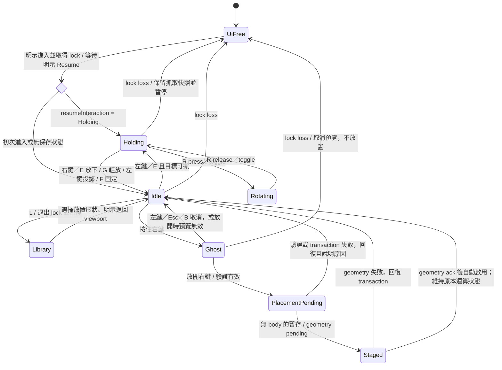

# 第一人稱互動與建造 UX

查核日期：2026-10-26。狀態：**可交付工程的設計提案；未實作／未進行使用者測試**。Workspace／運算分離見 [WORKSPACE_ARCHITECTURE.md](WORKSPACE_ARCHITECTURE.md)。數字如距離、速度及安全限制由物理 Domain Schema 決定，HUD 讀取有效範圍，不能另外發明不同上限。

## 進入、焦點與退出

進入 FPS 必須由可見的「進入第一人稱」按鈕／viewport 明示動作觸發。先顯示目前鍵位與「Esc 釋放滑鼠」，再要求 pointer lock；**用來取得 lock 的 pointerdown/click 不得觸發投擲、放置或推力**。只有收到成功事件且該次按鍵已 release 後的新輸入才可操作。失敗保留自由相機與非鎖定操作選項，顯示錯誤而不反覆要求 lock。

Esc 優先保留瀏覽器預設解鎖，不以 preventDefault 困住使用者。`pointerlockchange`、`pointerlockerror`、視窗 blur／visibilitychange 是權威事件。失去 lock 時立即清除按鍵／滑鼠按下狀態、取消尚未提交的投擲力、暫停於下一固定 tick；保留抓取的最後有效快照與 listener binding；取消尚未提交的 ghost 且不放置，顯示「已暫停：滑鼠已釋放」。恢復需明示點擊，不在下一個滑鼠移動時自動恢復。

UI、文字欄、可編輯內容及 IME 組字時，`WASD/E/G/R/F/B` 全部交由 UI；`event.isComposing`／compositionstart 期間不送遊戲命令。Dialog 開啟前先退出 lock，焦點進入 dialog；關閉回到觸發按鈕。Modal 中 Tab 正常循環，Esc 關閉最上層視窗且不連帶丟棄物件。退出 lock 的同一次 Esc 不再處理第二個 destructive action。

依據：[W3C Pointer Lock 2.0](https://www.w3.org/TR/pointerlock-2/)（2026-02-25 草案；需實測各瀏覽器）、[WAI-ARIA Modal Dialog](https://www.w3.org/WAI/ARIA/apg/patterns/dialog-modal/)。上述安全暫停為 Reflection Lab 設計決策。

## MVP 輸入映射

鍵位可重設，顯示實際裝置／layout label。動作以穩定 action ID 儲存；移動可使用 `KeyboardEvent.code` 的實體位置預設，其他動作可改綁定，不假設每個鍵盤都有相同標籤。組合鍵、保留鍵與重複綁定在設定頁驗證；不能覆寫 OS／瀏覽器保留組合。按住連續動作及單次 edge-trigger 動作分開處理。

| 動作 ID | 預設（viewport 擁有輸入時） | 可用狀態與處理 | 替代操作 |
| --- | --- | --- | --- |
| `move` | WASD | Running 且 FPS；放開或失焦即歸零 | 螢幕方向按鈕／重綁 |
| `look` | Mouse | lock 成功；轉物件時不轉相機 | 鍵盤視角步進、低速轉向按鈕 |
| `grabOrRelease` | 左鍵新按下抓取；Holding 時右鍵放下；E 為選用 | Idle 抓準星 3 m 內可抓物；Holding 時右鍵解除約束，保留可計算速度（Drop 語意） | 物件清單＋抓取／放下按鈕 |
| `placeDown` | G | Holding；尋找可用接觸點，驗證後低速放下；無有效支撐則不執行 | Inspector「輕放」；無支撐時可另選「釋放」，不得自動轉成 drop |
| `throw` | Holding 時左鍵新按下 | 僅 Holding＋Running；固定可調 impulse，MVP 無長按蓄力 | 「投擲」按鈕／重綁；顯示力值 |
| `rotateHeld` | 按住 R＋Mouse | Holding；輸入改送旋轉，release 恢復 look | toggle 旋轉模式、角度步進欄位 |
| `adjustDistance` | Wheel | Holding／Ghost；clamp 有效距離，超限提示 | ±距離按鈕／公尺數字欄 |
| `toggleFixed` | F | Holding 可固定並結束 grab；Hover 已固定物可解除，需目標明確 | Inspector 固定／解除；顯示重力後果 |
| `placementPreview` | 按住右鍵 | Idle（未持有）；按住時 ghost 跟隨準星，命中表面則貼附，否則在預覽距離的空中；Holding 時不啟動。2026-11-01 起取代 B 的建造模式 | 「開始放置預覽」按鈕 |
| `openLibrary` | L | FPS；退出 lock、安全暫停、開 Library 選擇放置形狀 | 可見 Library 按鈕 |
| `ghostRotate` | R toggle，按鍵步進 | Ghost；與 Holding 的 R 不同 context，不混用 | 角度欄／旋轉步進 |
| `ghostPlace` | 放開右鍵（快速點擊亦可） | Ghost-valid；呼叫驗證 transaction，geometry ack 後自動啟用；無效時捨棄預覽並說明原因 | 「放置」按鈕 |
| `ghostCancel` | 預覽中左鍵、Esc；B 為選用 | Ghost；只取消 preview；失焦、失去 lock 或暫停也會取消且不放置 | 「取消預覽」按鈕 |
| `releasePointer` | Esc | 任何已鎖定 FPS；由瀏覽器解鎖 | 顯示退出教學，另可見「離開第一人稱」 |
| `focusNext` | Tab / Shift+Tab | **保留標準焦點導覽，不作 Build toggle**；如仍鎖定先解鎖安全暫停 | 不得全域攔截 |

Space 跳躍、Ctrl 蹲下、推力工具列為 P2，MVP 未配置，避免與按鈕啟動、瀏覽器功能及持有物投擲混淆。Ctrl/Cmd+K 只作可選 Command Palette，保留可見按鈕並允許重綁；Ctrl/Cmd+L/T/W/R、Alt+F4 等組合永不攔截。全域可見 Mute 不依賴 lock 或遊戲快捷鍵；無 lock 時 M 可作 monitor mute，但輸入欄內保留打字。

輸入仲裁優先序：OS／瀏覽器 → Modal → IME／文字欄 → 標準 UI 焦點 → FPS active action → 視窗觀察控制。採 `keydown` edge／`keyup` state，不讓 `repeat` 重複固定、建立或投擲。Wheel 只有 viewport 明確持有輸入時才阻止滾動。只有 viewport 持有第一人稱輸入（已鎖定，或免鎖定模式聚焦畫面）時攔截右鍵 context menu，UI 保留標準選單。

## Interaction state machine

`UiFree` 額外記錄 `resumeInteraction`，不能丟失回復位置。Pending 期間重複按鍵不重複建立；每次放開右鍵最多建立一個物件，按住不放不會連續生成。此狀態機依[驗收補充](../11-v1/ACCEPTANCE_AMENDMENTS.md) 2026-11-01 修訂：沒有使用者可見的建造模式，也不需要明示啟用或另按繼續。

## 抓取回饋與物理語意

- Crosshair 為最小中心標記；hover 以外框＋名稱顯示可抓、過重、固定、距離不足等原因。外框不能只靠色彩。
- Holding 顯示名稱、質量、實際距離／要求距離、剛體模式、約束狀態。物件受牆阻擋時顯示「被阻擋」及實際距離，不讓 HUD 假裝物件已到錨點。
- Camera 只控制物理錨點目標。抓取仍有碰撞與慣性，不把 body parent 到相機；約束斷開／不穩定時安全釋放並記事件，實作參數由物理規格決定。
- E「釋放」保留可計算速度，G「輕放」在有效支撐面限制速度，Throw 施加明示 impulse；不能三個動作全部直接設同一 transform／velocity。
- 固定會將 body 轉成允許的固定模式，釋放 grab；解除固定前 HUD 明示重力模式。Fixed 不等於「音源停止」；持續發聲與 impact emitter 各自獨立。
- 碰撞聲事件顯示 contact 位置、時間、強度與 source ID，不將每幀接觸當成新的撞擊。無聲／靜音時仍有事件視覺回饋。

## First-Person Build：三階段物件生命週期

| 階段 | 視覺 | Domain／物理／聲學 | 成功／失敗 |
| --- | --- | --- | --- |
| `ghost` | 半透明輪廓、尺寸、surface normal、格線、有效／無效圖示及理由 | 只有暫存 draft；無音源、無碰撞、無實驗物件 | raycast miss、與玩家重疊、超出範圍均不能放 |
| `staged` | 不另外顯示（短暫內部狀態） | 已驗證、有穩定 ID 的暫存，尚無 active body、collider 或音源；固定步短暫安靜保持，不淡出音訊、不顯示暫停；聲學 geometry ack pending | ack 後自動啟用；失敗時回復 transaction，不留下半建立或停用的物件 |
| `active` | 正常材質，RigidBody／音源狀態圖示 | 啟用 dynamic；空中放置為 dynamicNoGravity，貼附表面維持草稿模式；同步 capability 支援的 acoustic geometry | 放置前正在運算且期間無其他暫停原因時維持運算；建立事件納入 trace；一次放置一筆復原紀錄 |

依[驗收補充](../11-v1/ACCEPTANCE_AMENDMENTS.md) 2026-11-01，放開右鍵後內部完成重新驗證、原子提交、geometry ack 與啟用，不再需要使用者確認啟用或另按繼續；不保證 Running 中任意動態反射幾何立即可用。Ghost 狀態可調距離、角度、grid step、surface alignment。碰撞驗證含物件與玩家、房間邊界；可視不代表可放。紅／綠之外必須有文字與形狀。Duplicate 產生新 draft 和 ID，不複製當前播放位置或 backend handle；保持相同資產引用可行。

## HUD 層級與無障礙

常駐：simulation state、十字準星、單一情境提示、Mute／monitor 狀態。Holding／Ghost 才加距離、旋轉與放置資訊；debug 路徑、FPS、tick、碰撞 box 預設關閉。Library／Inspector 開啟時收回 FPS 輸入。提示使用實際重綁鍵位，不顯示過期的固定 E 或 B。情境提示是一行提示列，固定在 viewport 底部，不遮住準星與畫面中央。

提供不鎖定滑鼠的**輔助操作模式**：以 Scene Explorer 選取、按鈕／數字欄移動 Listener 與物件、預設軌跡重播、抓取／釋放／投擲／建造明示按鈕。鍵盤相機步進支援低速與重設視角；停用 head bob／camera shake，降低視角加速度並支援 reduced motion。長按 R 有 toggle 替代。這是功能要求，完成度未驗證；不能宣稱 3D canvas 自動具備無障礙。

## 接受情境（NOT RUN）

### 失敗與復原矩陣（Phase 2 補充；全部 NOT RUN）

| 觸發／情境 | 即時回饋與狀態 | 可復原步驟／不得產生的副作用 |
| --- | --- | --- |
| 可見物件超出 grab range | 準星旁顯示距離與可抓範圍；E 不送 grab | 靠近或用非鎖定控制調位置；不得 clamp 後直接吸到相機 |
| 目標在另一物件／牆後 | visibility 判定失敗、阻擋圖示與原因 | 轉到可見方向；不能因 outline 可見就穿牆抓取 |
| held body 被牆擋住／離開允許距離 | 顯示要求／實際距離與約束狀態；不假裝已到 target | 採 physics 規格有限 impulse 與安全 release；保留事件，不瞬移／追加無限力 |
| Holding 切 Build 或 Workspace | 顯示輕放／釋放／取消切換，或既有安全暫停 guard | 保留 object ID 與 resumeInteraction；取消切換維持 Holding，不暗中 throw |
| 開 Settings／Inspector／Palette | 退出 lock、清遊戲按鍵、安全暫停；焦點交 UI | 關閉回 trigger；明示重新取得 lock＋Resume，該次 click 不能投擲 |
| Inspector 組字、文字 Undo 或 modal 同時按 E/W/R | inputOwner=UI，IME／原生編輯優先 | 不送 physics command；結束組字不補送先前 keydown |
| 退出 Simulation／Esc／blur | 下一安全 tick 暫停，保留 held 與 listener binding 快照；取消尚未提交的 ghost 且不放置 | 回來重驗 held object 存在、revision、範圍與能力，明示 Resume；失效則顯原因並回 Idle，不能套舊 handle；需要放置時重新開始 preview |
| browser 音訊權限尚未開啟／裝置丟失 | MonitorStrip 顯 blocked/error；Muted 與 source 停止分開 | 使用者手勢啟用或選裝置；不反覆自動 resume，不重播累積 impact |
| 模擬 Pause | 顯示 Freeze-and-fade、pause cause 與尾音截斷 | 明示 Resume 後重錨 audio epoch，只排未到達事件；詳 Workspace，不以 CSS 計時 |
| Fixed／NoGravity／Dynamic 切換 | HUD 顯示有效剛體模式與重力後果 | NoGravity 仍 dynamic；固定物不受力；拒絕不合規轉換並保留原模式 |
| Ghost snapping／collision 驗證失敗 | 表面法向／snap 位置／invalid 原因與圖示 | 可改角度距離或取消；不建立 domain object、不播放 placement impact |
| Player／物件交疊或 camera/listener 暫不同步 | 保留最後有效物理位置；顯示 binding／目前 tick | 重驗碰撞與 Listener 跟隨來源；observer camera 可獨立，但不偷偷改實驗 listener |
| staged geometry ack 逾時或 solver failure | 待啟用／error，保留 revision 與回復入口 | retry 去重或回復 transaction；不能顯示 Active，不能留下半建立 ID |

矩陣只定 UI 狀態與復原；牆角、薄牆、高速與 mode transition 的物理正確性仍須依 [FPS_INTERACTION_SPEC.md](../04-physics/FPS_INTERACTION_SPEC.md) 驗證，音訊需 DSP／browser 測試。共同壓力案例與證據格式見 [UI_STRESS_TESTS.md](UI_STRESS_TESTS.md)。

1. 新進入 lock 的 click 不丟出持有物；剛結束 Library 的 click 不放置物件。
2. 輸入中文名稱時 WASD／E 不移動、抓取；IME 未完成不提交。
3. 按 W 後切到別的視窗，回來仍為暫停，按鍵狀態為零，不沿用舊 keydown。
4. Tab 可從 viewport 到可見控制，Esc 可退出；關閉 dialog 恢復合理焦點但不自動 lock。
5. Holding 切 Build 不暗中放下；Ghost 無效時每次確認有原因且不產生 object ID。
6. 放置成功前連點只建立一個物件；backend 失敗不留下看似 active 的幽靈。
7. 牆後抓取不能硬拉穿牆；Fixed/Dynamic 切換不停止 continuous source；Pause 另依 Workspace 的 Freeze-and-fade。
8. 不用滑鼠鎖定，也能完成選物件、調參、投擲既定軌跡、擷取結果與 A/B。
9. Holding 中 Esc／失去 lock 後保留相同 object 與最後有效距離；Ghost 在 Esc、失焦、失去 lock 或暫停時取消且不放置。重新取得 lock 的 click 不得投擲或建立；只有明示 Resume 才恢復物理，需要放置時重新開始 preview。

## 2026-11-02：預覽取消政策文字對齊

本次僅消除泛文與既有明確ghostCancel／state-machine條款的矛盾；正式11/1[驗收補充](../11-v1/ACCEPTANCE_AMENDMENTS.md)及實作維持pause／blur／lock loss取消未提交ghost、不放置，held快照另保留。原source exactbytes見[preimage](archive://f95431483db0bf48e7fc86fc630179a73ed810ff/15a9f8dda4b2807b226d526f6174aafd83ebc5a4)，比較與理由見[Conflict Record](../../knowledge/conflicts/78d81bb5-7d39-426e-8394-8cc5838ee626.json)。原paused-preview測試錯oracle的FAIL不刪，修正測試預期後另存新結果，不由本文件改文推定browser通過。本文原提案／NOT RUN章節保留其歷史範圍，產品當前證據以最新Wiki/Task及固定收據為準。
