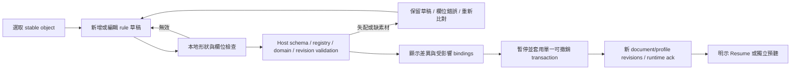

# Sound Behavior：Inspector、預聽與實驗檢查

日期：2026-10-27（Asia/Taipei）。狀態：**設計提案／靜態研究；正式 UI、使用者測試、browser、音訊及效能驗收全部 NOT RUN**。本頁決定編輯與檢查流程，不是新的 runtime、token 或資料 schema 權威。

本次使用者要求以 Codex 為主要開發者，Muse Code 為可選工具；產品內 Meta Muse Agent 仍須使用同一套經驗證的編輯流程。人工操作不依賴 API 存取或模型額度。本頁不安裝 UI library，也不開始正式介面實作。

## 1. 設計建議與既有工作區

**P0 採 Event Rules Inspector；物理狀態由獨立 state machine 提供；Node Graph 留 P2。** 初版讓使用者看懂「何時 → 發出什麼 → 參數如何變化 → 從哪裡傳播」，不需要先理解訊號圖。這是根據本專案需求與現況作的工程建議，未有比較使用者測試證明它一定較易用。

沿用 [Workspace](WORKSPACE_ARCHITECTURE.md) 的 Scene／Simulation／Analysis、右側 Context Inspector、左側 Audio Asset Library、下方 Event Timeline 及常駐 MonitorStrip。物件的「聲音」區段內新增「發聲行為」，擴充既有 `SoundEmitterInspector`；不再建立另一個聲音編輯工作區。切 Workspace、收合區段、變更選取都不能重設 run、source playhead 或錄製。

| 檢視 | 主要內容 | 不應混用的資料 |
| --- | --- | --- |
| Scene / Sound Behaviors | 綁定的 profiles、rule cards、素材／mapping／emitter、草稿與套用 | 作者設定不是當前物理狀態；不將 runtime velocity 存成初始值 |
| Simulation | 啟用規則摘要、活動 continuous instances、最近事件與抑制原因 | 配置 enabled 不代表正在播放；monitor muted 不代表 source 停止 |
| Analysis / Event Inspector | 固定 run、event、profile／asset revision、播放參數、contact／emitter、acoustic result reference | 舊 run 的 profile 不跟著目前 Inspector 改寫；不存在的 paths／metrics 不補造 |

視覺值、七態、async 態與動態分別沿用 [Design System](DESIGN_SYSTEM.md)、[canonical tokens](DESIGN_TOKENS.json)、[Component Spec](COMPONENT_SPEC.md)、[狀態矩陣](COMPONENT_STATES.json) 與 [Motion](MOTION_GUIDELINES.md)。本頁不複製色碼、間距、voice cap 或動畫長度。Emil 固定版使用方式見 [EMIL_SKILLS](EMIL_SKILLS.md)；高頻數字／選取／鍵盤操作直接更新，不因裝飾動畫延後輸入。

## 2. 最小 Inspector 資訊架構

頂部固定顯示物件名稱／stable object ID、作者或 runtime 目標、Scene revision、Sound Behavior document revision，以及每個綁定 profile 的 ID／revision。`document.revision`、`profile.revision`、Scene revision、run/tick 是不同版本，不合併成一個「已同步」狀態。實際 JSON 欄位與 enum 以 [Behavior Schema](../10-sound-behaviors/BEHAVIOR_SCHEMA.md) 為準，以下是其 UI 投影。

```text
選取物件 → 聲音 → 發聲行為
  Profile / revision / presetKind / 綁定啟用
  [新增行為] [套用 Preset] [保存為新 Preset]
  Rule：何時 / enabled / 目前狀態或抑制原因
    Trigger + Conditions
    Generator：Sample / Oscillator；素材 registry reference
    Playback / Layers：loop、one-shot、layer group
    Parameters：gain、pitch、mapping curve、fade
    Emitter：object / contact / zone / fixed
    Runtime 摘要：instance、voice admission、result freshness
  草稿錯誤 / 受影響物件 / [取消草稿] [套用]
  [素材乾音預聽] [場景聲學預聽] [停止預聽]
```

P0 入口只提供已實作且有驗收的 Always On、On Grab、On Throw、While Airborne、On Impact 與必要參數。其他連續／離散 trigger 依 registry 與功能階段顯示為尚未支援，附原因；不能因 schema 有 enum 就在產品上顯示可用。`While Airborne` 的 runtime 狀態不從「速度大於零」猜測，`On Throw` 只能由已接受的投擲命令產生，判定來源見 [Event Model](../10-sound-behaviors/EVENT_MODEL.md)。

| 區域 | 編輯行為 | 應提供的回饋 |
| --- | --- | --- |
| Trigger / Conditions | 分開「持續狀態」與「單次事件」；只列合法條件及其量綱 | 換 trigger 若令 mapping 失效，列出衝突，保留原草稿；不暗中換成別的量 |
| Sample / Oscillator | 選 registry 中實際存在、版本固定的 asset，或允許的 oscillator 參數 | 顯示 asset ID／revision／hash、解碼與權利狀態；不存在的素材不建立假預覽 |
| Playback / Layer | loop 與 one-shot 受 generator／trigger 契約約束；明示可同時播放的 layer group | continuous 與 impact 分組可見；新增 impact rule 不取代 Always On instance |
| Gain / Pitch / Curve | 數字輸入與拖曳兩種入口；curve 另有可鍵盤編輯的 point table | 軸標輸入 metric／SI 單位與輸出 gainLinear／pitchSemitones 等明確定義；顯示 clamp 與 smoothing，不把 smoothing 當物理結果 |
| Emitter | 根據 trigger 提供合法 attachment 與位置來源 | impact 顯 contact marker／event reference，不能一律放在物件中心；不可得時停用或顯不可用原因，不偽造位置 |
| Cooldown / Priority / Limit | 範圍與上限直接讀 domain schema／有效 run policy | 顯示設定值及目前 admitted／suppressed；UI 本身不另決定 voice cap 或偷改實驗參數 |

`presetKind` 的 physical／creative／hybrid／procedural 表示發聲設計，不是材料可信度。Physical preset 可是材質配對 sample，不能寫成已求解的物體振動；Creative 鋼琴聲同樣經空間傳播。素材權利是否已核、材料 Measured／Derived／Tuned／Synthetic，以及結果 Measured／Computed／Estimated 是獨立標籤，不能合併成一顆「可信」badge。dB 顯示必附 reference；digital meter 不寫 dB SPL。

創意 pitch 是發聲參數，Doppler 是傳播／renderer 模型的另一個效應；Inspector 分別標示，不以同一 slider 再施加一遍已由變動 delay 產生的 Doppler。UI 文案可翻譯，但保存與選取使用 schema 的 stable trigger／rule IDs，不以卡片順序或顯示文字代替。

PhysicsInspector 的重力／body mode、Environment 的傳播介質、Sound Behavior 的generator及monitor mute各自顯示。No Gravity不代表真空；無支援的傳播介質也不取消機械碰撞事件。若真空／耦合模型未實作，顯「該傳播模式未支援」而不是假造0Pa量測，素材乾音預聽仍清楚標為非場景實驗。

自有音檔由Audio Asset Library的獨立「匯入聲音」流程處理：先檢查格式、大小／解碼與來源／使用權metadata，建立有hash的registry版本後才可指定到rule。未解碼或權利狀態未通過時保留pending／拒絕原因，不讓AI猜一個asset ID來繞過檢查；也不因匯入自動公開、上傳模型或改變物件的物理／聲學材質。

## 3. 編輯、套用與失敗復原



一般可逆編輯不逐欄彈確認；「套用」是可檢視差異後的主要動作。文字／數字編輯保留本地 draft，Enter 提交欄位、Esc 取消該欄位；IME 組字期間不提交。整段 curve／slider drag 合成一筆作者命令，pointer cancel 不提交。欄位初檢不能取代 host 的 registry、units、revision 及資源檢查。

P0 的 profile／binding／generator 變更在 Ready 或 Paused 套用；Running／Recording 顯示所需影響，使用者選「暫停並套用」才在安全邊界提交，不能一邊改寫已記錄的 run。暫停遵循既有 Freeze-and-fade，保留原 trace 與 interrupted boundary。獨立 monitor gain／Master Mute 照原契約可直接操作，不能混成 profile gain 的永久修改。

Host 以 expected Scene／Behavior document／profile revisions 原子提交，失敗不留下部分 rules 或半個 asset reference。Undo／Redo 回復作者設定並建立合法的新版本，不倒轉物理或重發已發生的事件。更換 clip 後無法保留相同播放 offset 時需明示重新預聽／新 rendering，不能假裝仍是同一 playhead。連續 instance 的參數更新／淡入淡出依 [Audio Runtime](../02-architecture/AUDIO_RUNTIME.md) 排程，不由 UI re-render 重建 node。

選取另一物件時，未提交 draft 不無聲丟棄：可保留以原 object ID 釘選的 draft，再提供套用／放棄／回到該物件。若物件已刪除或 generation 改變，停用套用、保留可複製草稿並顯原因；不能改到同一列表位置的新物件。

### 共用 preset 與物件覆寫

一個物件可有多個 bindings；不同物件可參照同一 `profileId + profileRevision`。預設編輯明確允許的 binding overrides，或保存為新 profile；若選擇編輯共用 preset，先顯受影響物件清單與數量，不能透過單一物件 Inspector 偷改全部。profile 更新後，其他 bindings 不自動追最新版；host 需以顯式 migration／批次 transaction 切換。

物件覆寫只提供 schema 允許的欄位，例如指定 rule 的 gainLinear／pitchSemitones／enabled；不容許自由 JSON patch、任意 JavaScript 或引用未知欄位。顯示「繼承」與「物件覆寫」差異、提供個別回復繼承。P0 多選先顯共同／mixed 摘要及逐物件入口；P1 才加入經 domain 驗證的批次操作，不能用第一個物件的值冒充全體。

## 4. 預聽、聲源位置與聲學路由

所有預聽由明示按鈕與使用者手勢開始，不能 hover 自動發聲。Master Mute／monitor gain 常駐；初次 context blocked、asset 未解碼、設備失敗均顯原因與可操作重試。使用者未啟用聆聽時，事件與參數仍可在文字／圖示中檢查。P0 預聽入口位於 Ready／Paused；Running／Recording 中需先依安全流程暫停，避免與原實驗混播。

| 預聽／播放路徑 | 用途與固定內容 | 紀錄與限制 |
| --- | --- | --- |
| 素材乾音預聽 | 選定 asset／variant 或 generator 的獨立 UI audition，置中、不含環境／HRTF | 明示「乾音；非場景實驗」，獨立 audition ID／playhead；不產生 physics event、不寫原 experiment／metrics。它是素材編輯工具，不是假冒 3D 聲源繞過 Acoustic Core |
| 場景聲學預聽 | 靜態快照中的 object／固定 contact event 產生 emitter，走 Custom Acoustic Core 及 renderer | 顯示 listener、scene／profile versions、位置來源與啟用能力；獨立 audition epoch，不改原 run。缺 contact event 時要求選 recorded event 或合法的示範位置，示範需標 Synthetic，不可偽稱實測撞擊 |
| 正式 run / trace replay | 依同一 normalized event／trajectory、asset revision／seed／播放參數產生 source | 所有具場景位置的正式 emitter 必須走同一 propagation／spatialization 路徑；保留 event→instance→emitter→acoustic result 可追溯關係 |

場景中的 Raw／Simulated 只沿用 [Component Spec 的 monitoring contract](COMPONENT_SPEC.md#rawsimulated-monitoring-contract)：相同 emission、asset／seed／playhead，Raw 為置中乾音 bypass，Simulated 為有效能力下的傳播／空間化。切換不重新觸發 On Impact、不重擲 variant、不改 source gain 或抵消未標示的延遲；無法維持同一 playhead 就停用無縫切換，改為明示同事件 A/B rendering。

3D emitter marker 表示 source location，不是 solver path；接觸點 marker 與物件中心、listener、反射路徑採既有不同語彙。只有真實 AcousticFrame 可繪聲線；IR-only 或 stale backend 顯限制／版本，不畫裝飾假路徑。介面須顯示實際採用的 HRTF／spatialization owner，不能讓 behavior generator 另加未揭露的第二次 HRTF／distance attenuation。

## 5. 配置、runtime 與非同步狀態

Rule 的 `enabled`、trigger predicate、SoundInstance、voice admission、monitor、solver freshness 各為正交維度。至少能區分以下原因，不能把每一種「沒聽到」都標為 disabled：

| 情境 | 文字／行為 |
| --- | --- |
| 未選取／沒有 bindings | 顯「選取物件」或新增行為 empty state；不捏造預設 sample |
| 草稿錯誤／非法 trigger／curve | inline error 指向欄位、顯單位與拒絕原因；保留輸入，阻擋套用 |
| profile 已啟用但狀態未成立 | 顯「等待 Throw 事件」／「目前未 Airborne」；可檢查判定依據 |
| asset 不存在／版本失配／權利未核／解碼失敗 | 顯不同原因；保持最後合法配置，提供重新選取／重試，不自動替成未知音效 |
| cooldown／voice limit 抑制 | 顯 rule、event 及抑制原因；事件仍可檢查，不當成沒有發生碰撞 |
| 持續 instance 活動／one-shot 已結束 | 各自顯 active instance／已結束；不以 UI 列表 presence 反推聲音是否在設備輸出 |
| monitor muted／context blocked | 明示監聽狀態，模擬與記錄獨立；重試不重發舊 impact |
| solver pending／stale／unsupported | 顯 result revision／age／缺少能力；不是「量測為0」 |
| API 失敗／quota 不足 | 保留 AI 草稿與手動 Inspector；關閉 live AI 分支，不清空合法 profiles 或停用人工編輯 |

以上元件繼承 canonical 七態及 async 態；不是新增一套互斥 enum。錯誤／過期／啟用不能只靠顏色或聲音，必有可讀文字及必要 metadata disclosure。

## 6. Event Timeline、A/B 與 Muse 提案

事件表與 Timeline 共用 `runId + eventId` stable selection，3D contact marker、rule Inspector、instance 與結果鏈結一致；密集 burst 可在視圖聚合且可展開，不刪原紀錄。詳細欄位包括 physics tick／simulation time、event type、object／generation、material pair、contact位置、可得的相對速度／impulse與定義、profile／rule revision、asset／variant／seed、播放參數、voice admission、emitter、acoustic result reference、pause／epoch／gap markers。emission 時間、propagation arrival、DSP／device latency 分欄，不用動畫位置當音訊時鐘。

P1 的 A/B 先 Capture 固定 trajectory＋normalized events，再選不同 profile／asset／mapping 作獨立 render；畫面顯示唯一變因與兩邊 revisions。不能把「重新投一次」當相同條件，也不將重新跑 Rapier 稱逐位元重現。接觸材質、摩擦或 body mode 若改變，須標出物理條件差異；不得把 creative asset 改動混成 acoustic material 係數改動。原 trace、原音訊與結果保留，Undo 只回復當前作者設定。

產品 Muse Agent 的自然語言輸出先轉為合法 structured operations，使用和人工相同的 validation／diff／Apply／Undo。Preview 清楚列出改了哪些 objects／bindings／rules、素材是否存在、是否需暫停與計費／計算 gate；模型提案不直接建立 audible instance。AI 解釋與 computed evidence 分欄，數值只連到實際求解 artifact。詳見 [Meta Sound Behavior 整合](../08-ai/MUSE_SOUND_BEHAVIOR_INTEGRATION.md)。

## 7. Inspector 與 Graph 的取捨

| 面向 | Inspector / Event Rules（P0） | Node Graph（P2） |
| --- | --- | --- |
| 適合內容 | 事件／狀態、素材、mapping、簡單 layering；以表單顯示目前結果 | 複雜分支、多參數組合、可視化 generator／envelope／mixer 依賴 |
| 成本 | 重用既有 Inspector、asset picker、數字欄及 command transaction | 另需 node/port typing、連線／cycle 驗證、compile、layout、縮放、鍵盤連線、Undo／除錯 |
| 初學者理解 | 直接回答「何時、發什麼、從哪裡」，但仍需實測 | 畫布可能方便理解依賴，也可能增加導航成本；不能先宣稱更容易 |
| 驗證／可追溯 | stable rule IDs 與欄位錯誤，可直接連到 event | node ID／port ID／compile error需能回指 rule或受保護IR，圖的位置不是 runtime 語意 |
| 本次採用 | 設計提案；UI尚未實作 | 只保留研究與解鎖條件，不安裝 library或複製商業範例 |

React Flow 可列為未來 P2 呈現層候選：官方文件有 keyboard／screen-reader支援、節點資料流與連線cycle檢查範例，repo核心採MIT。這不提供 Reflection Lab 的音訊排程、domain驗證或即時DSP；其資料流示例也不能放進audio callback。版本、React相容性與發行license需採用時精確鎖定；本次未安裝或效能驗證，也未將Pro範例的權利混同核心MIT。[Accessibility](https://reactflow.dev/learn/advanced-use/accessibility)、[Computing flows](https://reactflow.dev/learn/advanced-use/computing-flows)、[Cycle validation](https://reactflow.dev/examples/interaction/prevent-cycles)、[核心LICENSE](https://github.com/xyflow/xyflow/blob/main/LICENSE)（查核2026-10-27）。

Graph解鎖前須有已驗證的 event/runtime、可量測的作者困難，以及固定node/port whitelist、上下限、循環政策、bounded compilation、錯誤回指與transaction測試。第一個control/event graph採可驗證DAG；音訊feedback若未有專門delay與穩定性契約就不開放。不能允許任意JavaScript、直接持有WebAudio nodes或以React畫布更新執行audio時鐘。Inspector／Graph若無法無損轉換，應顯示不支援，不能靜默遺失條件。

## 8. 可及性、FPS 仲裁與壓力案例

依 [InputRouter](../04-physics/INPUT_CONTROLS.md) 與 [FPS UX](FPS_INTERACTION_UX.md)：開Inspector／asset picker前釋放pointer lock，在安全tick暫停並保留Held／ghost；關閉後焦點回原控制，不自動重鎖或drop。Tab保留焦點，文字與IME擁有WASD／E／R／Delete／Undo；第一次lock click不兼作Throw。Esc只處理最上層／瀏覽器退出，不同時刪rule或釋放物件。

Rule cards優先使用原生button／select／number input，icon有accessible name；拖曳curve點另有point table與數字操作，asset選單可完整鍵盤使用。Enter／Space只作用於焦點所在控制，focus改變不自動audition。刪rule可Undo；文字框Delete不刪物件。選取／值更新／鍵盤回饋即時；Reduced Motion移除非必要位移，不改fade或物理／audio時間。重要狀態可有節制announcement，不逐tick播報voice或meter。

Stress沿用 [既有矩陣](UI_STRESS_TESTS.md) 與 [量測規範](PERFORMANCE_STANDARDS.md)：長繁中素材名稱、同名但不同ID、最大合法rules／bindings及超限一筆、missingasset、burst events、voice stealing、slowdecode、solverstale、API失敗、快速切選取、200%zoom、keyboard-only、IME、pointerlock失去、Pause/Resume。可虛擬化runtime列表、視圖聚合timeline，不減少原始event ledger；降級數量／抑制原因可見，Mute／Pause始終可到達。數量與效能門檻只讀schema及正式預算，不從此研究外推容量保證。

## 9. 實作後驗收計畫

| Case | 操作與可檢查預期 | 證據 | 本次 |
| --- | --- | --- | --- |
| SB-UX-01 | 建Always On＋On Throw＋On Impact三規則；選取／排序後IDs與bindings不變，impact不重啟continuous | command／instance／event trace＋畫面 | NOT RUN |
| SB-UX-02 | curve拖曳、IME輸入與取消；合法提交一筆Undo，非法／NaN／越界保留草稿且原配置不變 | schema/domain負例、Undo diff、focus trace | NOT RUN |
| SB-UX-03 | missing／舊版／未核權利asset，修正後再套用；不可產生假asset或靜默替代 | registry結果、原子revision、錯誤恢復 | NOT RUN |
| SB-UX-04 | 共用profile兩物件，預設override不改另一物件；共享更新顯影響清單且Undo原子回復 | binding/profile revisions與diff | NOT RUN |
| SB-UX-05 |乾音／場景預聽／Raw-Simulated；明示route、同event/seed/playhead、正確contact位置、無雙重HRTF；預聽不進實驗 | audio graph、event/arrival trace、DSP／設備檢查 | NOT RUN |
| SB-UX-06 | Recording中編輯、Pause/Resume與Undo；尾音截斷有marker，舊run不被新profile改寫，不重發已聽event | run/epoch/profile versions、recording與audio證據 | NOT RUN |
| SB-UX-07 | 固定trajectory/events作profile A/B；可辨唯一變因與不相容條件，不把再模擬當同條件 | captured hashes、A/Bmanifest與播放紀錄 | NOT RUN |
| SB-UX-08 | 模型提出合法／非法操作、API失敗；人可檢視diff再套用，人工編輯仍可用，無虛構metrics | hosttool驗證／audit＋手動流程 | NOT RUN |
| SB-UX-09 | 持有物件時開Inspector、IME、Esc、blur；不Throw/drop，恢復明示；鍵盤與非drag操作等值 | input/physics/focus trace，真browser操作 | NOT RUN |
| SB-UX-10 | 高密度規則、eventburst、largezoom、reducedmotion；輸入不等動畫，狀態可讀，音訊與UI預算分別量測 | screenshots、accessibility tree、frame與audio profile | NOT RUN |

實作時每案記Git revision／dirty hash、scene/profile/asset/fixture hashes、browser/OS/viewport/zoom、audio device與sample rate、步驟、實際結果及artifact。文件／token檢查只列STATIC REVIEW；瀏覽器互動、聽測、聲學／physics／DSP與效能各自驗證，不能以畫面合理或有聲音代替求解正確性。

## 10. 來源與範圍

本頁主要為既有Reflection Lab規範與本次使用者需求的綜合設計，並非競品介面複製。Emil Skills固定來源／MIT／原檔hash依既有[manifest](../../third_party/emil-skills.manifest.json)；沒有修改上游檔案。新增Graph官方資料僅記metadata與原創摘要，見 [ux-sources.json](../../research/sound-behaviors/ux-sources.json)，沒有下載商業素材或安裝第三方依賴。

## v1 Apply邊界補充

v1 runtime草案只解析目前revision；Apply或刪除採pause→fade/drain舊voices→原子新revision→newrunEpoch，未做retired-version/tombstone。Draft slider／audition不代表無縫修改running profile；普通pose／mapping輸入更新不改profile、不重建AlwaysOn。產品host與音訊此流程仍NOT RUN。
