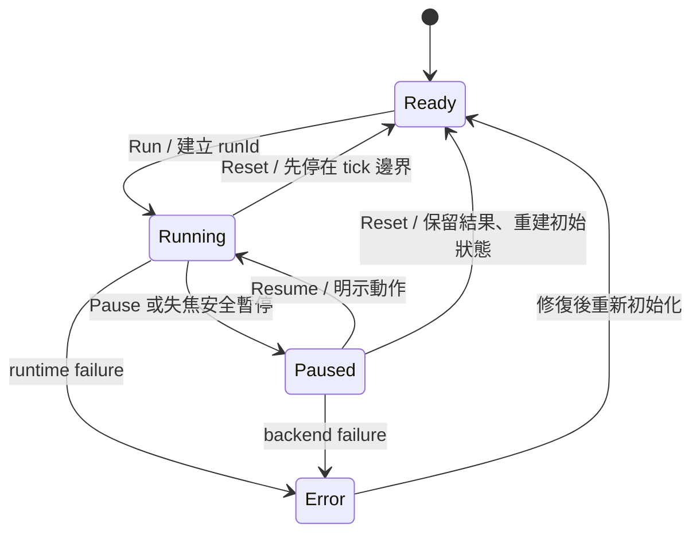

# 工作區與狀態架構

查核日期：2026-10-26（Asia/Taipei）。狀態：**研究完成／設計提案，正式 UI 尚未實作**。本文件中的資料型別是介面契約草案，須與正式 Domain Schema 合併；不是已運作 API。

## 目標與使用者

主要情境是評審或初學者建立小房間、移動持續發聲的球、投擲並比較材質。次要情境是具聲學背景的使用者查核路徑與結果。以「建立 → 操作 → 檢驗」為三個 Workspace；不用 Workspace 名稱暗示計算是否正在執行。

使用者需求直接來自 Phase F。競品原理及查核限制見 [COMPETITIVE_UX_RESEARCH.md](COMPETITIVE_UX_RESEARCH.md)。以下選擇均為 Reflection Lab 的設計決策，並非競品已證明的效能或易用性結果。

## 正交狀態

| 維度 | 值 | 擁有的資料 | 不能產生的副作用 |
| --- | --- | --- | --- |
| `workspace` | `scene / simulation / analysis` | 面板配置、上次寬度、圖表分頁 | 不重設物理、不清音源、不重新錄製 |
| `simulationState` | `ready / running / paused / error` | `runId`、tick、暫停原因、backend 狀態 | 不決定面板開關 |
| `interactionMode` | `editor / fps-interact / fps-build` | 相機控制、抓取／放置子狀態 | 不自行啟動音訊或模擬 |
| `inputOwner` | `ui / viewport / modal` | 焦點、pointer lock、輸入路由 | 不能同時將同一按鍵送給 UI 和物理 |
| `recordingState` | `idle / recording / finalized` | experiment ID、trace、缺口 | 不代表音訊設備正在輸出 |
| `monitorState` | `blocked / muted / audible / error` | gain、Raw/Simulated、設備／context 狀態 | 不停止記錄或改動計算值 |

進入另一 Workspace 只改第一列。離開 `fps-interact` 或 `fps-build` 必須先釋放輸入擁有權；若持有物件則在目前 tick 安全暫停並保留抓取狀態，顯示「持有中；恢復後繼續」，不暗中投擲。切換 Workspace 所需的安全暫停是**明示且有紀錄的 interaction guard**，並非 Workspace 自帶的 Reset。沒有進行 FPS 操作時可在 Running 中直接切 Analysis。



`Reset` 回到當前 `SceneRevision` 的起始狀態，保留已完成的結果與 run；不等於 Undo 或刪除場景。Transport 使用 Run/Pause/Resume/Reset 明確文字，不提供語意含糊的 Stop。`error` 保留最後穩定畫面與錯誤碼，停用物理輸入；可匯出診斷並重試，不能把凍結畫面標成仍在 Running。

### Pause／Resume 的音訊政策

MVP 設計採 `Freeze-and-fade`，尚未 DSP 驗證：Pause 時在安全 tick 保存 logical run time、continuous source offset 與 pending arrival queue；run bus 在 audio timeline 以有界淡出（初始目標 20 ms）靜音，舊 epoch 排程取消，reverb/convolution 尾音隨淡出截斷。保留 AudioContext 運作，不把設備時鐘凍結當成物理時間。Resume 明示重新錨定 `(simTime, audioTime)`，依保存 offset 恢復連續 source，僅重排尚未到達的 logical queue；不能重發已聽過的 impact／重複 contact event。Raw/Simulated 切換則**不暫停或重啟 source**，與 Pause 是不同操作。

UI 顯「已暫停；尾音已淡出」，錄製加入 pause/epoch/tail-cut marker。這個 MVP 策略不保證跨 Pause 的波形或卷積狀態連續；時間邊界附近的 tail／RIR 分析應排除或標 interrupted。想在 Paused 狀態試聽時，使用明示「靜態場景試聽」，獨立 audition playhead/epoch，不寫入原實驗 trace／metrics，關閉試聽後仍 Paused。不得讓 AudioContext 繼續前進就默認 source 實驗時間也已前進。實作前由 DSP 規格固定取消排程、queue 去重及 offset 精度；20 ms 是待驗初值，非測試結果。

## 版面與可保留內容

```text
┌ Project／儲存狀態 ─ Scene | Simulation | Analysis ─ Run/Pause/Reset ─ AI ┐
│ Scene Explorer / Library │                         │ Context Inspector │
│                         │       3D Viewport       │                   │
│                         │ HUD／選取／求解器狀態     │                   │
├─────────────────────────┴─────────────────────────┴───────────────────┤
│ Transport／Recording／Event Timeline／Analysis tabs                   │
├ Master Mute／音量／Raw–Simulated／Backend／revision／結果新鮮度 ─────────┤
└──────────────────────────────────────────────────────────────────────┘
```

| Workspace | 左欄 | 中央 | 右欄 | 下方 | 預設操作 |
| --- | --- | --- | --- | --- | --- |
| Scene | Scene Explorer、Object Library | 軌道相機、gizmo、格線、放置檢查 | 物件／材質／物理／聲源 | 可收合事件紀錄、Transport | `editor`，自由視角；FPS 按鈕可切換 |
| Simulation | 預設收合，Library 可開啟 | 乾淨 FPS／自由觀察，明示「進入第一人稱」 | 預設收合，必要時顯示摘要 | Transport、錄製、最近碰撞 | 預設仍為 `editor`；點擊進入才要求 lock |
| Analysis | Experiment／Run／Source／Listener 篩選 | 3D 路徑及可切換圖表 | 選取路徑／RIR／事件證據 | RIR、頻譜、EDC、A/B | `editor`，相機獨立於 Listener |

每個 Workspace 保留自己的**觀察相機**位置，Listener 則為場景／實驗實體。FPS 連結 Listener 時顯示「Listener 跟隨第一人稱」，進入時保存原 `ScenePinned` pose；**退出 FPS 預設還原該 pose、速度清零並標 discontinuity**，與物理 FPS 規格一致。重播模式由錄製軌跡決定 Listener。Analysis 拖曳相機不得改變錄音 Listener 或重算成另一組結果。使用者需按「將 Listener 移至目前相機」才產生可撤銷的 Domain Command；不能以退出模式暗中保留另一個量測位置。

Phase 2 曾發現此處舊文「留在最後位置」與物理規格相反，已保留衝突與設計理由於 Wiki decision／Conflict Record；這是工程規格整合，未宣稱使用者另行選定預設或已實作驗證。

### Editor 視角與物件控制（本地設計預設）

| 動作 | 初始映射 | 輸入作用域／替代 |
| --- | --- | --- |
| 選取／多選 | LMB／Shift+LMB | editor viewport；Explorer 同步；重疊有候選清單 |
| Orbit／Pan／Zoom | Alt+LMB drag／MMB drag／未修飾 wheel | 只有 viewport hover 且沒有 UI/drag owner；Ctrl/Cmd+wheel 保留瀏覽器縮放；軌道／平移工具按鈕與鍵盤步進替代 |
| Frame selected | F | 只限 editor viewport；按鈕可達。FPS 的 F 是 Fixed，HUD 清楚顯示當前作用域 |
| Move／Rotate／Scale gizmo | W／E／R | 只限 editor；選中物件且可編輯；進 FPS 不沿用這三個工具鍵 |
| 精確 Transform | Inspector 數字欄，Enter commit／Esc cancel | UI 擁有輸入；不觸發 FPS；輸入單位 m/deg，轉換 canonical 值由 Domain 層處理 |
| Undo／Redo | Ctrl/Cmd+Z／Shift+Ctrl/Cmd+Z | 非文字輸入且有場景作者命令；文字欄使用原生文字 undo；不倒轉 runtime |
| Delete／Duplicate | Delete／Shift+D | Explorer/viewport 有明確選取時才處理；文字欄不刪物件；刪除可 Undo；保留可見按鈕與可重綁 |

這些預設借用熟悉的編輯器原理，未經實機驗證；不要求實作 Blender 全套快捷鍵。沒有三鍵滑鼠時，用明示 Orbit/Pan 工具及數字視角；所有快捷鍵先經 FPS 文件的輸入仲裁。重綁設定需提示瀏覽器保留組合的衝突並保留可見按鈕，不能宣稱所有平台都能攔截。

## Document、Runtime、Result 的分離

`SceneDocument@revision` 保存作者建立的初始設定。`RuntimeState@runId/tick` 是演算後的位置、速度、抓取錨點。`ResultSnapshot` 參照固定的 scene/material/backend 版本與時間，不直接依賴可變 Inspector。

| 動作 | Ready／Paused | Running | 結果處理 |
| --- | --- | --- | --- |
| 新增／刪除／改尺寸／改剛體模式 | 驗證後以一筆 Undo Command 提交 | 顯示需暫停，使用者按「暫停並套用」後提交 | 新 revision；舊結果保留、標為相對目前場景已過期 |
| 拖 gizmo／數字 Transform | Ready 改 Document；Paused 若為 runtime，明示編輯目標 | 停用；改由受物理約束的抓取／運動工具 | 不能把 runtime transform 偷寫為起始值 |
| 聲源 gain／監聽音量 | 可變更，區分 source gain 與 monitor gain | runtime-safe source command 在 tick／audio 邊界排程；monitor 不改實驗 | 前者記錄事件，後者只存監聽設定 |
| acoustic material | 新材質版本＋驗證能量／頻帶 | MVP 需暫停並重建可支援的幾何；不假裝立即生效 | backend ack 前標 `pending`，過期結果不能取代新結果 |
| FPS Build 放置 | 見 FPS 文件的兩階段 commit | 先 ghost；確認時安全暫停、建立 staged body、重建後顯示啟用 | 保留 build command／版本；錄製標記變更 |
| 將當前 runtime 存為起始場景 | 明示另建 revision／snapshot | 需暫停並預覽差異 | 不覆寫舊實驗 |

頂列同時顯示 `Scene rev 7`、`Run #12 tick 840`、`Acoustic rev 6 — 更新中`；不同資料時鐘不能縮成一個「即時」綠燈。幾何變更超時或 backend 不支援時顯示原因及回復選項。

## 共享 Selection 與 Capability

```ts
type SelectionRef =
  | { kind: 'object'; sceneRevision: string; objectId: string }
  | { kind: 'path'; resultId: string; frameId: string; pathId: string }
  | { kind: 'event'; runId: string; eventId: string }
  | { kind: 'ir'; resultId: string; sourceId: string; listenerId: string };
// null 代表沒有選取；hover 另存，不取代 selection。
type ResultContext = {
  runId: string; sceneRevision: string; materialVersion: string;
  backendId: string; backendVersion: string; timestamp: number;
  provenance: 'measured' | 'computed' | 'estimated';
  capabilities: string[]; stale: boolean;
};
```

3D、路徑表、RIR 到達標記與 Inspector 共用 `SelectionRef`。密集路徑點擊有候選清單（依接近度排序），並提供鍵盤操作的表格。暫停／釘選 frame 後才檢查移動路徑，避免每幀重新排序搶走選取。路徑消失時保留釘選快照並顯示「此路徑已不在目前 frame」；不把排名第一的新路徑當成同一條。

按 `capabilities` 決定入口：有 `individualPaths` 才能選逐條聲線；有 `impulseResponse` 才顯示 RIR；沒有 RT 指標則顯示「未提供／尚未計算」及所需輸入，不能寫 0。只提供聚合反射／IR 的 backend 使用相應圖表，不能生出沒有求解依據的示意聲線。示意圖必須有獨立區域與 `示意，非求解結果` 標籤。

## Undo、AI 與儲存

作者命令以 transaction 記錄；拖曳整段是一筆，無效操作不入歷史。Undo 不倒轉物理時間；runtime 必須以 Reset／Replay 操作。AI 使用同一套 Domain Validation／Command pipeline，先顯示差異、影響範圍與所需暫停，再套用可撤銷 transaction。AI 說明有獨立標籤，不能覆蓋 Computed／Measured 來源。

自動儲存 Document、Workspace 偏好與鍵位；runtime／結果需可見的 Capture／Recording 狀態。當多種資料尚未存妥，不能只顯示一個「已儲存」。刪除物件後相關 Selection 失效要清除，錄製或舊結果的引用仍保留版本。

## 驗收（尚未執行）

1. Running 中切 Scene→Analysis→Simulation，runId/tick 持續且未 Reset；持有物件時依安全 guard 暫停並顯示原因。
2. Analysis 移動觀察相機不改 Listener；明示移動 Listener 才生成命令。
3. 新增牆後舊聲學結果顯示過期；backend ack 前不得顯示更新完成。
4. 只具 IR 的 backend 不出現可選幾何路徑；未提供的數值不是 0。
5. Undo 場景命令與 Reset 模擬清楚分離；AI 批次命令可一次撤銷。
6. 錄製跨工作區保留 ID、事件與暫停原因；裝置失焦或 pointer lock 遺失不會自動恢復輸入。

## 平台依據

- [W3C Pointer Lock 2.0，2026-02-25 Working Draft](https://www.w3.org/TR/pointerlock-2/)：lock 與鍵盤焦點分開；本文的仲裁、暫停是產品決策，規格並未保證所有瀏覽器行為一致。
- [Web Audio API Recommendation](https://www.w3.org/TR/webaudio-1.0/)：音訊排程使用獨立時間，UI 動畫不應作為聲音到達的時鐘。
- [WCAG 2.2](https://www.w3.org/TR/WCAG22/)：鍵盤、焦點、音訊控制為設計約束；未宣稱成品已達符合性。
