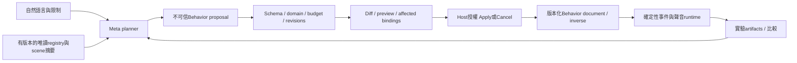

# Muse Agent：Sound Behavior 提案與實驗

查核：2026-10-27，Asia/Taipei。狀態：**DESIGN_READY / PRODUCT_IMPLEMENTATION_PENDING / META_LIVE_NOT_RUN**。Codex 是開發主力；Muse Code 僅是可選 coding 工具。此處的 Muse Agent 是透過 **Meta Model API** 執行的產品功能，不因 coding executor 改變而改用 Codex 模型冒充。開發 Muse 額度由使用者確認不可用；產品 Meta API credits／帳號能力另為 UNKNOWN，費用預算維持0。

本文件擴充 [原實驗 Agent](AI_EXPERIMENT_AGENT.md)、[原12項工具契約](AI_TOOL_SCHEMAS.md) 與 [原場景交易](AI_SCENE_CONTROL.md)，不改寫舊工具 enum、不宣稱 host executor 或 provider 已完成。聲音行為資料權威在 [Behavior Schema](../10-sound-behaviors/BEHAVIOR_SCHEMA.md)，物理事件權威在 [Event Model](../10-sound-behaviors/EVENT_MODEL.md)。

## 產品內的實質工作

Agent 的設計責任是將自然語言轉為可檢查的規則與版本化 bindings，使用當次 registry 實際回傳的物件、材質、資產與 trigger IDs。它可提議音效、分層、輸入到 gain／pitch 的映射、實驗自變項及比較步驟；所有物理、DSP、聲學數字由程式與 artifacts 提供。正式實作必須讓無 API 的使用者仍可透過同一 Inspector／domain commands 手動編輯，不能讓模型成為播放或物理迴圈的必要條件。

## 機器契約與候選工具

新草案為 [sound-behavior-ai.schema.json](../../schemas/sound-behavior/sound-behavior-ai.schema.json)，資料文件為 [behavior-document.schema.json](../../schemas/sound-behavior/behavior-document.schema.json)。模型提案 envelope 是 `schemaVersion:"1.0.0"`、`proposalId`、`sceneId`、`expectedSceneRevision`、`expectedBehaviorRevision`、`operations`。`transactionId`、授權、preview digest、Apply／Undo 與結果 ID 由 host 建立；模型不能自己批准。

| 唯一 mutation operation | 主要資料與語意 |
| --- | --- |
| `CreateProfile` | `profile`；新 ID 不可覆蓋。 |
| `ReplaceProfile` | `profileId,expectedProfileRevision,profile`；完整受限替換，保留穩定 rule IDs。 |
| `DeleteProfile` | `profileId,expectedProfileRevision`；候選交易完成後仍被 binding 使用即拒絕，不做隱藏 cascade。 |
| `AssignBinding` | `binding` 內含 objectId／objectGeneration、profileId／profileRevision 與允許的 overrides。 |
| `RemoveBinding` | `bindingId`；只解除指定 binding。 |

這五種 operation 是新的**草案本地模型**，不是現有 `ai-scene-change-set.schema.json` 已支援的 operations。不得直接混入舊32 mutation交易。未來 host 需提供受版本控制的 Behavior transaction adapter，檢查 scene／behavior document／profile／registry revisions，在鎖內整包套用、產生 inverse；任一失敗保留原資料。Undo 產生新 revision，不能抹掉已播放聲音或倒轉 API 費用。

Profile replacement不得留下指向不存在舊revision的binding；需要遷移時在同一候選提案明確rebind所有受影響物件，否則拒絕。只要host尚未提供版本保留／遷移策略，就不能由模型假定shared preset升版會安全自動更新所有物件。

使用者需求中的工具名稱可採以下較小的表面，不需要為每種 Inspector 控制重做一套 runtime：

| 候選名稱 | 編譯／執行方式 |
| --- | --- |
| CreateSoundBehavior | `CreateProfile`，接著明確 `AssignBinding`；不暗中改物件材質。 |
| AddBehaviorRule、UpdateTrigger | host 讀固定 profile revision，產生完整 `ReplaceProfile` 候選；不接受任意 JSON Pointer patch。 |
| SetSoundAsset、SetParameterMapping、ConfigureSoundLayer、EnableBehavior | Asset／mapping／layer變更需完整受限profile replacement；binding只允許enabled、gainLinear、pitchSemitones的局部override。新profile version受影響bindings須列入diff。 |
| PreviewSoundBehavior | read-only staged preview，不是 commit operation；asset audition 不進實驗 trace。 |
| RunExperiment | 已支援項目才呼叫原 `RunSimulation` → 成功後 `CaptureExperiment`；queued 不代表完成。 |
| CompareAudioResults | 候選產品名稱；既有 acoustic metrics 可走原 Analyze／Compare，音色／behavior A/B 需另有分析契約，不能把新 metric 塞進舊 enum。 |

「建立五顆無重力球」先走既有場景提案／preview／Apply，host 回傳已提交物件 ID 與新 registry snapshot，再提出 Behavior 交易。兩者目前是分開的設計契約，不能宣稱現有 schema 已提供跨 scene／behavior 文件的全域原子交易。MVP 可先只對已存在物件設定 Behavior，降低復原與展示風險。

## Host 必要驗證

| 檢查 | 拒絕或處理 |
| --- | --- |
| Scene／物件 | scene 必須獲授權；expected revisions、objectGeneration、物件 ID 相符，避免刪除後重建的同名物件收到舊提案。 |
| Profile／規則 | profile／rule／mapping／binding IDs 唯一；trigger／condition／generator 只用封閉 enums。未知欄位、JavaScript、任意 graph／函式碼拒絕。 |
| Audio Asset | `{assetId,revision,sha256}` 必須對應已授權且可用的 registry asset；模型不能提供檔案路徑／URL、捏造 piano asset 或下載音效。匯入／解碼／授權審查另由 host 完成。 |
| Material | material-pair 必須解析實際 physics／acoustic registries；creative asset 選擇不改 friction／restitution／吸收係數，不把音效標成自然振動量測。 |
| Mapping | input 必須適用 trigger；曲線有界、x嚴格遞增、clamp明示、有限輸入、正確單位。OnImpact 的 closing speed／normal impulse 不由模型猜數字。 |
| Spatial routing | 世界聲音必經受控 emitter／Acoustic Core；不允許模型增加直接接 master 的 bypass、重複 HRTF 或補一份距離衰減。 |
| Budget | document 草案上限與 session／voice／simulation／provider 限制取更嚴者；模型不能提高上限。preview須顯示可能的instance數、資產缺口與效能估計來源。 |
| Recording | 保存 proposal／操作／before-after revisions／profile版本／asset hashes／seed／trace refs；AI-generated explanation與computed結果分開。 |

Registry描述、asset標籤與使用者文字都視為資料，不能修改工具白名單、provider或budget；label中像程式的文字也不得eval或當HTML執行。產品Agent沒有shell／OS／repository／私人檔案權限。錯誤只回受限欄位路徑與可操作原因，不回傳secrets或內部stack。

草案資料上限為64 profiles、256 bindings／asset pins、每profile32 rules／32 material-pair overrides、每rule8 conditions／8 mappings、每curve2–16點、每proposal64 operations。這些是格式與政策候選上限，不代表實測容量，也不會放寬原 AI session 的工具呼叫／mutation限制或 [canonical performance budgets](../06-validation/PERFORMANCE_BUDGET.md)。實際數值以 schema 為準。

Mapping輸入依草案使用 `sourceSpeedMetresPerSecond`、`angularSpeedRadiansPerSecond`，impact另有 `normalImpulseNewtonSeconds`／`closingSpeedMetresPerSecond`／`tangentSpeedMetresPerSecond`，接觸loop另有 `slipSpeedMetresPerSecond`／`contactSupportForceNewtons`。`gainLinear`、`pitchSemitones`、`filterCutoffHz` 是聲音生成參數；不得標成 Pa 或 dB SPL。

## Meta API adapter 邊界

官方 tool calling 是由 host 執行函式。產品初版採 function tools，mutation逐一排程；`tool_choice` 目前僅支援 `auto`，須處理模型回一般文字而未呼叫工具。`parallel_tool_calls:false` 可限制每回合的平行函式呼叫，但總 turn／client function calls 仍由 host 限制；`max_tool_calls` 不是 client function 的總額度。[官方 Tool calling](https://dev.meta.ai/docs/tool-calling)

Responses API 用 flat tool 定義與 `function_call_output/call_id`；Chat Completions 用 `function` 包裝及完整assistant tool_calls訊息、逐一回傳匹配的 `tool_call_id`。只能解析完整參數後驗證與stage，不能邊收字串邊改正式資料。[官方 cookbook](https://dev.meta.ai/docs/cookbook/tool-function-calling)

本地 schema 的 union／refs 不能直接冒充 provider strict parameters。adapter須分離五個 operation 的 plain-object函式，展開非循環refs並檢查深度；只有語意已證明等價的下層union才能轉成provider支援形式，仍重跑本地AJV與domain驗證。官方strict subset要求每個object封閉且所有properties必填，不支援 `oneOf/allOf` 或recursive refs；structured output與function `strict`的保證不同，不能取代場景語意與授權。[官方 Structured output](https://dev.meta.ai/docs/structured-output)

本階段**未產生或驗證 provider-specific schema adapter**，也未呼叫 Meta API。SDK相容範例不是帳號存取／模型可用／tool執行證據；模型 ID 由已核實 host configuration 指定，不在此硬編最新版。

## 可展示的受控實驗

1. 使用者選現有球及可用資產，要求抓取音、投擲whoosh、飛行合成loop、撞擊creative sample。模型可提出 OnGrab／OnThrow／OnImpact one-shots與WhileAirborne gate，預覽列出可能彈跳後再啟動的語意；airborne不等於throw，OnThrow必須引用玩家命令事件。
2. 若registry無機械sample，列出可用候選或提供明示的簡單合成器候選；不能把oscillator命名為已取得piano錄音。每個音高／gain是creative設定，不是聲學量測。
3. 使用者看diff／預覽後Apply；runtime以保存的物理事件與持久聲音instances執行，模型不在audio callback內。
4. 保存一次motion／contact trace，A版與B版只改明示的Behavior／asset／mapping自變項。physics materials、motion、listener、acoustic model與solver設定不變；若改mass／friction等，必須另類實驗，不能當相同物理條件。
5. **Behavior A/B與acoustic/material A/B分開**：前者容許聲音生成設定／asset改變，後者常需相同source。舊比較規格的source hash相等條件不能無聲套用或移除；比較型別與allowed independent variables須先有版本化host分析契約。沒有量測／分析工具的音色評價只能標為使用者或AI主觀說明。

精確要求「OnThrow啟動loop，第一次OnImpact後停止直到下一次throw」需要latch，不能以state-gated `WhileAirborne` 等價替代。P1草案以離散trigger啟動、rule的 `lifecycle:{mode:"latched",stopOn,retriggerPolicy,maxDurationSeconds}` 控制停止／重啟／deadline；生成器需為loop。input event IDs去重、tick／sequence順序與epoch／mode／刪除取消由host控制，不開放JavaScript或任意Graph。只有host明示支援P1 latch capability才可執行；當前尚無產品runtime，Agent不可宣稱已執行，缺capability回 `CAPABILITY_UNSUPPORTED` 並列可接受替代。

草案 `$defs.SoundBehaviorComparison` 已區分 `comparisonKind:acoustic|behavior` 與自變項，使用 `physicsEventTraceHash` 固定物理／玩家輸入；聲音觸發／voice trace本來可能改變，不能拿它充當必須相同的input trace。分析執行仍未實作。

最有展示價值的是「語言→可檢查規則→明確事件時間軸→相同物理trace比較」，而非未經驗證的AI自動產生RT60／聲壓結果。這是工程展示建議，非新增競賽合格條款；公開規則重查見 [HACKATHON_RULES](../01-compliance/HACKATHON_RULES.md)。

## 失敗與驗收

Meta API 401／403、billing、429／暫時故障分開；只有可重試類別做有限重試。結果未知的mutation先查request／proposal ledger，不因重送重複套用；模型失敗不阻止手動Inspector。Live credit不足只停Meta分支，offlineFixture／recorded responses明示來源，不能用Codex模型替換後稱Meta驗證完成。[官方 Error handling](https://dev.meta.ai/docs/error-handling)

| 情境 | 期待結果／本階段證據範圍 |
| --- | --- |
| 合法profile／binding提案 | schema與registry／domain fixtures可離線驗；host實際preview／Apply／Undo仍NOT RUN。 |
| 無效trigger、未知或stale asset pin、錯誤mapping單位 | 拒絕，原document hash不變；不能因strict JSON通過就接受。 |
| shared profile更改、stale objectGeneration／revision | preview列全受影響bindings；衝突拒絕，不能覆蓋後來修改。 |
| 超量rules／voices、任意JS／URL／路徑 | schema／policy拒絕，不自動提高上限。 |
| malformed／截斷／多個tool calls、未知request結果、API quota | 完整parse後序列驗證；有界loop、ledger去重、保留錯誤及手動路徑。provider實測NOT RUN。 |
| A/B缺trace或宣稱未計算metric | 回不可比較／unavailable、value=null；不由模型補值。 |
| 真Meta整合及競賽展示 | 需具授權的真Meta response／model ID、redacted tool trace、preview／Apply、實際runtime結果與來源。當前BLOCKED／NOT RUN。 |

測試命令與各層PASS／FAIL／BLOCKED／NOT RUN由 [Sound Behavior validation](../10-sound-behaviors/SOUND_BEHAVIOR_VALIDATION.md) 統一索引。Schema／離線fixtures、host runtime、provider、音訊品質、科學數值各自記錄，不以其中一層通過推論整套產品完成。

## Trusted pins與v1 Apply補充

Validator可在clone上由trusted catalog推導所需asset pins，回derivedAssetPins供Preview顯示；不直接改原document。Host須把操作與pins一起原子提交並保存inverse，Undo不能依賴模型重建。v1 Apply／刪除先pause、fade/drain舊voices，再換revision／runtime epoch；多版本無縫live authoring／tombstone尚未支援。這是host實作需求，validator通過不代表Apply／音訊已執行。
