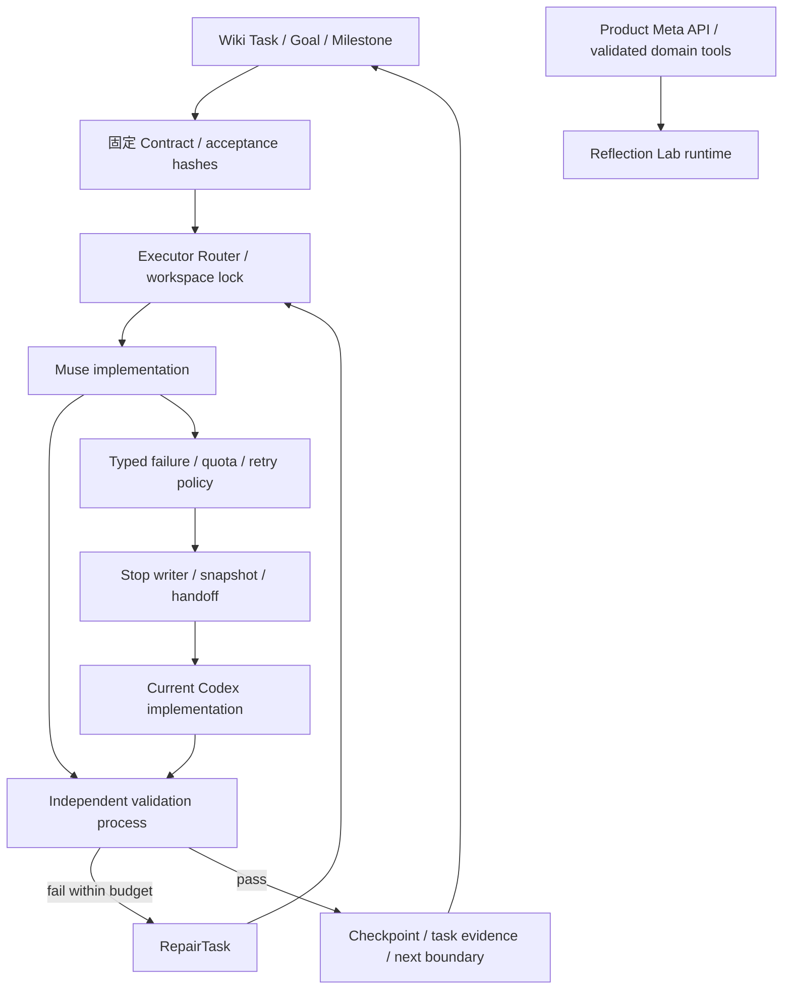

# 開發代理架構

> **2026-10-27現行政策：Codex主導，Muse Code僅選用。** 見 [ADR-013](../02-architecture/adr/013-codex-primary-development.md)。以下Muse優先流程保留為Optional Harness／Phase3歷史profile，不是正常開發前置，恢復額度也不使專案自動切回。

目前是開發基礎設施，正式產品尚未實作。根據 [ADR-012](../02-architecture/adr/012-development-harness.md)，Codex 負責目標、Task Contract、資源政策、獨立驗收與 Wiki；Muse Code 優先實作。Muse 無法繼續時，既有 Codex Orchestrator 進入 Implementation Mode。自動 runner 的驗收結果決定是否完成，不是 executor 的 exit 0 或 completion report。

## 持久狀態

`knowledge/tasks/*.json` 是工作唯一權威；宏觀狀態 BACKLOG…DONE 維持原 Wiki 契約。`schemas/agents/task.schema.json` 固定某項工作的執行 scope／驗收／政策；Run State 保存細部 executor 狀態、attempts、Git／內容快照、模型來源與 resources。Wiki 的 `agent_execution` 是有 artifact hash 的投影，不能由 executor 自稱成功便把 criteria 升為 verified。

Task ID、wiki_task_id、milestone_id、goal_id 與 contract hash 在接手期間保持。`goal_id` 是關聯欄位；不代表 runner 可以建立／恢復任意 Codex 產品的 `/goal`。原 thread 的 Goal 仍由該 session 管理；新 chat 從 Wiki／handoff 重建進度時需如實標示。見 [Codex 能力](CODEX_CAPABILITIES.md)。

## 隔離與驗證

Control directory 保存 state／events／acceptance copies／snapshots，executor 只得到指定 workspace 和 prompt。worktree 優先，但無 HEAD 不能建立有歷史的 worktree，本階段以隔離 fixture 進行測試；不把 `git diff` 的空輸出當作 untracked 無變更。協作鎖不等於 OS sandbox，見 [安全政策](AGENT_SECURITY.md)。

測試的可證明範圍：Mock Runner 驗證控制流程；真正 Muse echo 驗證 CLI 輸出協定；真正模型修改、live quota exhaustion／恢復與產品 Meta 連線需另有 live artifacts。完整執行結果與 Gate A–I 見 [報告](PHASE3_REPORT.md)。

## 產品界線

Muse Code 的開發訂閱／Meta API keys、Codex ChatGPT usage、產品 Meta API credits 各有來源與限制，不能互抵。產品 Agent 只能呼叫已驗證 domain tools，沒有 repo／shell／私人檔案權限。Mock 數字不能成為 Meta 模型或物理求解證據，見 [Runtime 契約](../08-ai/PHASE3_RUNTIME_AGENT.md)。
