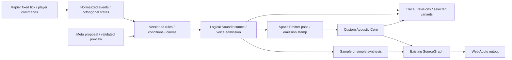

# Sound Behavior 架構與整合界線

2026-10-29：架構已採納，正式 evaluator／bridge／Inspector／Audio integration 已有實作與分項證據；完整 V1 尚未完成。以下設計包含尚無 producer 的事件與後續能力，不能將整份規劃讀成已實作。當前 code／test／gap 見[研究](../12-architecture-review/SOUND_BEHAVIOR_RESEARCH.md)；[結案報告](SOUND_BEHAVIOR_REPORT.md)只保留原研究／draft 範圍。決策見[ADR-014](../02-architecture/adr/014-sound-behavior-system.md)，事件／schema／UX維持唯一正式來源，不重複閾值或 token。

## 分層與責任

| 層 | 權威／可修改內容 | 不應承擔 |
| --- | --- | --- |
| Physics／Player | 真正pose/contact、成功Grab／Throw意圖、固定步stamp | 依sample改mass/friction，從速度猜玩家投擲 |
| Event／State | pair episode、support與motion分類、穩定ID／去重 | 假造substep精度或把接觸力當每次撞擊 |
| Behavior | profiles／bindings／overrides、條件、曲線、cooldown、instance意圖 | 執行任意JS、直接連master或修改solver |
| Generation | sample／oscillator、envelope／filter、creative gain／pitch | 宣稱sample選擇是真實模態振動或SPL校準 |
| Propagation | 依emitter/listener、geometry/medium/revisions輸出既有AcousticFrame | 依規則名自行合成不存在的reflection paths |
| Renderer | 同一發聲的direct／early／late、spatialization、headroom、生命週期 | 再算一次distance／delay／Doppler／HRTF |
| AI／Recorder | 合法候選、preview／undo、trace及實際結果引用 | 音訊callback阻塞、任意shell、LLM製造測量值 |

既有Rapier world、Scene command host、AcousticFrame、audio clocks與domain IDs仍是權威，新增的是行為作者／事件橋接層。主程式尚未實作，沒有因draft validator通過而產生可播放的產品。

## Event Rules＋正交狀態，而非單一FSM或大Graph

Held、Moving、Airborne、Rolling/Sliding、Sleeping、body mode是不同維度；被抓住的物件仍可能移動並撞牆，AlwaysOn也不應因OnImpact切換而停止。規則獨立判斷後，可同時持有continuous與one-shot instances。profile共用定義，runtime state按物件binding分離，不能共用冷卻／playhead。

規則與分類的精確ID、條件與可用數據看[Event Model](EVENT_MODEL.md)、[Physics Bridge](PHYSICS_AUDIO_BRIDGE.md)與[Schema](BEHAVIOR_SCHEMA.md)。投擲／自然掉落不混用；固定／無重力／暫停／teleport為明確transition，不能依瞬時速度自行補造意圖。

「投擲後開始loop，第一次Impact後停止，下一次Throw才重啟」需要有界latch，不能拿WhileAirborne代替（彈跳後可能再度airborne）。draft可描述P1 latch；host未宣告支援就回CAPABILITY_UNSUPPORTED，不偷偷近似。完整Node Graph留P2；需typed nodes、cycle規則／有限feedback、compiler與debugger，現在不增加這些負擔。

## 定義、綁定與live state

Profile是版本化不可變定義；多個物件以binding引用同版，overrides只允許schema列出的欄位。修改共享preset時先顯示影響範圍，再以新revision提交，不能改寫歷史run。Rule／asset／instance／emitter均有穩定domain IDs，Rapier handle僅adapter內臨時查表。

SceneSpec目前版本不直接新增未知欄位。draft behavior document與現有Scene／asset registries以ID和revision外接；正式host整合需獨立migration／引用驗證／原子command／inverse，不能把schema草案當已完成save/load。重複request去重，stale revision拒絕，失敗不留下半套Profile或bindings。

v1 draft只對目前document/profile/binding revision驗證runtime state，還沒有retired revision／tombstone支援。因此作者Apply／刪除的安全設計是pause→fade/drain舊voices→原子提交新revision→建立新runtime epoch；不能承諾無縫多版本live editing。pose與既有mapping的runtime輸入更新不改profile，不因此重建AlwaysOn。編輯中的slider/audition是draft preview，非偷偷提交running profile。

SoundInstance是logical lifecycle；AudioBufferSourceNode只是其當次播放的backend資源。continuous保留正在運作的loop／oscillator與playhead；退出gate淡出並釋放，重新進入的restart／resume政策需記錄。one-shot建立新的source node、重用decoded AudioBuffer，不能重啟已停止的BufferSource。這是規範能力，實際連續性與設備效果仍NOT RUN。[Web Audio REC](https://www.w3.org/TR/2021/REC-webaudio-20210617/)、[AudioBufferSourceNode](https://developer.mozilla.org/en-US/docs/Web/API/AudioBufferSourceNode)

## 定位與統一傳播

| 發聲 | 預定anchor／生命週期 | 關鍵限制 |
| --- | --- | --- |
| AlwaysOn／Held／移動loop | 物件pose＋明示local offset | 不假設object origin就是COM；抓取不重建loop |
| Whoosh／throw內容 | 可選follow-object emitter | 是creative內容；真Doppler屬傳播，避免速度pitch重複補償 |
| Impact／bounce one-shot | 發聲時有效contact代表點，短尾固定 | 不跟球飛回物件中心；物件移除後tail可由獨立instance安全結束 |
| Rolling／sliding | 該pair episode的contact anchor，穩定更新 | 細碎contact需聚合／hysteresis；不把所有平移當rolling |
| 多接觸／多layer | bounded代表點或有限多emitter | 不同位置不可先全部混成COM；規則雙方不能重複播同一impact |

同一無序碰撞pair先產生一次正規化事件；相同rule/event去重，明確多layer則保留不同layer身份。雙物件profile如何處理是可見政策：P0採pair owner／選一個material-pair內容，P1才允許明示雙方layers；不以任意callback順序決定。

3D生成器只能取得SourceGraph的emitter入口，不能取得master destination直接旁路。聲學材質、physics friction／restitution、聲音內容配對分別讀取；共用material ID也不表示改音檔就能改三者。Physical-inspired sample是perceptual approximation；Creative／Hybrid仍使用相同傳播。Measured／Derived／Tuned／Synthetic標籤維持，不能把sample分類當實測表面係數。

所有direct／reflections共用相同emission與已定義的delay/gain責任；HRTF每條arrival route一次、distance attenuation一次。reflection方向取最後一段到達方向，不取source直線方向。既有[Audio Runtime](../02-architecture/AUDIO_RUNTIME.md)是clock／routing正式權威。backend缺capability時回unavailable／明示降級，不暗中乾聲直連而宣稱完整聲學。

Gravity0只改力學；真空是獨立medium設定。真空仍有碰撞與logical events，本版不模擬固體傳聲，空氣聲學路由不可把「無衰減空氣」當真空。獨立dry audition可用來編輯內容，但必須有可見標籤且不進3D實驗／科學metrics。

## 三個時間域與錄放

Physics事件只有固定步可支持的時間精度；Behavior在排序後的tick/sequence評估，保存profile/binding版本與seed／selected variant。Audio scheduler以既有epoch將發聲時間轉到AudioContext，再加**一次**path delay；聽到的裝置時間另有output latency，不能把AudioContext當麥克風量測時鐘。

pause沿用Freeze-and-fade、保留logical offsets與未到達queue、取消舊epoch排程；resume只排未到達的項目一次。seek／reset／scene改版建立新runEpoch並檢查所有latch／continuous狀態，不重播已處理impact。paused audition另域，不推進physics cursor。

錄製正規化physics/player trace與behavior決策trace兩層；前者用於同運動比較，後者包含rule／asset版本、variant、playback與voice admission／steal／drop原因、emitter位置、acoustic result refs。authoritative replay可重評新behavior，不能把兩種行為的decision trace要求相同。詳見[Record Replay](../07-experiments/RECORD_REPLAY.md)與[A/B模式](../07-experiments/AB_COMPARISON.md)。

## 效能、匯入與驗證

正式數值預算只在[Performance Budget](../06-validation/PERFORMANCE_BUDGET.md)維護。rule、logical voices、active emitters、每emitter paths／總paths、queue、decoded bytes各自有界；voice上限不能取代solver source上限。暫定profile/schema上限不是測得容量。P0先少量emitter，不預設大量voice都能full-propagation。

預載／解碼／檔案權利檢查在非audio thread；匯入限制bytes／duration／channels／sample rate與decode錯誤，registry保留來源／license／原檔與解碼版本hash，模型不能填任意URL或不存在ID。bus headroom與steal/fade需OfflineAudioContext／實機驗證，不能只用峰值數學fixture稱無click/pop。

callback不等待physics／geometry／AI／network；只收bounded control frames與preallocated資料、以實際block length處理。以實測決定是否需要AudioWorklet，初版可用原生nodes，不為「有Worklet」增加不必要DSP。128-frame僅既有benchmark profile，不可硬編成所有render block。[AudioWorklet process](https://developer.mozilla.org/en-US/docs/Web/API/AudioWorkletProcessor/process)

Primary來源metadata／claim狀態見[audio sources](../../research/sound-behaviors/audio-sources.json)。Draft schema、風險spike與browser／hearing／Meta live的狀態分開；[驗證計畫](SOUND_BEHAVIOR_VALIDATION.md)不等於全部已跑。
