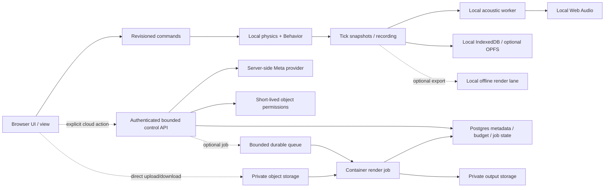

# Client-first與可選雲端架構

狀態：**PROPOSED；研究候選，未部署／未建立帳號、bucket、database或queue**。查核日：2026-10-29。程式基準`c210ca882ca8503b322c28884bf1e9f6e9fe126d`。本文不修改ADR-010/011/013/014及正式驗收；最小整合只可在另附diff／測試後稱為已實作。成本預設0、Meta network disabled的現行邊界維持。

## 建議方向與現況

維持client-first：互動physics、acoustics、Behavior、view、replay與即時audio在使用者裝置；local project／recording仍可離線運作。雲端只承擔自願同步／分享、server-side Meta控制面、較長的可選輸出工作。**本機離線WAV render與cloud render都尚無正式產品流程**；現行export是project／recording JSON，OfflineAudioContext用於asset decode及測試。不能把此圖寫成既有部署。

[Browser研究](BROWSER_PERFORMANCE_RESEARCH.md)核對了實際限制：physics仍在main RAF，錄製`onTick`還會同步solveAcoustics；一般互動AcousticService是真worker，並有bounded in-flight策略。先補足本機排程與資料流證據，再決定是否遷移physics worker；不以雲端替代互動輸入至聲音的低延遲鏈，也不承諾雲端支援萬人同時實時simulation。

## 現行server不能直接當公開多租戶服務

`server/app.ts:createAgentServer`使用Node `createServer`；只允許localhost/127.0.0.1 Host及既定Origin。body預設256KiB、單server closure `active>=1`拒絕並行。`MetaProvider`的call count、reserved USD與active request存在process memory，預設network=false、API key/model/pricing未設定、最大估費0。現有單機live-validation ledger與產品雲端多租戶權限是不同問題。

若日後另行授權cloud phase，先抽HTTP handler／provider interface，保留相同schema及proposal→validation→preview→Apply／undo語義。Vercel、Workers或Cloud Run adapters是候選，**不直接刪除本機Host保護並公開原server**。公開API至少需要身份驗證、每user/project授權、same-origin／CSRF處理、bounded request／response、idempotency key、timeout/cancel、每user與全域durable budget/reservation，以及速率與並行lease。CORS/Origin allowlist只是browser邊界，不能當身份驗證。

多instance不能共用`let active`或memory cost ledger作為全域限額；需資料庫原子reserve→dispatch→settle/uncertain流程。未知傳輸結果保留uncertain，不能透過重啟、重送或解除lease洗掉費用。Meta key僅server secret，不出現在public bundle、project export或logs；provider/model/version/usage/result provenance仍進experiment metadata。研究情境中的AI rpm不是帳號配額已驗證。

## 平台比較：資源適配與已查限制

| 候選 | 適合責任 | 已核實限制／代價與本案決策 |
|---|---|---|
| Cloudflare Pages＋Workers | Pages提供Vite靜態app；Workers作短控制API／signed object permissions／queue dispatch | Pages靜態請求不計費；每asset25MiB，較大音檔不能打包進靜態站。Workers128MB/isolate（含WASM及同isolate多請求共用），Paid CPU可至5min但不是任意Linux runtime。採其作可重算主成本候選，不代表已部署。 [Pages pricing](https://developers.cloudflare.com/pages/functions/pricing/)、[Pages limits](https://developers.cloudflare.com/pages/platform/limits/)、[Workers limits](https://developers.cloudflare.com/workers/platform/limits/) |
| Vercel | 靜態app／Node相容HTTP adapter／AI control API，方便接既有TypeScript | Function request/response上限4.5MB，錄製／音檔應直傳object store。2026-09已有Flat Rate CDN，不能沿用舊CDN價當現價。完整container render不應塞入一般function；本輪不改框架、不部署。 [Functions limits](https://vercel.com/docs/functions/limitations)、[Flat Rate CDN公告](https://vercel.com/blog/introducing-flat-rate-cdn)、[Pro](https://vercel.com/docs/plans/pro-plan) |
| Supabase Postgres/Auth | ownership、project versions、asset manifests、experiment metadata、jobs、durable budget／lease；可選Auth | 付費org至少Pro $25/月＋compute差額；每project獨立Postgres。Micro 1GB RAM、60 direct／200 pooler connections只是配置限制，不是200user容量。前端走Data API/RLS，不把DB連線密碼放browser；serverless走transaction pool，具體client pool上限另驗。 [Pricing](https://supabase.com/pricing)、[Connection guide](https://supabase.com/docs/guides/database/connecting-to-postgres) |
| R2 Standard | private encoded assets、recordings、content-addressed blobs | egress免費，但storage／Class A/B計費。不是SQL DB、browser origin disk或跨服務無成本保證；Google輸出到R2仍可能收Google網路費。[R2 pricing](https://developers.cloudflare.com/r2/pricing/) |
| Cloud Run Jobs＋同region GCS | 固定版本Linux container／browser或DSP離線render，CPU/RAM明示，結果存GCS | 每task最多8vCPU/32GiB；每instance最低計費60秒，完整lifetime計費；task timeout可至168h但本案另限時。`parallelism`只限單execution，不能限制所有用戶的總並行。regional quota與實測cold start／browser sandbox另驗。[Pricing](https://cloud.google.com/run/pricing/)、[Quotas](https://docs.cloud.google.com/run/quotas)、[Parallelism](https://docs.cloud.google.com/run/docs/configuring/parallelism) |
| Cloudflare Containers（另一候選） | Linux container輸出，與Workers協同；可減跨provider控制複雜度 | 這是**獨立container產品**，不能把Workers128MB限制套到它。standard-3為2vCPU/8GiB；CPU／provisioned RAM/disk、Durable Objects／Workers及egress另計，須驗browser／DSP runtime。主成本試算未採，避免重複加總兩個render方案。[Pricing](https://developers.cloudflare.com/containers/platform/pricing/)、[Limits](https://developers.cloudflare.com/containers/platform/limits/) |

資源限制補充（均非本產品吞吐保證）：Pages Free為500 builds/月、1個build同時、20分鐘build timeout、20,000files。Workers Free為100k requests/day、10ms CPU/invocation；Paid HTTP預設30秒CPU、可設至300秒。Vercel Fluid Hobby最多2GB/1vCPU、300秒；Pro最多4GB/2vCPU，800秒為GA上限，1800秒extended duration是有runtime條件的Beta，不能當所有方案預設。Cloud Run Jobs每execution最多10,000tasks、同region最多1,000個執行中executions；Jobs Run API預設180次/60s/project/region。task預設3次retry、上限10次，成本scenario的1.05等倍率是預期額外attempt，不是已採用的provider設定。正式啟用前需將retry policy、global lease與剩餘regional CPU/RAM quota一起核對。[Vercel limits](https://vercel.com/docs/functions/limitations)、[Run quotas](https://docs.cloud.google.com/run/quotas)、[Run retries](https://docs.cloud.google.com/run/docs/configuring/max-retries)

Vercel官方docs工具、Supabase官方`search_docs`與pricing/connection/RLS頁已讀。Supabase changelog index未見會把本研究建議變成已部署能力的證據；沒有查詢私人project／帳單或執行SQL。Cloudflare/Google資料均來自官方docs，詳細單價、共享free tier及替代queue見[成本模型](CLOUD_COST_MODEL.md)。

## 儲存分工與最小資料契約（設計草案）

Postgres只放有界metadata與refs：`project_id / owner_id / revision / scene_hash / manifest_hash`、asset encoded bytes hash／license／size／object key、experiment run/tick range／fixedDt／physics/solver/Behavior版本、job state／budget reservation／lease。錄製trace、原音檔與PCM不逐frame寫Postgres，不用Realtime廣播60Hz poses。每個實驗的manifest可攜且pinned，分享link不代表所有原素材可再次授權。

所有project read/write需要owner/membership predicate；對exposed schema啟用RLS。不能只用`TO authenticated`當ownership，也不能用user-editable metadata作授權。service/secret key留server；read-only share設獨立revocable permission，object key猜中仍不能下載。版本提交以expected revision／CAS，metadata與blob不跨服務假稱原子：先上傳temp／驗hash→commit manifest→標記可讀；失敗temp由有界retention清理。[Supabase RLS](https://supabase.com/docs/guides/database/postgres/row-level-security)

Blob key候選`owner/project/sha256`，但不可只靠prefix授權；hash語義沿用現行encodedBytesSha256、canonicalRecordingArtifactSha256與utf8JsonBytesSha256的區別。直接upload需先取得短效permission與server側size/type budget，完成後驗實際bytes/hash再列manifest。presigned URL是bearer token，不可進analytics／referer；R2 S3 presigned domain與custom domain不同，CORS需限定origin/method/header。下載用短效GET或經驗證private gateway；public素材才可另用可快取的public immutable URL。[R2 presigned URL](https://developers.cloudflare.com/r2/api/s3/presigned-urls/)

R2 location hint是best effort，不能聲稱資料一定在台灣；jurisdiction選項才約束特定法域。Supabase、Google及R2跨provider有各自備份／留存／刪除邊界；以明示區域、retention、delete propagation與必要資料告知決定，不能用「加密」代替權限設計。未授權前不自動上傳本機錄製／私有音檔，也不將其送模型。[R2 data location](https://developers.cloudflare.com/r2/reference/data-location/)

## Queue與render生命週期

候選狀態：`created → reserved → queued → leased → running → uploading → completed`；終態另有`cancelled / failed / uncertain / expired`。descriptor僅含job ID、owner/project revision、manifest hash、object refs、render settings、engine/container version、cost/time/bytes cap，**不放原音檔或秘密**。API以202＋job ID早回；browser可離開，progress/status另查，輸出manifest完成且hash一致才提供下載。

Cloudflare Queues為at-least-once，write/read/delete一般三個operation，retry另計；需idempotency key與job attempt ID。lease由DB原子取得，設global/user並行上限、到期／heartbeat與cancel語義；過期不意味舊job已停止，避免雙算／雙發。使用者cancel後容器應停止、未完成output不發布，已耗compute保留成本紀錄。輸出可重試upload，不能把整段render無條件重跑。[Queues delivery](https://developers.cloudflare.com/queues/reference/delivery-guarantees/)

Cloud Run Jobs是由queue consumer／受權限保護的dispatcher呼叫Jobs API啟動，不是可直接接收任意HTTP request的job endpoint。OAuth／最小權限橋接需另實作並計費；不得把長期Google service account key放前端。若改Google Cloud Tasks，只讓task啟動job後結束，HTTP handler最多30min並不等於可等待168h job。Pub/Sub可作事件流，較適合多consumer用途；不是本案必要依賴。[Cloud Tasks](https://docs.cloud.google.com/tasks/docs/creating-http-target-tasks)、[Run jobs execute](https://docs.cloud.google.com/run/docs/execute/jobs)

Render以immutable recording輸入，固定sample rate、source phase、backend/model class、spatialization、quality、素材hash與環境manifest。local native Web Audio與headless browser／自製DSP不得未驗即宣稱sample-identical；若用headless Chromium，pin browser/container digest及GPU/CPU mode，運行權限／音訊功能另測。若用不同native backend，顯示獨立backend/approximation，不冒充當前Web solver等價。retry/cancel/partial output及缺素材應能獨立復現。

## 後續階段與驗收邊界

1. **現在可做的可逆工程**：釐清mode/clock/capture hot paths、bounded telemetry及revision契約；保留本機成本0與所有歷史FAIL。研究中的成本script只做離線算術。
2. **先驗本機輸出**：固定錄製→短OfflineAudioContext render→PCM oracle→pause/cancel/資產缺失／RAM上限；量正常筆電與高階機。沒有本機產品renderer前不先建立「雲端功能完成」狀態。
3. **若另行授權cloud phase**：HTTP/auth/budget adapter、private blob與metadata先完成，測tenant隔離／quota／revision conflict／purge；再加入queue/container renderer。基準仍為同一pinned run與聲學oracle。
4. **才驗容量與費用**：100/1000/10000情境是工作量推算；API/provider quota、DB QPS、job-start limit、worker memory與container吞吐需各自load test。超cap明示queue/wait/reject，不自動提高預算／供應商方案。

本輪沒有部署、花費、新Meta呼叫、cloud provisioning或雲端容量實測。一般browser gate、R17性能、Worklet、跨裝置與真人聽測仍依原驗收分別判定，研究報告不能使整體V1完成。
