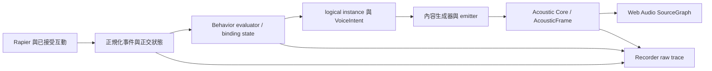

# Sound Behavior 架構研究

查核日期：2026-10-29（Asia/Taipei）。基準：`c210ca882ca8503b322c28884bf1e9f6e9fe126d`。研究先讀 [既有 middleware 研究](../10-sound-behaviors/SOUND_BEHAVIOR_RESEARCH.md)、[來源 metadata](../../research/sound-behaviors/middleware-sources.json)、[Evidence Ledger](../../research/EVIDENCE_LEDGER.json)、最新 handoff 與正式 `src/`。本頁補現況／gap／官方來源，不取代 [ADR-014](../02-architecture/adr/014-sound-behavior-system.md)、[V1 驗收](../11-v1/ACCEPTANCE.md) 或 [驗收補充](../11-v1/ACCEPTANCE_AMENDMENTS.md)。

## 結論與狀態

既有 Event Rules＋正交 states＋versioned binding／profile 已足以承接這一階段，不需導入商用 middleware 或重建 Node Graph。優先補 producer capability 的共用權威、修正舊文件現況入口、保留 trace／budget／preset 語義，比新增聲音觸發種類更小且可驗。

本文標籤：**VERIFIED-SOURCE**＝本次官方正文閱讀；**VERIFIED-CODE**＝基準程式與測試內容已讀；**VERIFIED-PROBE**＝下述必要唯讀程序實際執行；**HISTORICAL-TEST**＝既有固定 artifact 的原範圍；**APPROXIMATION**＝工程／感知近似；**PROPOSED**＝未採納建議；**UNVERIFIED／NOT RUN**＝無該項實測。程式存在、Node domain 通過、真 AudioNode graph、browser 輸入、裝置聽感與性能不可互代。完整 V1 尚未完成，R17 性能 FAIL 與真人／裝置聽測缺口保留。

## 現行責任鏈



| 層 | 現有程式／驗證 | 權威與界線 |
| --- | --- | --- |
| Physics／Player producer | [PhysicsWorld](../../src/physics/physics-world.ts)、[InteractionHost](../../src/interaction/interaction-host.ts) | 真 pose／contacts、成功 Grab／Throw；不依音檔或速度猜玩家意圖 |
| Normalization | [physics-behavior](../../src/app/physics-behavior.ts) | 列出接受的 discrete producers；帶固定 tick／sequence、generation、contact provenance；缺 force 為 null，不將 Ns 誤標 N |
| Behavior | [audio-behavior](../../src/audio-behavior/index.ts)、[registry](../../src/audio-behavior/profile-registry.ts)、[types](../../src/audio-behavior/types.ts) | schema＋domain＋trusted registry；條件／曲線／cooldown／latch／logical admission。沒有 AudioNode、physics solver 或任意 JS |
| App host | [runtime](../../src/app/runtime.ts)、[behavior editor](../../src/app/behavior-editor.ts) | pause／drain／原子 revision／epoch／Undo；pending voice 等有效 route，記錄 behavior／native 拒絕原因 |
| Content／renderer | [AudioEngine](../../src/audio/engine.ts)、[PathRoute](../../src/audio/routes.ts)、[late reverb](../../src/audio/late-reverb.ts) | sample／oscillator 與穩定 path route；內容 gain／pitch 與傳播分開，reverb 標 Synthetic／perceptual approximation |
| Record／reprocess | [recorder](../../src/experiments/recorder.ts)、[reprocess](../../src/experiments/reprocess.ts)、[replay audio](../../src/app/replay-audio.ts) | 原物理／motion 與衍生 decisions 分開；snapshot 有界，不序列化 Rapier／AudioNode |

VERIFIED-CODE：現有 continuous instance 不因另一次 OnImpact 被替換；shared profile 的每個 binding 有獨立 cursor／cooldown／instances。sample one-shot 建立新 BufferSource、重用 decoded AudioBuffer；continuous 參數更新保留運行 source。這些由 [domain tests](../../tests/audio-behavior/runtime.test.ts)、[engine tests](../../tests/audio-runtime/engine.test.ts) 與既有 native／browser 收據各自驗證；Node fake-context 測試不能升格實際聽測。

## Trigger 狀態全表

所有規則另受 lifecycle Active、binding／rule effective enabled、合法 asset／revision、條件、mapping 與預算限制。Preview／Staged 不發聲。Continuous 是 level、Discrete 是 edge；getter 不推進物理遲滯。表中「有 producer」僅指基準程式，並非每一種情境皆已通過真人聽測。

| Trigger | 現行 producer／評估語義 | anchor／主要限制 | 狀態 |
| --- | --- | --- | --- |
| AlwaysOn | Active 且 enabled；sleep／Held／Moving／NoGravity 不自行停止 | object pose＋明示 offset；持久 instance | VERIFIED-CODE |
| WhileHeld | 成功 grab 後的 Held state；Held 仍可移動、撞牆 | object／grip offset | VERIFIED-CODE |
| OnGrab | 成功 `grab` command，不是 hover／按鍵本身 | object；command ID 必需 | VERIFIED-CODE |
| OnRelease | 成功 Drop／Throw 共用 command ID；失焦／mode invalidation 不冒充 | object；與 OnDrop／OnThrow 訂閱不同 rule 可刻意疊音 | VERIFIED-CODE |
| OnThrow | 成功明確 throw，有限 impulse | object；高速／被撞飛／自然落下不構成 Throw | VERIFIED-CODE |
| OnDrop | 成功 Drop；移除 controller，保留 solver 速度／重力模式 | object；freefall 不構成 Drop | VERIFIED-CODE |
| WhileMoving | world-frame 線速度遲滯 | object；Tuned 門檻，不代表相對平台移動 | VERIFIED-CODE／APPROXIMATION |
| WhileAirborne | Dynamic 無有效支撐；evaluator 額外要求 held=false | object；零重力靜止也可能 airborne，可 AND moving | VERIFIED-CODE／APPROXIMATION |
| OnImpact | 新 contact episode、J＋closing speed＋cooldown，非 support force 每步 | contact one-shot，固定發聲時的位置 | VERIFIED-CODE／APPROXIMATION |
| OnBounce | evaluator 可接受合法 physics normalized input；現行 bridge 未產生 | 需 parent impact＋有界 outgoing 法向反轉／分離證據；不能以 Impact 或 restitution 替代 | PRODUCER_UNSUPPORTED；UI 停用 |
| WhileRolling | 有支撐球體、相對支撐 frame 的速度／角速度、低 slip 與 hysteresis | contact；任意 mesh／compound 不支持，null 保留 unknown | VERIFIED-CODE／APPROXIMATION |
| WhileSliding | 真 contact-point 相對 slip 過遲滯門檻 | contact；牆擦也可成立，非 COM 平移 | VERIFIED-CODE／APPROXIMATION |
| WhileSpinning | 角速度 rad/s 遲滯，獨立於 Moving／支撐 | object；spin 不等於 rolling | VERIFIED-CODE／APPROXIMATION |
| OnStartMoving | 同 speed basis moving false→true 固定步 edge | object；不是 action started／Awake／teleport | VERIFIED-CODE |
| OnStopMoving | moving true→false，符合退出帶與兩步穩定 | object；Pause 不製造 edge | VERIFIED-CODE |
| OnSleep／OnWake | Dynamic sleep state edge，非 input key | object；初始 baseline／mode change 不應解讀為新的玩家行為 | VERIFIED-CODE；細節依 producer tests |
| OnEnterZone／OnExitZone | evaluator 能處理合法 zone inputs，現產品 context zoneIds=[]，bridge 沒 occupancy producer | zone；刪除／load baseline 不假造穿越 | PRODUCER_UNSUPPORTED；UI 停用 |

精確閾值留 [MOTION_HYSTERESIS](../11-v1/MOTION_HYSTERESIS.md)，本頁不建立第二套數值權威。球體 Rolling／Sliding 是 Derived／Tuned 工程分類；contact J、point speed 不等真實物件振動、聲功率或校準 SPL。

## Cooldown、去重與三種預算

| 政策 | 現行 scope／行為 | 可重現證據入口 |
| --- | --- | --- |
| Raw impact suppression | Physics pair episode onset＋跨 episode pair cooldown；沒有 audible candidate 也不否認物理接觸存在 | [physics-world tests](../../tests/physics/physics-world.test.ts)、[contact projection](../../tests/physics/contact-projection.test.ts) |
| Rule cooldown | `bindingState(bindingId).cooldowns[ruleId]`；`ceil(seconds/fixedDt)` ticks，不受 render FPS 支配 | [runtime cooldown／shared profile tests](../../tests/audio-behavior/runtime.test.ts) |
| Duplicate inputs | event ID cache 有界＋單調 input cursor；被淘汰 ID 也不能倒回同 tick 舊 sequence | 同上；reset／seek 換 epoch |
| Logical admission | maxVoices／maxPerObject／rule voiceLimit；fading tails 也計數。同 input 候選依 priority、stable binding／rule ID 決定。現行 logical policy 為 reject，不突然 steal | [voice-admission](../../src/audio-behavior/voice-admission.ts)、[active rule tests](../../tests/audio-behavior/active-rule-projection.test.ts) |
| Native voice resources | AudioEngine 另計 active／retiring／pending／frozen；可對較低 priority native voice fade／steal，會有不同 admission／cleanup 結果 | [engine](../../src/audio/engine.ts)、[restore cursor](../../tests/audio-runtime/restore-cursor.test.ts)、[pause regressions](../../tests/audio-runtime/pause-regressions.test.ts) |
| Solver／paths／assets | source、source-frame cache、每 voice／總 paths、decoded bytes、decode concurrency、pending events、late sends 均有獨立 bounds | [AudioBudget](../../src/audio/types.ts)、[control](../../src/audio/control.ts)、[asset bounds](../../tests/audio-runtime/asset-bounds.test.ts) |

Logical start／active rule 不等實際播放。後續 native 拒絕、無路徑／stale、Mute、sample 尚未 ready、過載各有不同原因；UI 不應把它們統稱「規則未觸發」。[behavior diagnostics](../../tests/app/behavior-diagnostics.test.ts) 已有真 Rapier cooldown case：保留 raw impact／contact、COOLDOWN decision、接觸位置及 replay provenance。它不刪 raw event，也不虛構 COM emitter。

FMOD 的 cooldown 是「同 event instances」間開始間隔；UE concurrency 可按 owner 或共用 asset scope。這些 scope 不等於本案 binding＋rule；借鑑成熟概念不能直接移植成全域冷卻，也不能用 middleware voice 限制代替 solver 容量。[FMOD macros](https://www.fmod.com/docs/2.04/studio/event-macro-controls-reference.html)、[UE concurrency](https://dev.epicgames.com/documentation/unreal-engine/sound-concurrency-reference-guide?lang=en-US)（VERIFIED-SOURCE，2026-10-29）。

## 統一 SourceGraph 與 preset 邊界

[PathRoute](../../src/audio/routes.ts) 每個穩定 path 建一個 DelayNode 與 PannerNode；Panner `rolloffFactor=0`，距離 gain 由 solver band pressure ratios 負責。傳播使用 `AcousticFrame.absoluteDelayS` 一次；HRTF direction 來自最後一段 arrival direction，不改拿 source 直線。Band filter bank 與 path birth／death 平滑，convolver normalize=false。內容 pitch 是創作參數；delay 移動產生 Doppler 時不再另補同一物理 Doppler。

Raw／Simulated 是同一 emission 的 monitor routes；dry audition 是明示的獨立編輯域，不進實驗 metrics。這些合法旁路不能冒充「3D 音效已通過全部聲學」。Late reverb 為 Synthetic／perceptual approximation，IR 不含 direct 且明示 normalization／send 責任；不拿其 tail 推成真房間量測。

| Preset／作者能力 | 現行行為 | 最小標示與限制 |
| --- | --- | --- |
| Default continuous tone | [defaults](../../src/app/defaults.ts) `profile.continuous-tone`，procedural 220 Hz | 程序測試音，非自然振動 |
| Default interactive | `profile.interactive-tone`，OnImpact／OnGrab／OnThrow；Impact gain 映射 closing speed | creative tones；不是 Measured material |
| physical／creative／hybrid／procedural | schema label；`setPreset` 改 presetKind，既有 rules 不會因此自動換成振動 solver | `physical` 應解讀 authored physical-inspired preset，不等 modal synthesis；改分類標籤不等變更 physics／acoustics |
| Material-pair override | 同 rule 依 material pair 選 generator，保留 contact 與 finite lifetime／budget | 內容材質配對不能覆寫 acoustic A/R/T／bands 或 Rapier mass／friction |
| Shared preset editing | profile revision／binding pin；局部編輯會 clone shared profile，binding overrides 保留相應規則 | 版本凍結；Undo／Redo／CAS，不回寫歷史 run |
| Variants／Graph／modal synthesis | 正式 evaluator 無 variants、任意 JS、DSP graph、modal synthesis | P2／未實作；seed 欄位存在不等各項能力已提供 |

現有 [editor tests](../../tests/app/behavior-editor.test.ts) 含 shared-profile isolation、curve／override、stale draft、Undo／Redo；[scene-source projection](../../tests/app/scene-source-behaviors.test.ts) 處理 legacy source 與規則同步。這是既有能力應保留的回歸面。新 sample 匯入仍要 trusted ID／revision／SHA、READY／APPROVED、decode／duration／memory 檢查，不能讓模型給任意 path／URL。

## 必要唯讀 probe：producer 能力沒有共用權威

**VERIFIED-PROBE，2026-10-29，exit 0。** 基準 UI 的 [unsupportedTriggerReasons](../../src/ui/behavior-options.ts) 禁用 OnBounce／OnEnterZone／OnExitZone；但 [offline planner](../../src/ai/offline-sound-planner.ts) 對 bounce 音訊要求會提出 OnBounce，`SoundProposalHost.stage` 通過 strict document validation 並建立 awaitingApproval preview。這證明 preview 接受「schema／evaluator 合法、現行 producer 不會產生」的規則，不是已證明 apply／有聲執行缺陷。

可重現程式（在 repository root，用 `node --import tsx --input-type=module` 執行）：

```javascript
import { createDefaultScene, createDefaultBehaviors, makeBehaviorContext } from "./src/app/defaults.ts";
import { OfflineSoundPlanner } from "./src/ai/offline-sound-planner.ts";
import { SoundProposalHost } from "./src/ai/sound-host.ts";
import { unsupportedTriggerReasons } from "./src/ui/behavior-options.ts";
const scene = createDefaultScene();
const document = createDefaultBehaviors(scene);
const context = makeBehaviorContext(scene, scene.objects.map(o => ({ objectId: o.id, generation: 1 })));
const state = { sceneId: scene.sceneId, sceneRevision: scene.sceneRevision, document, context };
const plan = new OfflineSoundPlanner().plan("ball bounce sound", state, { selectedObjectId: "ball" });
const host = new SoundProposalHost({
  getState: () => state,
  commit: () => { throw new Error("COMMIT_MUST_NOT_RUN"); }
});
const preview = await host.stage(plan.proposal, plan.provenance);
console.log({
  uiUnsupported: unsupportedTriggerReasons.OnBounce,
  previewState: preview.state,
  hasBounce: preview.candidate.profiles.some(p => p.rules.some(r => r.trigger.type === "OnBounce"))
});
```

實際已執行等價命令的結果：UI 原因為「目前物理 bridge 未產生 OnBounce；請使用 OnImpact。」；planned／candidate triggers 都含 OnBounce；previewState=`awaitingApproval`。Probe 的 commit adapter 必拋且未被呼叫，只做本機 deterministic proposal／preview，沒有 apply、AudioContext 啟用、網路或付費 API。未另外建立 production fixture，不將 hard-coded telemetry 欄位當量測。

**PROPOSED 最小修補**：抽出 domain producer capability map／查詢，列 `triggerId`、evaluatorSupported、producerStatus、reason、適用 shape／必要資料；UI、AI context、preview diagnostics 共同讀。保留通用 schema／既有 project 匯入及 evaluator 外部合法輸入；先針對新作者／AI 提案顯式 warning 或 `CAPABILITY_UNSUPPORTED`，由產品政策決定，不無聲替換成 OnImpact。能力檢查不能只放在 UI，也不能將 existing imported rules 直接破壞性刪除。

## 官方成熟工具：新增查核與可借鑑範圍

本次使用官方正文與官方 repository，全部 access date **2026-10-29**。僅原創摘要／metadata，無安裝或執行 FMOD／Wwise／UE SDK，無 latency／voices／memory benchmark，無下載商業素材。

| Claim／版本／狀態 | 官方直接支持 | 本案工程推論／不能外推 | 來源 |
| --- | --- | --- | --- |
| SND26-F01，FMOD 2.04，VERIFIED-SOURCE | 共用 Event 可有獨立 instance、3D pose、local parameters；global parameter 值共用 | Profile／binding state 分開是合理參考；不是同 Event 自動等於同物理 contact | [Events](https://www.fmod.com/docs/2.04/studio/authoring-events.html)、[Parameters](https://www.fmod.com/docs/2.04/studio/parameters.html) |
| SND26-F02，FMOD 2.04，VERIFIED-SOURCE | Max Instances、stealing／virtualization、cooldown；官方以頻繁碰撞碎片說明 instance limiting | 音訊 budget 不判斷真 impact，不替代物理 episodes；不照抄其 scope | [Event Macros §§19.6–19.9](https://www.fmod.com/docs/2.04/studio/event-macro-controls-reference.html) |
| SND26-U01，UE 5.8 文件，VERIFIED-SOURCE | MetaSounds 是 DSP dataflow；Source／Patch／Preset 重用；Preset 繼承 read-only parent graph，input 可覆寫、parent 更新會傳播。Trigger 有 audio-block 內 sample timing，接非 audio-rate 型態節點時輸出可能為 block-rate | 不能提高 Rapier 固定步接觸觀測精度；本案 frozen profile revision 不應照抄 live parent propagation | [MetaSounds Reference](https://dev.epicgames.com/documentation/en-us/unreal-engine/metasounds-reference-guide-in-unreal-engine) |
| SND26-U02，UE 5.8 文件，VERIFIED-SOURCE | Concurrency 有 Max Count、owner scope、Retrigger Time、voice steal fade；active silent components 亦計數，共用 asset 可共享 state | 無聲不等沒資源；本案 logical／native／solver 三種預算仍分開，不直接搬 UE 計數規則 | [Sound Concurrency](https://dev.epicgames.com/documentation/unreal-engine/sound-concurrency-reference-guide?lang=en-US) |
| SND26-U03，UE 5.8 文件，VERIFIED-SOURCE | Gameplay speed 可映射風聲 gain；Sound Attenuation 另列 distance、spatialization、air absorption、reverb、occlusion | 速度映射是內容設計，不是空氣力學／實測聲學材質；attenuation 曲線不是本案量測 reference | [Quick Start](https://dev.epicgames.com/documentation/unreal-engine/metasounds-quick-start?lang=en-US)、[Attenuation](https://dev.epicgames.com/documentation/en-us/unreal-engine/sound-attenuation-in-unreal-engine) |
| SND26-W01，Wwise 2017.2.0 build6500，VERIFIED-SOURCE-LEGACY | 官方 headers 的 PostEvent／Playing ID、object／global／playing RTPC scope；spatial geometry／emitter 分層；indirect-path query 可能取 global lock | 只支持歷史 API 原理，非 2026 現行 Wwise 查核；不能把阻塞 query 搬入 audio callback | [SoundEngine](https://raw.githubusercontent.com/audiokinetic/WwiseIncludes/master/SDK/include/AK/SoundEngine/Common/AkSoundEngine.h)、[Query](https://raw.githubusercontent.com/audiokinetic/WwiseIncludes/master/SDK/include/AK/SoundEngine/Common/AkQueryParameters.h)、[Spatial](https://raw.githubusercontent.com/audiokinetic/WwiseIncludes/master/SDK/include/AK/SpatialAudio/Common/AkSpatialAudio.h) |
| SND26-W02，Wwise current，UNVERIFIED API | 本次 current edge SDK／Help 官方入口仍不可讀；保留存取失敗 | 不能由存取失敗推 Wwise 沒功能，不能把舊 header／搜尋摘要升格 current API | [Events（讀取失敗）](https://www.audiokinetic.com/en/library/edge/?source=SDK&id=soundengine__events.html)、[Limiting（讀取失敗）](https://www.audiokinetic.com/en/library/edge/?id=limitingsoundinstances.html&source=Help) |

FMOD／MetaSounds／Wwise 是成熟原理參照，沒有支撐「本案首創 events／procedural audio／natural-language authoring」的證據。Web Audio 與 Rapier primitives 已足夠現階段；完整 DSP Graph／商用中介層會增加部署、權利與驗證面，不是本輪最小方案。

## 重要 gap、最小建議與驗證

| 優先 | gap／狀態 | 最小建議與可重現驗證 |
| --- | --- | --- |
| 高 | Producer capability 僅 UI map；唯讀 probe 證明 AI preview 可接受無 producer 的 OnBounce | 共用唯讀 capability projection；測 UI／AI／manual authoring／import 各入口一致顯示，不改 evaluator 通用 schema |
| 高 | [architecture](../10-sound-behaviors/SOUND_BEHAVIOR_ARCHITECTURE.md)、[event model](../10-sound-behaviors/EVENT_MODEL.md)、[bridge](../10-sound-behaviors/PHYSICS_AUDIO_BRIDGE.md)、ADR-014 舊總述仍寫未實作 | 補明示當前 status／evidence 入口，保留歷史 draft 結果，不用研究文件重設 task DONE |
| 中 | Physics pair identity／cooldown 跨 generation 與 churn cleanup 風險 | 見 [物理研究](PHYSICS_AND_MOTION_RESEARCH.md)；先建負例，不為加新音效改 raw trace 語義 |
| 中 | Bounce／zone producer 缺失；persistent-contact rearm／compound patches 未完成 | 先 capability unavailable；如另立任務，再用 parent impact／分離／bounded window 與 multi-patch fixtures，不能每個 ContactEnd 都播 Bounce |
| 中 | `physical` preset 可能被誤讀成自然振動；分類切換不生成新物理模型 | UI／文件明示 physical-inspired；驗 preset 不改 mass／friction／A/R/T／同運動 trace |
| 中 | Shared preset 更新與 vendor live inheritance 不同 | 保持 immutable revision＋binding pins；跨兩物件 cooldown／playhead 互不污染，歷史 run 不變 |
| 保留 | 真裝置 Hi-x65／D3V、實體 FPS／IME、完整 delivery／Worklet deadline 未完成，R17 性能 FAIL | 依 [Human Test Guide](../11-v1/HUMAN_TEST_GUIDE.md) 與原長測獨立補證；不由此研究升格 |

聲音領域本輪實際執行只有上述必要無聲 preview probe；物理領域另有 generation／cooldown probe，見物理研究；**未重跑** root 將統一執行的完整 check／runtime／benchmark，也未跑 browser／聽測／付費模型。下列命令為現有回歸重現入口，**本文件不宣稱本輪 PASS**：

```powershell
node --import tsx --test tests/audio-behavior/runtime.test.ts tests/audio-behavior/active-rule-projection.test.ts tests/app/behavior-diagnostics.test.ts tests/app/behavior-editor.test.ts
node --import tsx --test tests/audio-runtime/engine.test.ts tests/audio-runtime/pause-regressions.test.ts tests/audio-runtime/restore-cursor.test.ts tests/app/replay-audio.test.ts tests/experiment-runtime/reprocess.test.ts tests/experiment-runtime/source-phase.test.ts
```

第一組涵蓋 AlwaysOn／one-shot 共存、同 profile 獨立 state、cooldown／voice limits／latch、authoring revision／overrides 與 raw diagnostics；第二組 Node tests 包含 fake-context graph／cursor／重評，不是實際 PCM 聽測。原生音訊 reference 命令與固定產物見 [audio-runtime README](../../tests/audio-runtime/README.md)；首次／失敗結果不覆寫。既有 [R17 功能收據](../../artifacts/v1/r17-browser-verification-20261029/verification.json)、[R17 逐條判定](../11-v1/REQUIREMENT_EVIDENCE_20261029-r17.json)、[性能](../11-v1/BROWSER_PERFORMANCE.md) 各自保留成功／失敗／NOT RUN 範圍。

新增測試只對實際補強：capability shared source 的不相容 producer 負例、兩 binding 不互吃 cooldown、silent／retiring／pending 資源不逃預算、preset label 不改 physics／acoustics。不要為只新增研究文件建立照抄表格的測試。

## 錄放、A/B 與未來 Motion 的接點

Recorded-output replay 重放既有 decisions／VoiceIntents；behavior reevaluation 保留原 motion／raw physics／listener／geometry／physics／solver／medium，再改明示 profile／generator／asset／gain／pitch；新的 decisions 合法不同。Acoustic A/B 固定發聲內容，不能用換鋼琴的結果宣稱牆面 RT 改善。Source phase 有 logical intent／native epoch／silent／missing 不同 evidence class，不能把 timestamp 或 source cursor 說成硬體 PCM。

未來 Move To／Move & Release 的完成／阻擋／取消屬 Motion receipt；物理 OnStartMoving／OnStopMoving 仍按真速度。程式 move 不假造 OnGrab／OnThrow；release 是否 fan out 新聲音 trigger 需明確產品契約。sound evaluator 不從軌跡名／速度猜玩家意圖，音訊 callback 不等 Motion／geometry／AI。此為 PROPOSED 邊界；沒有新增 Motion producer 或新音效規則。

交付限制：本文提供可審查研究與最小提議，不是 middleware 授權結論、完整產品完成證明、真實振動模型或新性能基準。主代理統一維護 task／Wiki／英文 currentness 與整合驗證，本文不直接改共享來源 manifest。

