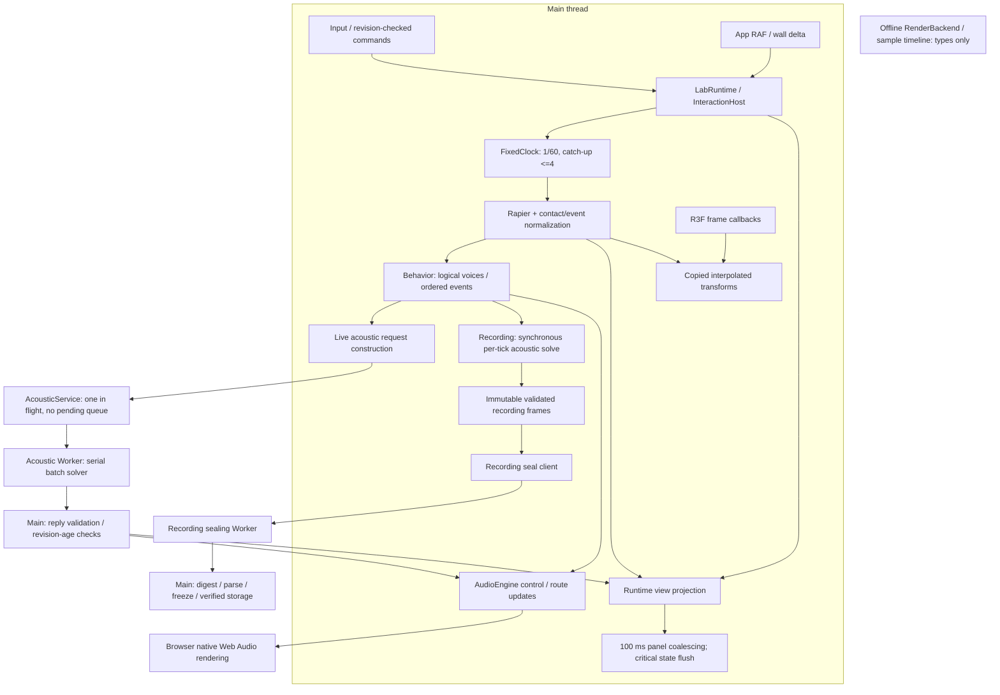

# 現行 Runtime 盤點

狀態：研究盤點；**CODE FACT** 只表示在指定 Git 版本讀到的程式行為，**HYPOTHESIS** 表示尚待量測的成本來源，**PROPOSED** 表示尚未採納或實作的變更。本輪沒有修改產品、建立新 clock、執行產品測試或宣稱性能通過。

基準：`05d40fd2d52f4b737f6acac61fa00356403c0038`（Claude 開發線），不是舊工作區 `a5f2a909`。下列程式路徑及行號均針對此基準；工作區後續 dirty R21、舊研究分支及公開 snapshot 的結果不得混入。此頁未採用 dirty R21 補充資料。正式需求／目標仍以[驗收](../11-v1/ACCEPTANCE.md)、[補充](../11-v1/ACCEPTANCE_AMENDMENTS.md)、[效能預算](../06-validation/PERFORMANCE_BUDGET.md)為準；本研究不恢復或結案原產品 goal。

## PERF-RT-001：執行緒與依賴圖

現行主執行緒同時負責 RAF 推進、Rapier、behavior、聲學請求組裝、音訊控制、錄製逐 tick evaluation 與 view projection。Native Web Audio 處理聲音，普通 live acoustic solve 在 module Worker；錄製封存另有 Worker。這些是不同執行環境，並非每項 subsystem 都有專屬 thread。R3F 的獨立 reconciler 不代表獨立 CPU 執行緒。[bootstrap](../../src/app/bootstrap.ts) L280、315–327；[runtime](../../src/app/runtime.ts) L774–838、935–978、1894–1903。

圖中的箭頭表示資料或呼叫依賴，沒有宣稱同時執行、無 copy 或硬體 real-time deadline。recording solve 與 live Worker 是兩條不同路徑；封存 Worker 不會自動移走 capture 階段的同步 solver。

## PERF-RT-002：逐模組排程、queue 與過載矩陣

以下「上限」是程式／契約上限，全部不等於測得容量。完整七時鐘對照見[Clock Review](CLOCK_AND_SCHEDULING_REVIEW.md)，聲學狀態機見[Acoustic Worker Review](ACOUSTIC_WORKER_REVIEW.md)。

| 模組／基準位置 | Thread／clock／觸發率 | Queue／backpressure／overload |
| --- | --- | --- |
| `app/bootstrap.ts:37,242,315` | main；RAF timestamp 計 delta；panel 100 ms | 一個 pending latest view；critical 狀態及一般命令可提早 flush；不累積 panel snapshots |
| `ui/viewport/SceneEntities.tsx:98`、`CameraRig.tsx:130` | main R3F render frame；各自 useFrame | 讀 controller pose／camera；不是另一套 physics step queue |
| `app/runtime.ts:774,821,830` | main；app wall-delta accumulator、physics callback、live solve ≥50 ms、view 逢 tick 或 ≥100 ms | live 忙時略過該次取樣；replay 最多每 RAF 4 frames，保留 replay accumulator；transaction busy 拒絕一般並行命令 |
| `physics/fixed-clock.ts:91` | caller thread；固定 dt 預設 1/60 | 預設 catch-up 4；interactive 丟整數步牆鐘積欠但不跳 logical tick；recording 保留欠帳並 pause |
| `physics/physics-world.ts:321,603,1176` | main；每 fixed tick | own pending events 2048、command dedup IDs 4096，超限顯式失敗；Rapier EventQueue 每 step drain，沒有量測其內部容量 |
| `app/physics-behavior.ts:55` | main；步後 snapshot → behavior frame | 無非同步 queue；只映射已接受的 interaction／physics／state 離散事件，不由速度猜 Throw／Impact |
| `audio-behavior/index.ts:184,493,632` | main；以 physics tick 評估，不自設 timer | runtime 指定 16 logical voices、每物件 8；frame ≤1024 objects／4096 events；dedup/cooldown/lifetime 有界；拒絕保留原因 |
| `app/acoustic-input.ts:39` | main；每次 live request／capture solve／重評 | ≤16 explicit sources／256 poses；完整表面超 budget 拒絕，並非偷偷裁掉物體 |
| `app/acoustic-service.ts:415` | main control；一批 promise | 一個 in-flight，沒有 waiting batch；busy 回 SOLVER_BUSY；≤32 sources、256 total requested paths、2 MiB；timeout ≤5 s，取消 terminate |
| `app/acoustic-worker.ts:10` | module Worker；每 message | 一個同步 handler，sources 依 map 次序逐一 solve；沒有 pool、yield 或內部 cancel polling |
| `acoustics/solver.ts:220,417`、`geometry.ts:50` | 呼叫者環境；live 在 Worker，capture／部分重評在 main | 明示 surfaces／paths／segment-test／propagation budgets；visibility 不完整時 fail closed 並標 budgetExceeded；不是 deadline scheduler |
| `audio/engine.ts:206,778,1048`、`audio/control.ts:3` | main 控制；AudioContext epoch；DSP 為 browser native render | native voices／emitters／paths／pending arrivals／decoded bytes 各有 budget；logical admission 與 native admission 是不同決策 |
| `app/recording-host.ts:79,116,264` | main；tick append、明確 finalize/replay/A-B command | 一個 pending host operation；B 重評每 32 processed frames 才 task yield；不是逐 tick capture background queue |
| `experiments/recorder.ts:468`、`hash.ts:80` | main capture；recorded tick timeline | 逐 frame 驗證、canonical clone/freeze、byte accounting；frame/bytes/event 上限限制錄製長度，超限中斷，不把部分 run 標 captured |
| `experiments/recording-worker-client.ts:17` | main client + 專用 seal Worker | 一個封存 job，timeout ≤120 s；成功後 Worker terminate；主緒仍有 send、digest、decode/parse/freeze |
| `app/runtime.ts:1262,1734` | main；AI／作者動作非週期，非音訊 clock | command transaction busy gate；安全輸入及 cancel／blur 等走較早分支；工具另有 serial quota/timeout，不阻塞 audio callback 等待 AI |
| `audio/render-contract.ts:28` | **types only**；planned integer sample timeline | 無實作 RenderBackend；job/output budgets 是型別契約，不能計為現有 renderer 或 throughput |

## PERF-RT-003：所有權、copy／GC、順序與 telemetry 矩陣

| 模組群 | 現行 copy／allocation／可能 blocking（CODE FACT） | 順序／一致性 | 既有 telemetry／缺口 |
| --- | --- | --- | --- |
| bootstrap／R3F／runtime | latest view 參照合併；runtime 仍建立 objects/paths/rules 等動態投影；getPose cache 同一 latest snapshot＋alpha，回傳 copied pose | app RAF 與 R3F 回呼的相對先後不作 correctness 保證；render 只讀插值資料 | panel publication policy 可查；無完整逐段 p95/p99 成本 |
| FixedClock／PhysicsWorld | pre-step history／COM/v/ω map、步後 poses/events copied DTO；snapshot 讀取不是零 allocation；grab/placement 有同步 shape queries | 先控制、pre-cache、Rapier step、contact drain/aggregation、motion edges、events stamp；tick=n+1 表示步後，不是 CCD 精確發生時刻 | droppedWallTime、overrun、accumulator、tick；無內建分段 physics histogram |
| physics-behavior／behavior | contacts copied；每 step rollback state/metadata/cursor clone、結果與 trace clone | input tick/sequence/eventId 排序及 dedup；continuous/latch lifetimes 由 logical tick，native onended 不決定 logical state | 有 bounded decisions/trace；無每階段 CPU/GC attribution |
| acoustic-input | 每 call 驗證 scene；call-local box cache；後續 source clone faces；每 source clone material/atmosphere；沒有跨 tick geometry cache | sources／objects 按 stable ID；source owner faces 排除；moving objects 是 snapshot occluder | 無 request-build 時間、cache reuse bytes、allocation counters |
| acoustic-service／worker | request preflight 遍歷＋JSON encode；postMessage 無 transfer list；reply known-shape validation＋JSON encode | transport pins scalar identity；reply 必須符合 batch/source/listener/revision/tick，單一 source error 使整批 reject | 128 timing samples、bytes、pending age、round-trip/compute/delivery p95、reject/cancel/timeout/restart；service timing 不涵蓋全鏈 |
| solver／geometry | 每 source prepare/copy/sort surfaces、material map；反射候選與 segment scan、path arrays/sort | stable path IDs 不含座標／rank；surface sorting 決定有 budget 時的穩定順序；只求有限一階 | segmentTests/candidates/droppedPathCount/budgetExceeded；非 CPU/memory timing |
| AudioEngine | JS 控制建立/更新 native graph、routing/filter/path state；native DSP 不在本專案 JS callback | emission time 經 epoch 映射；absolute delay 一次；舊 frame/revision 被拒；logical 與 native cleanup 分開 | voices/paths/pending/late/stale/bytes/device latency 等；不能推論 native DSP p99 或實耳 latency |
| capture／sealing | capture 同步 solver、immutable canonical parse/freeze；seal Worker 可移走部分重算，主緒 digest/parse/freeze 仍在 | 接納連續 tick 後才 seal；核驗 bytes/hash／identity後發布；失敗不發布部分成果 | recorder frame/event/bytes/state；seal timeout；完整 capture/serialization/GC 切段未量 |
| authoring／AI | candidate validation、world construction、asset decode／storage／network await 均不等同 background CPU | revision／generation 在 await 後重查；成功才 swap；cancel/stale 不套用舊成果 | host operation/run 狀態；不能當模型 live、多人容量或 audio deadline 證據 |

引用：[runtime](../../src/app/runtime.ts) L421–438、458–487、503–572、839–978、1034–1084、2060–2375；[physics](../../src/physics/physics-world.ts) L346–600、1176–1288；[behavior](../../src/audio-behavior/index.ts) L632–845；[input](../../src/app/acoustic-input.ts) L39–135；[service](../../src/app/acoustic-service.ts) L243–323、415–567。copy 的存在可由程式核對，GC pause 的頻率、耗時與真正 bottleneck 尚未量測。

## PERF-RT-004：優先研究的熱路徑

| Finding | 可確認事實 | 尚未證實的推論／需量測 |
| --- | --- | --- |
| PERF-RT-004A | capture 每 tick 同步求解，最多 4 個 catch-up callbacks 可在同 RAF 連續執行 | 可能放大 frame tail；需分離 physics-only／behavior／record-evaluation／append 的 wall CPU 與 GC，不能直接宣稱 solver 佔最大 |
| PERF-RT-004B | live Worker 前仍有 scene/geometry build、clone、bounds walk、JSON encoding；後有 validate/audio/view consumers | Worker compute p95 達標仍可能主緒超標；需端到端 stage trace |
| PERF-RT-004C | maxPaths 在候選生成後排序截斷 | 降 paths 可能主要省 delivery/native graph，不能保證同比省 solver work；需 surface/source/path 矩陣 |
| PERF-RT-004D | panel coalescing 和 authoring projection cache 已存在 | 後續變更須證明改善剩餘 dynamic projection；不能以「加入節流」描述尚未定位的問題 |
| PERF-RT-004E | fixed step、snapshot observer、capture callback 在同一 call stack | 搬 physics Worker 會同時牽涉 input/query/grab/build/revision/lifecycle；先比較只移 recording evaluation 的較小邊界 |

## PERF-RT-005：研究後才能決定的選項

第一個候選 spike 應比較現狀與「有界、immutable、保序的 recording-evaluation lane」；不先改正式產品。每個已接受 tick 都必須有 evaluation/record commit 或明確 fail/interrupted，滿載採 producer pause，不以 latest-only overwrite 遺失實驗 tick。與主緒 physics 共存時需訂出 watermark、stop/finalize drain、失敗復原與 source cursor 契約。更完整選項見[Recording Review](RECORDING_AND_RENDERING_REVIEW.md)。

Physics Worker、跨 tick geometry cache、typed transferable pool、triple buffering 或 SAB 都是 **PROPOSED**。選擇依[Measurement Plan](MEASUREMENT_PLAN.md)的分段成本與等價證據，而非「thread 越多越快」。WHATWG 將 Worker 視為獨立 agent／event loop，並提示建立成本；移走 CPU 不消除 send/receive/validation。[HTML Workers](https://html.spec.whatwg.org/multipage/workers.html)、[HTML Event loops](https://html.spec.whatwg.org/multipage/webappapis.html#event-loops)（2026-11-01 查閱；Living Standard 2026-10-30 版本）。

驗收不得放寬：interactive wall-time drop、recording pause/debt、source/voice/path 各層 caps、finite paths 的科學限制、唯一 propagation delay、穩定 path IDs、原錄製／A-B fingerprints、authoring atomicity／undo 都必須保留。[ADR-015](../02-architecture/adr/015-client-first-and-render-contract.md) 是既有 accepted 邊界；本頁沒有採納新 ADR。

## 證據界線

本頁是指定版本的靜態盤點，不產生測得容量或新的 PASS。既有 R17 性能負面結果及真人／裝置限制仍按[Performance Budget](../06-validation/PERFORMANCE_BUDGET.md)、[Browser Performance](../11-v1/BROWSER_PERFORMANCE.md)保存。目標原文只在正式預算維護；本頁不另建數值權威。不把旧文件的歷史「未實作」段落當作現行 src 全未實作，也不把單一 functional Worker fixture 成功當作整體性能通過。
