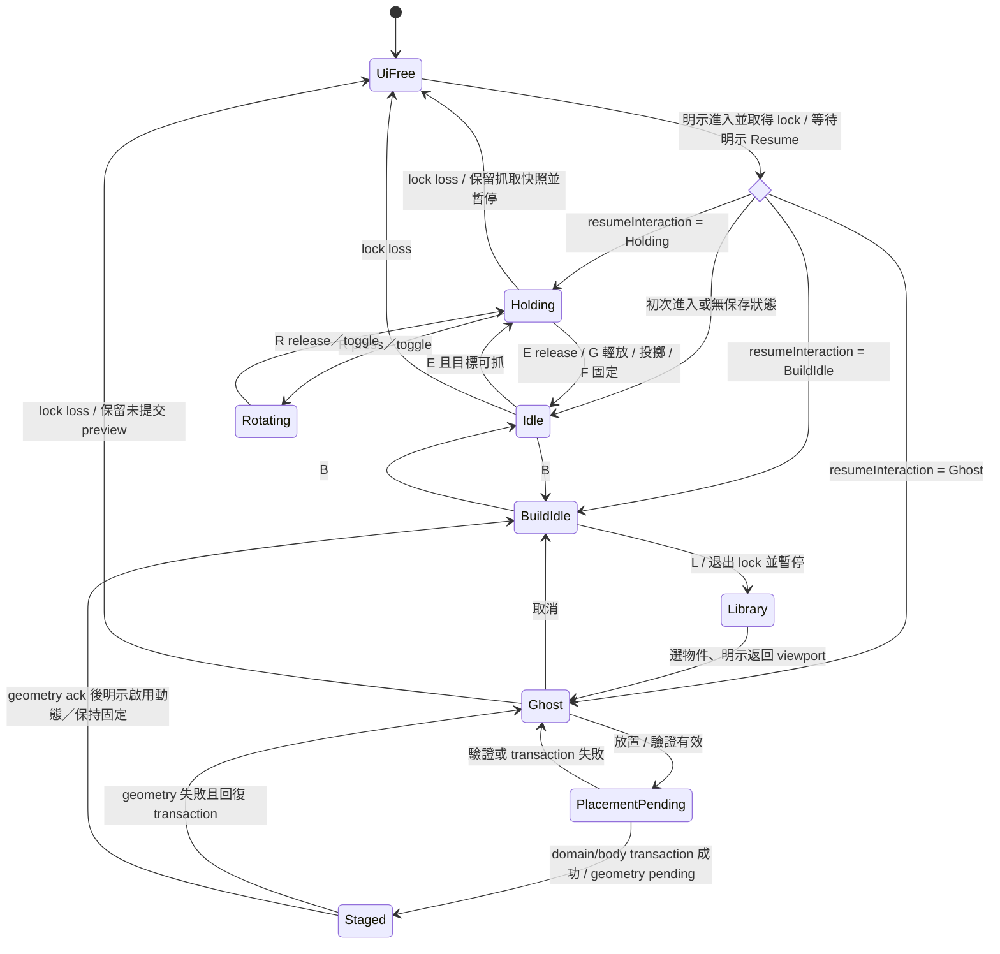

<!-- english-source: {"path":"docs/05-ux/FPS_INTERACTION_UX.md","sha256":"806e8aa0cd44e0e6b19bd1d351ebe66088d6b404548f2cc17e16ca5c690809ef","translated_at":"2026-10-27T03:39:33.9614646Z","executor":"Codex","model_id":null,"links":"english-relative"} -->
<!-- english-notice:start -->
> English translation of [`docs/05-ux/FPS_INTERACTION_UX.md`](../../05-ux/FPS_INTERACTION_UX.md). Source SHA-256: `806e8aa0cd44e0e6b19bd1d351ebe66088d6b404548f2cc17e16ca5c690809ef`. Executor: Codex; model ID unavailable. Translation is not new implementation or validation evidence. Canonical sources and shared task/contract/result files retain their authority. Verbatim technical examples may retain their original language.
<!-- english-notice:end -->

<!-- english-original-anchor --> 
# First-Person Interaction and Build UX

Review date: 2026-10-26. Status: **design proposal ready for engineering handoff; not implemented / no user testing performed**. For Workspace and computation separation, see [WORKSPACE_ARCHITECTURE.md](WORKSPACE_ARCHITECTURE.md). Values such as distances, speeds, and safety limits are defined by the physics Domain Schema. The HUD reads the valid ranges and must not invent different limits.

<!-- english-original-anchor --> 
## Entry, Focus, and Exit

Entering FPS must be triggered by a visible “Enter First Person” button or an explicit viewport action. First show the current key bindings and “Esc releases the mouse,” then request pointer lock; **the pointerdown/click used to acquire the lock must not trigger a throw, placement, or force**. Actions are allowed only after a success event has been received and a new input occurs after that button has been released. On failure, retain the free camera and unlocked interaction options, and show an error without repeatedly requesting lock.

Esc gives priority to the browser's default unlock behavior; do not trap the user with preventDefault. `pointerlockchange`, `pointerlockerror`, and window blur / visibilitychange are authoritative events. On lock loss, immediately clear held keyboard/mouse states, cancel uncommitted throw force, and pause at the next fixed tick. Preserve the last valid held-object or ghost state and display “Paused: mouse released.” Resuming requires an explicit click; do not resume automatically on the next mouse movement.

When interacting with UI, text fields, editable content, or IME composition, all `WASD/E/G/R/F/B` input belongs to the UI; do not send game commands during `event.isComposing` / compositionstart. Exit lock before opening a dialog, then move focus into the dialog; closing it returns focus to its trigger button. Tab cycles normally within a modal. Esc closes the topmost window without also discarding an object. The same Esc event that exits lock must not perform a second destructive action.

Basis: [W3C Pointer Lock 2.0](https://www.w3.org/TR/pointerlock-2/) (2026-02-25 draft; testing in each browser is required), [WAI-ARIA Modal Dialog](https://www.w3.org/WAI/ARIA/apg/patterns/dialog-modal/). The safety pause above is a Reflection Lab design decision.

<!-- english-original-anchor --> 
## MVP Input Mapping

Key bindings can be reassigned; display the actual device / layout label. Store actions using stable action IDs. Movement may default to the physical positions represented by `KeyboardEvent.code`; other actions can be rebound. Do not assume every keyboard has the same labels. Validate key combinations, reserved keys, and duplicate bindings on the settings page; OS / browser reserved combinations must not be overridden. Handle held continuous actions separately from single edge-trigger actions.

| Action ID | Default (when the viewport owns input) | Available states and handling | Alternative interaction |
| --- | --- | --- | --- |
| `move` | WASD | Running and FPS; zero on release or focus loss | On-screen direction buttons / rebinding |
| `look` | Mouse | Lock acquired; rotating an object does not rotate the camera | Keyboard view steps, slow-turn buttons |
| `grabOrRelease` | E | Idle grabs a movable object; Holding removes the constraint and retains computable velocity | Object list + Grab / Release buttons |
| `placeDown` | G | Holding; find a usable contact point, validate, then lower at low speed; do nothing without valid support | Inspector “Place Gently”; without support, “Release” may be selected separately; never automatically convert to drop |
| `throw` | New left-button press | Holding + Running only; fixed adjustable impulse, no hold-to-charge in MVP | “Throw” button / rebinding; display the force value |
| `rotateHeld` | Hold R + Mouse | Holding; route input to rotation; release restores look | Toggle rotation mode, angle-step fields |
| `adjustDistance` | Wheel | Holding / Ghost; clamp to the valid distance and indicate limits | ± distance buttons / numeric field in meters |
| `toggleFixed` | F | Holding can fix the object and end grab; Hover over a fixed object can unfix it; the target must be clear | Inspector Fix / Unfix; display gravity consequences |
| `toggleBuild` | B | Enter / exit only in Idle; when Holding, first place gently / release / cancel the switch | HUD “Build” button |
| `openLibrary` | L | FPS Build; exit lock, safety pause, open Library | Visible Library button |
| `ghostRotate` | R toggle, keyboard steps | Ghost; a different context from Holding's R; do not mix them | Angle fields / rotation steps |
| `ghostPlace` | New left-button press | Ghost-valid; invoke the validation transaction | “Place” button |
| `ghostCancel` | Right button | Ghost; cancel the preview only | “Cancel Preview” button |
| `releasePointer` | Esc | Any locked FPS state; the browser unlocks | Show exit instructions and a visible “Leave First Person” control |
| `focusNext` | Tab / Shift+Tab | **Reserve for standard focus navigation, not Build toggle**; if still locked, unlock and safety pause first | Must not be intercepted globally |

Space to jump, Ctrl to crouch, and the force toolbar are P2 and unassigned in MVP, avoiding confusion with button activation, browser functions, and throwing a held object. Ctrl/Cmd+K is only an optional Command Palette shortcut; retain a visible button and allow rebinding. Never intercept combinations such as Ctrl/Cmd+L/T/W/R or Alt+F4. Globally visible Mute does not depend on lock or game shortcuts; when unlocked, M may mute the monitor, but text fields retain normal typing.

Input arbitration priority: OS / browser → Modal → IME / text field → standard UI focus → FPS active action → viewport observation controls. Use `keydown` edges / `keyup` state; do not let `repeat` repeatedly fix, create, or throw. Prevent Wheel scrolling only when the viewport explicitly owns input. Intercept the context menu for right-click cancellation only in locked Ghost; the UI retains its standard menu.

<!-- english-original-anchor --> 
## Interaction state machine

`UiFree` additionally records `resumeInteraction`; the return state must not be lost. Repeated input during Pending must not create duplicates; deduplicate by command ID. After success, starting a new ghost requires explicit “Continue Placing” or duplicate; do not automatically generate objects in bulk.

<!-- english-original-anchor --> 
## Grab Feedback and Physics Semantics

- The crosshair is a minimal center marker; hover uses an outline + name to indicate grabbable, too heavy, fixed, out of range, and other reasons. Outlines must not rely on color alone.
- Holding displays the name, mass, actual distance / requested distance, rigid-body mode, and constraint state. When an object is blocked by a wall, display “Blocked” and the actual distance; the HUD must not pretend that the object has reached the anchor.
- The camera controls only the physics anchor target. Grabbed bodies retain collision and inertia; do not parent a body to the camera. Safely release and record an event if the constraint breaks / becomes unstable; implementation parameters are defined by the physics specification.
- E “Release” retains computable velocity, G “Place Gently” limits velocity on a valid supporting surface, and Throw applies an explicit impulse. These three actions must not all directly set the same transform / velocity.
- Fixing changes the body to a permitted fixed mode and releases grab; before unfixing, the HUD explicitly shows the gravity mode. Fixed does not mean “sound source stopped”; continuous sound and impact emitters remain independent.
- Collision sound events display contact position, time, intensity, and source ID; do not treat contact on every frame as a new impact. Event feedback remains visible when silent / muted.

<!-- english-original-anchor --> 
## First-Person Build: Three-Stage Object Lifecycle

| Stage | Visuals | Domain / physics / acoustics | Success / failure |
| --- | --- | --- | --- |
| `ghost` | Translucent outline, dimensions, surface normal, grid, valid / invalid icons and reasons | Temporary draft only; no sound source, no collision, no experiment object | Raycast miss, overlap with the player, and out-of-range positions all prevent placement |
| `staged` | Solid outline + “Awaiting Activation” label | A Document object with a stable ID has been created, temporarily fixed / kinematic with dynamic disabled; simulation paused; acoustic rebuild pending | Activation requires geometry / validation ack; on failure, roll back the transaction or retain a correctable staged object |
| `active` | Normal material, RigidBody / sound-source state icons | Enable the selected dynamic/no-gravity/fixed mode; synchronize acoustic geometry supported by the capability | Explicit Resume; creation / activation events enter the trace |

MVP uses “safety pause after placement confirmation, atomic commit, and user choice to activate immediately or keep fixed”; it does not guarantee that arbitrary dynamic reflection geometry is immediately available while Running. Ghost supports distance, angle, grid step, and surface alignment adjustments. Collision validation includes objects, the player, and room boundaries; visibility does not imply that placement is allowed. Provide text and shapes in addition to red / green. Duplicate creates a new draft and ID without copying the current playback position or backend handle; retaining the same asset reference is allowed.

<!-- english-original-anchor --> 
## HUD Hierarchy and Accessibility

Always visible: simulation state, crosshair, one contextual hint, and Mute / monitor state. Add distance, rotation, and placement information only during Holding / Ghost; debug paths, FPS, tick, and collision boxes are off by default. Library / Inspector takes back FPS input when opened. Hints use actual rebound keys rather than stale fixed E or B labels.

Provide an **assisted interaction mode** without mouse lock: select through Scene Explorer; move Listener and objects with buttons / numeric fields; replay preset trajectories; and provide explicit Grab / Release / Throw / Build buttons. Keyboard camera steps support slow movement and view reset; disable head bob / camera shake, reduce view acceleration, and support reduced motion. Holding R has a toggle alternative. These are functional requirements whose completion has not been verified; do not claim that a 3D canvas is automatically accessible.

<!-- english-original-anchor --> 
## Acceptance Scenarios (NOT RUN)

<!-- english-original-anchor --> 
### Failure and Recovery Matrix (Phase 2 Supplement; All NOT RUN)

| Trigger / scenario | Immediate feedback and state | Recovery steps / prohibited side effects |
| --- | --- | --- |
| Visible object is beyond grab range | Display distance and grab range beside the crosshair; E does not send grab | Move closer or adjust position with unlocked controls; do not clamp and pull it directly to the camera |
| Target is behind another object / wall | Visibility check fails; show a blocking icon and reason | Move to a visible direction; a visible outline must not permit grabbing through a wall |
| Held body is blocked by a wall / leaves the allowed distance | Show requested / actual distance and constraint state; do not pretend it has reached the target | Apply finite impulse and safe release according to the physics specification; retain events; no teleporting / adding infinite force |
| Switch from Holding to Build or Workspace | Show Place Gently / Release / Cancel Switch, or the existing safety-pause guard | Preserve object ID and resumeInteraction; canceling the switch maintains Holding without a hidden throw |
| Open Settings / Inspector / Palette | Exit lock, clear game keys, safety pause; transfer focus to UI | Return focus to the trigger on close; explicitly reacquire lock + Resume; that click must not throw |
| Press E/W/R during Inspector composition, text Undo, or a modal | inputOwner=UI; IME / native editing takes priority | Send no physics command; do not replay previous keydown after composition ends |
| Exit Simulation / Esc / blur | Pause at the next safe tick; preserve held/ghost and listener binding snapshots | On return, revalidate object existence, revision, range, and capabilities; if invalid, display the reason and return to Idle; do not apply an old handle |
| Browser audio permission not yet enabled / device lost | MonitorStrip shows blocked/error; Muted and source stopped remain separate | Enable through a user gesture or choose a device; no repeated automatic resume or replay of accumulated impacts |
| Simulation Pause | Display Freeze-and-fade, pause cause, and tail truncation | Re-anchor the audio epoch after explicit Resume; schedule only events that have not yet arrived; see Workspace; do not use CSS timing |
| Switch Fixed / NoGravity / Dynamic | HUD displays the effective rigid-body mode and gravity consequences | NoGravity is still dynamic; fixed objects do not respond to force; reject noncompliant transitions and retain the original mode |
| Ghost snapping / collision validation fails | Display surface normal / snap position / invalid reason and icon | Change angle or distance, or cancel; create no domain object and play no placement impact |
| Player / object overlap, or camera/listener temporarily out of sync | Retain the last valid physics position; display binding / current tick | Revalidate collision and the Listener follow source; observer camera may be independent, but do not silently change the experiment listener |
| Staged geometry ack times out or solver fails | Awaiting activation / error; preserve revision and a recovery entry point | Deduplicated retry or transaction rollback; do not show Active or leave a partially created ID |

The matrix defines only UI states and recovery; physics correctness at wall corners, thin walls, high speeds, and mode transitions still requires validation against [FPS_INTERACTION_SPEC.md](../04-physics/FPS_INTERACTION_SPEC.md). Audio requires DSP / browser tests. For shared stress cases and evidence format, see [UI_STRESS_TESTS.md](UI_STRESS_TESTS.md).

1. The click that first acquires lock does not throw a held object; the click that closes Library does not place an object.
2. WASD / E does not move or grab while entering a Chinese name; incomplete IME composition does not submit.
3. After pressing W and switching to another window, returning leaves the simulation paused, with key state zeroed and no reuse of the old keydown.
4. Tab can move from the viewport to visible controls, and Esc can exit; closing a dialog restores reasonable focus without automatically locking.
5. Switching from Holding to Build does not silently put down the object; each confirmation of an invalid Ghost gives a reason and creates no object ID.
6. Repeated clicks before placement succeeds create only one object; backend failure leaves no apparently active phantom.
7. Grabbing behind a wall must not forcibly pull an object through the wall; switching Fixed/Dynamic does not stop a continuous source; Pause separately follows Workspace's Freeze-and-fade.
8. Without mouse lock, the user can select objects, adjust parameters, throw along a prescribed trajectory, capture results, and perform A/B.
9. Pressing Esc during Holding / Ghost and reacquiring lock preserves the same object/draft and valid distance; physics resumes only after explicit Resume, without another throw, creation, or loss of selection.
