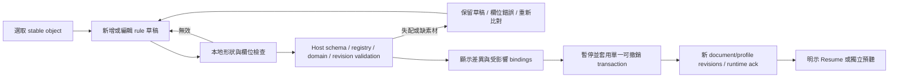

<!-- english-source: {"path":"docs/05-ux/SOUND_BEHAVIOR_UX.md","sha256":"24d1fd048ba7aae166e5dce5b0041e91089c23a80bec984f45306767bceec821","translated_at":"2026-10-27T03:39:33Z","executor":"Codex","model_id":null,"links":"english-relative"} -->
<!-- english-notice:start -->
> English translation of [`docs/05-ux/SOUND_BEHAVIOR_UX.md`](../../05-ux/SOUND_BEHAVIOR_UX.md). Source SHA-256: `24d1fd048ba7aae166e5dce5b0041e91089c23a80bec984f45306767bceec821`. Executor: Codex; model ID unavailable. Translation is not new implementation or validation evidence. Canonical sources and shared task/contract/result files retain their authority. Verbatim technical examples may retain their original language.
<!-- english-notice:end -->

<!-- english-original-anchor --> <a id="sound-behaviorinspector預聽與實驗檢查"></a>
# Sound Behavior: Inspector, Audition, and Experiment Checks

Date: 2026-10-27 (Asia/Taipei). Status: **design proposal / static research; formal UI, user testing, browser, audio, and performance acceptance are all NOT RUN**. This page defines editing and inspection workflows; it is not a new authority for runtime, tokens, or data schemas.

The user requested Codex as the primary developer for this work, with Muse Code as an optional tool; the product's Meta Muse Agent must still use the same validated editing workflow. Manual operation does not depend on API access or model quota. This page does not install a UI library or begin formal interface implementation.

<!-- english-original-anchor --> <a id="1-設計建議與既有工作區"></a>
## 1. Design Recommendation and Existing Workspace

**Use an Event Rules Inspector for P0; provide physics state through a separate state machine; leave the Node Graph for P2.** The first version should let users understand “when → what sound is emitted → how parameters change → where it propagates from” without first understanding a signal graph. This is an engineering recommendation based on this project's requirements and current state; no comparative user testing has established that it is necessarily easier to use.

Reuse the [Workspace](WORKSPACE_ARCHITECTURE.md) Scene / Simulation / Analysis views, right-side Context Inspector, left-side Audio Asset Library, lower Event Timeline, and persistent MonitorStrip. Add “Sound Behaviors” inside an object's “Sound” section by extending the existing `SoundEmitterInspector`; do not create another sound-editing workspace. Switching Workspace, collapsing sections, or changing selection must not reset the run, source playhead, or recording.

| View | Main content | Data that must not be conflated |
| --- | --- | --- |
| Scene / Sound Behaviors | Bound profiles, rule cards, assets / mappings / emitters, drafts and Apply | Author settings are not the current physics state; do not save runtime velocity as an initial value |
| Simulation | Summary of enabled rules, active continuous instances, recent events and suppression reasons | A configuration being enabled does not mean it is playing; monitor muted does not mean the source has stopped |
| Analysis / Event Inspector | Fixed run, event, profile / asset revision, playback parameters, contact / emitter, acoustic result reference | A past run's profile must not be rewritten with the current Inspector; do not fabricate missing paths / metrics |

Visual values, the seven states, async states, and motion follow the [Design System](DESIGN_SYSTEM.md), [canonical tokens](../../05-ux/DESIGN_TOKENS.json), [Component Spec](COMPONENT_SPEC.md), [state matrix](../../05-ux/COMPONENT_STATES.json), and [Motion](MOTION_GUIDELINES.md), respectively. This page does not duplicate color codes, spacing, voice caps, or animation durations. See [EMIL_SKILLS](EMIL_SKILLS.md) for use of the pinned Emil version; high-frequency numbers, selection, and keyboard operations update directly, without delaying input for decorative animation.

<!-- english-original-anchor --> <a id="2-最小-inspector-資訊架構"></a>
## 2. Minimal Inspector Information Architecture

The top always displays the object name / stable object ID, authoring or runtime target, Scene revision, Sound Behavior document revision, and each bound profile's ID / revision. `document.revision`, `profile.revision`, Scene revision, and run/tick are different versions; do not merge them into one “synchronized” state. The [Behavior Schema](../10-sound-behaviors/BEHAVIOR_SCHEMA.md) governs actual JSON fields and enums; the following is its UI projection.

```text
選取物件 → 聲音 → 發聲行為
  Profile / revision / presetKind / 綁定啟用
  [新增行為] [套用 Preset] [保存為新 Preset]
  Rule：何時 / enabled / 目前狀態或抑制原因
    Trigger + Conditions
    Generator：Sample / Oscillator；素材 registry reference
    Playback / Layers：loop、one-shot、layer group
    Parameters：gain、pitch、mapping curve、fade
    Emitter：object / contact / zone / fixed
    Runtime 摘要：instance、voice admission、result freshness
  草稿錯誤 / 受影響物件 / [取消草稿] [套用]
  [素材乾音預聽] [場景聲學預聽] [停止預聽]
```

The P0 entry points offer only implemented and accepted Always On, On Grab, On Throw, While Airborne, On Impact, and required parameters. Other continuous / discrete triggers are shown as unsupported, with reasons, according to the registry and feature phase; an enum existing in the schema does not make it available in the product. Do not infer the `While Airborne` runtime state from “velocity greater than zero”; `On Throw` can only arise from an accepted throw command. See the [Event Model](../10-sound-behaviors/EVENT_MODEL.md) for the source of these determinations.

| Area | Editing behavior | Required feedback |
| --- | --- | --- |
| Trigger / Conditions | Separate “continuous state” from “one-time event”; list only legal conditions and their dimensions | If changing the trigger invalidates a mapping, list conflicts and retain the original draft; do not silently substitute another quantity |
| Sample / Oscillator | Choose an asset that actually exists in the registry with a pinned version, or permitted oscillator parameters | Show asset ID / revision / hash, decoding status, and rights status; do not create a fake preview for a nonexistent asset |
| Playback / Layer | Generator / trigger contracts constrain loop and one-shot; explicitly identify layer groups that can play simultaneously | Keep continuous and impact groups visible; adding an impact rule does not replace the Always On instance |
| Gain / Pitch / Curve | Provide both numeric input and dragging; a curve also has a point table editable by keyboard | Label axes with the input metric / SI unit and explicit output definitions such as gainLinear / pitchSemitones; show clamp and smoothing, without presenting smoothing as a physics result |
| Emitter | Offer legal attachment and position sources according to the trigger | For impact, show a contact marker / event reference rather than always using the object center; when unavailable, disable it or show the reason, without fabricating a position |
| Cooldown / Priority / Limit | Read ranges and limits directly from the domain schema / effective run policy | Show configured values and current admitted / suppressed status; the UI does not independently decide a voice cap or silently change experiment parameters |

The physical / creative / hybrid / procedural values of `presetKind` describe sound design, not material credibility. A Physical preset may be a material-pair sample; do not describe it as solved object vibration. A Creative piano sound also passes through spatial propagation. Whether asset rights have been checked, material Measured / Derived / Tuned / Synthetic, and result Measured / Computed / Estimated are separate labels; do not combine them into one “trusted” badge. Every dB display must include a reference; a digital meter must not be labeled dB SPL.

Creative pitch is a sound-generation parameter; Doppler is a separate effect of the propagation / renderer model. The Inspector labels them separately and does not use the same slider to apply Doppler again when a changing delay already produces it. UI copy can be translated, but saving and selection use the schema's stable trigger / rule IDs, not card order or displayed text.

Display gravity / body mode in PhysicsInspector, the propagation medium in Environment, and the generator and monitor mute in Sound Behavior separately. No Gravity does not mean vacuum; an unsupported propagation medium also does not cancel mechanical collision events. If a vacuum / coupling model is unimplemented, show “This propagation mode is unsupported” rather than fabricating a 0Pa measurement; asset dry audition must still be clearly labeled as outside the scene experiment.

Users' own audio files go through the separate “Import Sound” workflow in Audio Asset Library: check format, size / decoding, and source / usage-rights metadata first; assign the file to a rule only after creating a registry version with a hash. When decoding or rights checks have not passed, retain pending status / rejection reasons; do not let AI guess an asset ID to bypass checks. Importing also does not automatically publish the asset, upload it to a model, or change the object's physics / acoustic material.

<!-- english-original-anchor --> <a id="3-編輯套用與失敗復原"></a>
## 3. Editing, Apply, and Failure Recovery



Ordinary reversible edits do not show a confirmation for each field; “Apply” is the primary action after reviewing a diff. Text / numeric editing retains a local draft; Enter commits the field and Esc cancels that field; do not commit during IME composition. Combine a complete curve / slider drag into one authoring command; pointer cancel does not commit. Initial field checks do not replace host checks of registry, units, revision, and resources.

P0 profile / binding / generator changes apply in Ready or Paused. In Running / Recording, show the required impact; submit at a safe boundary only when the user chooses “Pause and Apply,” without rewriting a recorded run while editing. Pausing follows the existing Freeze-and-fade behavior and preserves the original trace and interrupted boundary. Independent monitor gain / Master Mute remain directly operable under their original contract; do not turn them into permanent changes to profile gain.

The host commits atomically with expected Scene / Behavior document / profile revisions; failures leave no partial rules or half an asset reference. Undo / Redo restores author settings and creates a legal new version, without reversing physics or re-emitting events that already occurred. If changing a clip cannot preserve the same playback offset, explicitly require a new audition / rendering rather than pretending the playhead is unchanged. Parameter updates / fades for continuous instances follow [Audio Runtime](../02-architecture/AUDIO_RUNTIME.md) scheduling; UI re-renders must not rebuild nodes.

When selecting another object, do not silently discard an uncommitted draft: retain the draft pinned to the original object ID and offer Apply / Discard / Return to Object. If the object has been deleted or its generation has changed, disable Apply, retain a copyable draft, and show the reason; do not edit a new object occupying the same list position.

<!-- english-original-anchor --> <a id="共用-preset-與物件覆寫"></a>
### Shared Presets and Object Overrides

An object can have multiple bindings; different objects can reference the same `profileId + profileRevision`. By default, edit explicitly permitted binding overrides or save as a new profile. If editing a shared preset is selected, first display the affected object list and count; do not silently change all objects through a single object's Inspector. After a profile update, other bindings do not automatically follow the latest version; the host must switch them through an explicit migration / batch transaction.

Object overrides offer only schema-permitted fields, such as gainLinear / pitchSemitones / enabled for a specified rule; do not allow freeform JSON patches, arbitrary JavaScript, or references to unknown fields. Show the distinction between “Inherited” and “Object Override,” and let each override revert to inheritance. P0 multi-selection first shows a common / mixed summary and per-object entry points; P1 adds domain-validated batch operations. Do not present the first object's value as the value for all objects.

<!-- english-original-anchor --> <a id="4-預聽聲源位置與聲學路由"></a>
## 4. Audition, Source Position, and Acoustic Routing

Every audition starts with an explicit button and user gesture; hovering must not automatically emit sound. Master Mute / monitor gain remain persistent; an initially blocked context, undecoded asset, or device failure each shows its cause and an actionable retry. Events and parameters can still be inspected in text / icons when the user has not enabled listening. P0 audition entry points are in Ready / Paused; Running / Recording must first pause through the safe workflow to avoid mixing with the original experiment.

| Audition / playback path | Purpose and fixed content | Recording and limits |
| --- | --- | --- |
| Asset dry audition | Independent UI audition of a selected asset / variant or generator, centered, without environment / HRTF | Explicitly label “Dry audio; not a scene experiment”; separate audition ID / playhead; generates no physics event and writes nothing to the original experiment / metrics. It is an asset-editing tool, not a fake 3D source bypassing Acoustic Core |
| Scene acoustic audition | An object / fixed contact event in a static snapshot generates an emitter through Custom Acoustic Core and the renderer | Show listener, scene / profile versions, position source, and enabled capabilities; separate audition epoch without changing the original run. Without a contact event, require a recorded event or a legal demonstration position; label demonstrations Synthetic, without falsely calling them measured impacts |
| Formal run / trace replay | Generate a source from the same normalized event / trajectory, asset revision / seed / playback parameters | Every formal emitter with a scene position must use the same propagation / spatialization path; preserve traceability from event → instance → emitter → acoustic result |

Scene Raw / Simulated follows only the [Component Spec monitoring contract](COMPONENT_SPEC.md#rawsimulated-monitoring-contract): identical emission and asset / seed / playhead; Raw is a centered dry bypass, and Simulated is propagation / spatialization under effective capabilities. Switching must not retrigger On Impact, reroll a variant, alter source gain, or cancel an undisclosed delay. If the same playhead cannot be maintained, disable seamless switching and explicitly render the same event for A/B instead.

A 3D emitter marker represents the source location, not a solver path; contact-point markers use the existing distinct vocabulary from object centers, listeners, and reflection paths. Only a real AcousticFrame can draw acoustic rays; an IR-only or stale backend shows limits / versions without decorative fake paths. The interface must show the HRTF / spatialization owner actually used; a behavior generator must not add an undisclosed second HRTF / distance attenuation stage.

<!-- english-original-anchor --> <a id="5-配置runtime-與非同步狀態"></a>
## 5. Configuration, Runtime, and Async States

A rule's `enabled`, trigger predicate, SoundInstance, voice admission, monitor, and solver freshness are orthogonal dimensions. At minimum, distinguish these reasons instead of labeling every “no sound heard” condition disabled:

| Situation | Text / behavior |
| --- | --- |
| No selection / no bindings | Show “Select an object” or an Add Behavior empty state; do not invent a default sample |
| Draft error / illegal trigger / curve | An inline error identifies the field, unit, and rejection reason; retain input and block Apply |
| Profile enabled but state unmet | Show “Waiting for Throw event” / “Currently not Airborne”; allow inspection of the determination's basis |
| Asset nonexistent / version mismatch / rights unchecked / decoding failed | Show separate reasons; retain the last legal configuration and offer reselection / retry, without automatically substituting an unknown sound effect |
| Suppressed by cooldown / voice limit | Show rule, event, and suppression reason; the event remains inspectable, rather than treating the collision as never having occurred |
| Continuous instance active / one-shot ended | Show active instance / ended separately; do not infer whether audio is output on the device from presence in a UI list |
| Monitor muted / context blocked | Explicitly show monitoring status, independently of simulation and recording; retry must not re-emit an old impact |
| Solver pending / stale / unsupported | Show result revision / age / missing capabilities; this is not “measured as 0” |
| API failure / insufficient quota | Preserve the AI draft and manual Inspector; close the live AI branch without clearing legal profiles or disabling manual editing |

These components inherit the canonical seven states and async states; they do not add another mutually exclusive enum. Error / stale / enabled states must not rely only on color or sound; they require readable text and necessary metadata disclosure.

<!-- english-original-anchor --> <a id="6-event-timelineab-與-muse-提案"></a>
## 6. Event Timeline, A/B, and Muse Proposals

The event table and Timeline share stable selection by `runId + eventId`; 3D contact markers, rule Inspector, instances, and results link consistently. Dense bursts may be aggregated in the view and expanded, without deleting original records. Detailed fields include physics tick / simulation time, event type, object / generation, material pair, contact position, available relative velocity / impulse and their definitions, profile / rule revision, asset / variant / seed, playback parameters, voice admission, emitter, acoustic result reference, and pause / epoch / gap markers. Emission time, propagation arrival, and DSP / device latency occupy separate columns; animation position is not an audio clock.

P1 A/B first Captures a fixed trajectory + normalized events, then selects different profiles / assets / mappings for separate renders; the view shows the sole variable and both revisions. “Throw it again” is not the same conditions, and rerunning Rapier is not bitwise reproduction. Changes to contact material, friction, or body mode must identify the differing physics conditions; do not conflate creative asset changes with changes to acoustic material coefficients. Preserve the original trace, audio, and results; Undo restores only current author settings.

Natural-language output from the product's Muse Agent first becomes legal structured operations, using the same validation / diff / Apply / Undo as manual editing. Preview clearly lists changed objects / bindings / rules, whether assets exist, and whether pausing and billing / computation gates are required; a model proposal does not directly create an audible instance. AI explanations and computed evidence appear separately; numbers link only to actual solver artifacts. See [Meta Sound Behavior Integration](../08-ai/MUSE_SOUND_BEHAVIOR_INTEGRATION.md).

<!-- english-original-anchor --> <a id="7-inspector-與-graph-的取捨"></a>
## 7. Inspector and Graph Tradeoffs

| Aspect | Inspector / Event Rules (P0) | Node Graph (P2) |
| --- | --- | --- |
| Suitable content | Events / states, assets, mapping, simple layering; forms show current results | Complex branching, combinations of parameters, visualized generator / envelope / mixer dependencies |
| Cost | Reuses the existing Inspector, asset picker, numeric fields, and command transaction | Additionally requires node/port typing, connection / cycle validation, compile, layout, zoom, keyboard connections, Undo / debugging |
| Beginner understanding | Directly answers “when, what sound, where from,” but still requires testing | A canvas may help explain dependencies or increase navigation cost; do not claim in advance that it is easier |
| Validation / traceability | Stable rule IDs and field errors can link directly to events | node ID / port ID / compile error must point back to a rule or protected IR; graph positions are not runtime semantics |
| Adoption in this work | Design proposal; UI not yet implemented | Research and unlocking conditions only; no library installation or copying commercial examples |

React Flow can be listed as a future P2 presentation-layer candidate: official documentation covers keyboard / screen-reader support, node data flow, and connection-cycle validation examples; the repository core uses MIT. This does not provide Reflection Lab's audio scheduling, domain validation, or real-time DSP; its data-flow example also must not enter an audio callback. Pin the exact version, React compatibility, and distribution license at adoption. It was not installed or performance-validated in this work, and Pro example rights were not conflated with the core MIT license. [Accessibility](https://reactflow.dev/learn/advanced-use/accessibility), [Computing flows](https://reactflow.dev/learn/advanced-use/computing-flows), [Cycle validation](https://reactflow.dev/examples/interaction/prevent-cycles), [core LICENSE](https://github.com/xyflow/xyflow/blob/main/LICENSE) (checked 2026-10-27).

Unlocking the Graph requires validated event/runtime behavior, measurable authoring difficulties, a fixed node/port whitelist, bounds, a cycle policy, bounded compilation, error references, and transaction tests. The first control/event graph uses a verifiable DAG; audio feedback remains unavailable without a dedicated delay and stability contract. Do not allow arbitrary JavaScript, direct ownership of WebAudio nodes, or running the audio clock through React canvas updates. If Inspector / Graph cannot convert losslessly, show unsupported status rather than silently losing conditions.

<!-- english-original-anchor --> <a id="8-可及性fps-仲裁與壓力案例"></a>
## 8. Accessibility, FPS Arbitration, and Stress Cases

Follow [InputRouter](../04-physics/INPUT_CONTROLS.md) and [FPS UX](FPS_INTERACTION_UX.md): release pointer lock before opening Inspector / asset picker, pause on a safe tick, and retain Held / ghost; return focus to the original control after closing, without automatically relocking or dropping. Tab remains reserved for focus; text and IME own WASD / E / R / Delete / Undo; the first lock click does not also Throw. Esc handles only the top layer / browser exit; it must not simultaneously delete a rule or release an object.

Rule cards prioritize native button / select / number input; icons have accessible names. Dragging curve points has point-table and numeric alternatives; the asset menu is fully keyboard-operable. Enter / Space acts only on the focused control; a focus change does not automatically audition. Deleting a rule supports Undo; Delete in a text box does not delete an object. Selection / value updates / keyboard feedback are immediate; Reduced Motion removes unnecessary movement without changing fades or physics / audio timing. Important states may use restrained announcements, without reporting voices or meters every tick.

Stress follows the [existing matrix](UI_STRESS_TESTS.md) and [measurement standards](PERFORMANCE_STANDARDS.md): long Traditional Chinese asset names, identical names with different IDs, the maximum legal rules / bindings and one entry over the limit, missingasset, burst events, voice stealing, slowdecode, solverstale, API failure, rapid selection changes, 200%zoom, keyboard-only, IME, pointerlock loss, and Pause/Resume. Runtime lists can be virtualized and the timeline aggregated in the view, without reducing the original event ledger; degraded counts / suppression reasons remain visible, and Mute / Pause are always reachable. Read quantity and performance thresholds only from the schema and formal budgets; do not extrapolate capacity guarantees from this research.

<!-- english-original-anchor --> <a id="9-實作後驗收計畫"></a>
## 9. Post-Implementation Acceptance Plan

| Case | Operation and inspectable expectation | Evidence | This work |
| --- | --- | --- | --- |
| SB-UX-01 | Create Always On + On Throw + On Impact rules; IDs and bindings remain unchanged after selection / sorting, and impact does not restart continuous | command / instance / event trace + screen | NOT RUN |
| SB-UX-02 | Curve drag, IME input, and cancel; a legal commit creates one Undo entry; illegal / NaN / out-of-bounds input retains the draft and leaves the original configuration unchanged | schema/domain negative cases, Undo diff, focus trace | NOT RUN |
| SB-UX-03 | Missing / old-version / rights-unchecked asset, then correct and Apply; no fake asset or silent substitution | registry result, atomic revision, error recovery | NOT RUN |
| SB-UX-04 | Two objects share a profile; default override does not change the other object; shared update shows an impact list and Undo restores atomically | binding/profile revisions and diff | NOT RUN |
| SB-UX-05 | Dry / scene audition / Raw-Simulated; explicit route, same event/seed/playhead, correct contact position, no double HRTF; audition stays out of the experiment | audio graph, event/arrival trace, DSP / device inspection | NOT RUN |
| SB-UX-06 | Edit during Recording, Pause/Resume, and Undo; tail truncation has a marker, a new profile does not rewrite an old run, and an already-heard event is not re-emitted | run/epoch/profile versions, recording and audio evidence | NOT RUN |
| SB-UX-07 | Profile A/B with fixed trajectory/events; sole variable and incompatible conditions are identifiable, without treating resimulation as identical conditions | captured hashes, A/Bmanifest, and playback record | NOT RUN |
| SB-UX-08 | Model proposes legal / illegal operations and API fails; users can inspect the diff before Apply, manual editing remains available, and there are no fabricated metrics | hosttool validation / audit + manual workflow | NOT RUN |
| SB-UX-09 | Open Inspector while holding an object, use IME, Esc, and blur; no Throw/drop, explicit recovery; keyboard and non-drag operations are equivalent | input/physics/focus trace, real browser operation | NOT RUN |
| SB-UX-10 | Dense rules, eventburst, largezoom, reducedmotion; input does not wait for animation, states remain readable, and audio and UI budgets are measured separately | screenshots, accessibility tree, frame and audio profile | NOT RUN |

For each case during implementation, record Git revision / dirty hash, scene/profile/asset/fixture hashes, browser/OS/viewport/zoom, audio device and sample rate, steps, actual results, and artifacts. Document / token checks are listed only as STATIC REVIEW; browser interaction, listening tests, acoustics / physics / DSP, and performance each require their own validation. A plausible screen or audible sound does not establish solver correctness.

<!-- english-original-anchor --> <a id="10-來源與範圍"></a>
## 10. Sources and Scope

This page primarily synthesizes existing Reflection Lab standards and the user's requirements for this work; it does not copy a competitor's interface. Pinned Emil Skills sources / MIT / original-file hashes follow the existing [manifest](../../../third_party/emil-skills.manifest.json); upstream files were not modified. Added official Graph material records metadata and original summaries only; see [ux-sources.json](../../../research/sound-behaviors/ux-sources.json). No commercial assets were downloaded and no third-party dependency was installed.

<!-- english-original-anchor --> <a id="v1-apply邊界補充"></a>
## v1 Apply Boundary Supplement

The v1 runtime draft resolves only the current revision. Apply or deletion uses pause → fade/drain old voices → atomic new revision → newrunEpoch; retired-version/tombstone is not implemented. Draft sliders / audition do not imply seamless editing of a running profile; ordinary pose / mapping input updates do not change the profile or rebuild AlwaysOn. This product-host and audio workflow remains NOT RUN.
