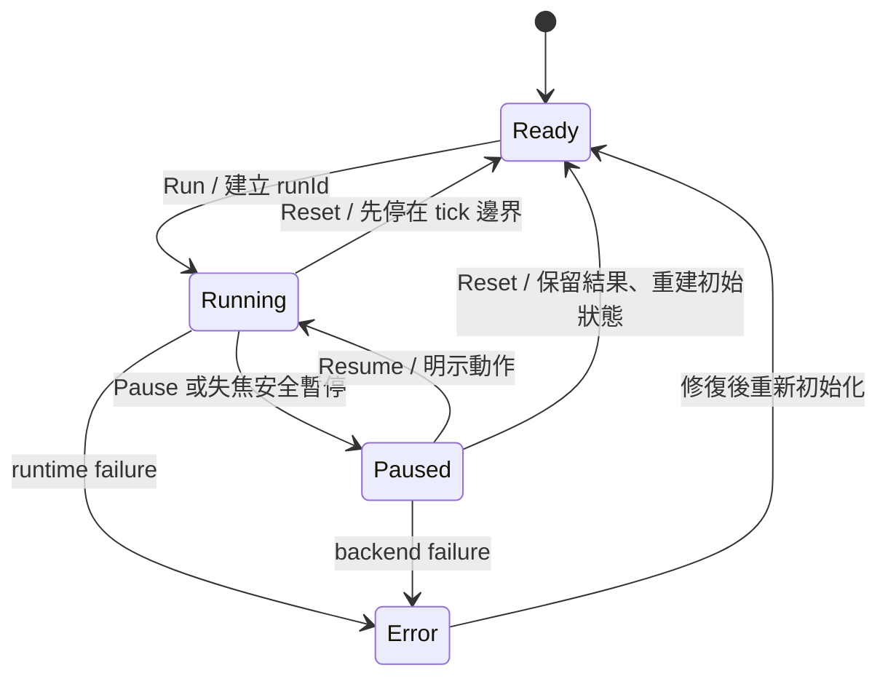

<!-- english-source: {"path":"docs/05-ux/WORKSPACE_ARCHITECTURE.md","sha256":"0bc02011aab1e9ec009b53d976e08343b5c2507cea48bf798c938e8c8309e247","translated_at":"2026-10-27T03:45:00Z","executor":"Codex","model_id":null,"links":"english-relative"} -->
<!-- english-notice:start -->
> English translation of [`docs/05-ux/WORKSPACE_ARCHITECTURE.md`](../../05-ux/WORKSPACE_ARCHITECTURE.md). Source SHA-256: `0bc02011aab1e9ec009b53d976e08343b5c2507cea48bf798c938e8c8309e247`. Executor: Codex; model ID unavailable. Translation is not new implementation or validation evidence. Canonical sources and shared task/contract/result files retain their authority. Verbatim technical examples may retain their original language.
<!-- english-notice:end -->

<!-- english-original-anchor --> <a id="工作區與狀態架構"></a>
# Workspace and State Architecture

Review date: 2026-10-26 (Asia/Taipei). Status: **Research complete / design proposal; the production UI has not yet been implemented**. The data types in this document are draft interface contracts that must be merged with the formal Domain Schema; they are not working APIs.

<!-- english-original-anchor --> <a id="目標與使用者"></a>
## Goals and Users

The primary scenario is a judge or beginner building a small room, moving a continuously sounding sphere, throwing it, and comparing materials. The secondary scenario is a user with an acoustics background inspecting paths and results. The three Workspaces follow "create → interact → inspect"; Workspace names do not imply whether computation is running.

User requirements come directly from Phase F. For competitor principles and review limitations, see [COMPETITIVE_UX_RESEARCH.md](COMPETITIVE_UX_RESEARCH.md). All choices below are Reflection Lab design decisions, not performance or usability outcomes proven by competing products.

<!-- english-original-anchor --> <a id="正交狀態"></a>
## Orthogonal States

| Dimension | Values | Data owned | Side effects it must not cause |
| --- | --- | --- | --- |
| `workspace` | `scene / simulation / analysis` | Panel layout, previous widths, chart tabs | No physics reset, source clearing, or re-recording |
| `simulationState` | `ready / running / paused / error` | `runId`, tick, pause reason, backend state | Does not determine whether panels are open |
| `interactionMode` | `editor / fps-interact / fps-build` | Camera controls, grab/place substates | Does not start audio or simulation by itself |
| `inputOwner` | `ui / viewport / modal` | Focus, pointer lock, input routing | Must not send the same key to both UI and physics |
| `recordingState` | `idle / recording / finalized` | experiment ID, trace, gaps | Does not mean the audio device is outputting sound |
| `monitorState` | `blocked / muted / audible / error` | gain, Raw/Simulated, device/context state | Does not stop recording or change computed values |

Entering another Workspace changes only the first row. Leaving `fps-interact` or `fps-build` must first release input ownership. If an object is held, pause safely at the current tick, retain the grab state, and show "Holding; continues after resume"; do not throw it silently. A safety pause required for Workspace switching is an **explicit, recorded interaction guard**, not a Reset inherent to the Workspace. When no FPS interaction is taking place, users can switch directly to Analysis while Running.



`Reset` returns to the initial state of the current `SceneRevision`, retaining completed results and runs; it does not mean Undo or scene deletion. Transport uses explicit Run/Pause/Resume/Reset labels and does not offer an ambiguous Stop. `error` retains the last stable view and error code and disables physics input. Diagnostics can be exported and the operation retried; a frozen view must not be labeled as still Running.

<!-- english-original-anchor --> <a id="pauseresume-的音訊政策"></a>
### Pause/Resume Audio Policy

The MVP design uses `Freeze-and-fade`, not yet DSP-validated: at Pause, save logical run time, continuous source offset, and the pending arrival queue at a safe tick. Mute the run bus with a bounded fade-out on the audio timeline (initial target 20 ms), cancel old epoch schedules, and cut reverb/convolution tails with the fade. Keep AudioContext operating; do not treat freezing the device clock as physical time. Resume explicitly reanchors `(simTime, audioTime)`, restores continuous sources from saved offsets, and reschedules only the logical queue entries that have not yet arrived; it must not re-emit impacts already heard or duplicate contact events. Raw/Simulated switching **does not pause or restart the source** and is a different operation from Pause.

The UI displays "Paused; tails faded out," and recording adds pause/epoch/tail-cut markers. This MVP strategy does not guarantee waveform or convolution-state continuity across Pause; tail/RIR analysis near the time boundary should be excluded or marked interrupted. To listen while Paused, use an explicit "Static scene audition" with an independent audition playhead/epoch, without writing to the original experiment trace/metrics; closing the audition leaves the simulation Paused. Advancing AudioContext must not imply that the source's experiment time has also advanced. Before implementation, the DSP specification must fix schedule cancellation, queue deduplication, and offset precision; 20 ms is an initial value awaiting validation, not a test result.

<!-- english-original-anchor --> <a id="版面與可保留內容"></a>
## Layout and Retained Content

```text
┌ Project／儲存狀態 ─ Scene | Simulation | Analysis ─ Run/Pause/Reset ─ AI ┐
│ Scene Explorer / Library │                         │ Context Inspector │
│                         │       3D Viewport       │                   │
│                         │ HUD／選取／求解器狀態     │                   │
├─────────────────────────┴─────────────────────────┴───────────────────┤
│ Transport／Recording／Event Timeline／Analysis tabs                   │
├ Master Mute／音量／Raw–Simulated／Backend／revision／結果新鮮度 ─────────┤
└──────────────────────────────────────────────────────────────────────┘
```

| Workspace | Left | Center | Right | Bottom | Default interaction |
| --- | --- | --- | --- | --- | --- |
| Scene | Scene Explorer, Object Library | Orbit camera, gizmo, grid, placement checks | Object/material/physics/source | Collapsible event log, Transport | `editor`, free view; the FPS button can switch modes |
| Simulation | Collapsed by default; Library can be opened | Clean FPS/free observation, explicit "Enter first person" | Collapsed by default; summary shown when needed | Transport, recording, recent collisions | Remains `editor` by default; request lock only after clicking enter |
| Analysis | Experiment/Run/Source/Listener filters | 3D paths and switchable charts | Selected path/RIR/event evidence | RIR, spectrum, EDC, A/B | `editor`, camera independent of Listener |

Each Workspace retains its own **observer camera** position, while the Listener is a scene/experiment entity. When FPS binds the Listener, show "Listener follows first person" and save the original `ScenePinned` pose on entry. **Exiting FPS restores that pose by default, zeros velocity, and marks a discontinuity**, consistent with the physics FPS specification. In replay mode, the recorded trajectory determines the Listener. Dragging the Analysis camera must not change the recording Listener or recompute a different set of results. Only pressing "Move Listener to current camera" creates an undoable Domain Command; exiting a mode must not silently retain a different measurement position.

Phase 2 found that the previous wording here, "remain at the last position," contradicted the physics specification. The conflict and design rationale are retained in the Wiki decision / Conflict Record. This is an engineering specification integration; it does not claim that the user separately selected the default or that it has been implemented and validated.

<!-- english-original-anchor --> <a id="editor-視角與物件控制本地設計預設"></a>
### Editor View and Object Controls (Local Design Defaults)

| Action | Initial mapping | Input scope / alternative |
| --- | --- | --- |
| Select / multi-select | LMB / Shift+LMB | editor viewport; synchronized with Explorer; candidate list for overlaps |
| Orbit/Pan/Zoom | Alt+LMB drag / MMB drag / unmodified wheel | Only on viewport hover with no UI/drag owner; Ctrl/Cmd+wheel retains browser zoom; orbit/pan tool buttons and keyboard step alternatives |
| Frame selected | F | editor viewport only; reachable button. F in FPS means Fixed; HUD clearly shows the current scope |
| Move/Rotate/Scale gizmo | W/E/R | editor only; an editable object must be selected; these three tool keys do not carry into FPS |
| Precise Transform | Inspector numeric fields, Enter commit / Esc cancel | UI owns input; no FPS triggering; input units m/deg, with conversion to canonical values handled by the Domain layer |
| Undo/Redo | Ctrl/Cmd+Z / Shift+Ctrl/Cmd+Z | Outside text input with a scene-authoring command available; text fields use native text undo; does not reverse runtime |
| Delete/Duplicate | Delete / Shift+D | Handle only with an explicit Explorer/viewport selection; text fields do not delete objects; deletion supports Undo; retain visible buttons and rebinding |

These defaults borrow familiar editor principles and have not been validated on a real machine; they do not require implementing the complete Blender shortcut set. Without a three-button mouse, use explicit Orbit/Pan tools and numeric view controls. All shortcuts first pass through input arbitration in the FPS document. Rebinding settings must flag conflicts with browser-reserved combinations and retain visible buttons; do not claim that every platform can intercept them.

<!-- english-original-anchor --> <a id="documentruntimeresult-的分離"></a>
## Separating Document, Runtime, and Result

`SceneDocument@revision` stores the authored initial settings. `RuntimeState@runId/tick` contains computed positions, velocities, and grab anchors. `ResultSnapshot` references fixed scene/material/backend versions and time, without depending directly on a mutable Inspector.

| Action | Ready/Paused | Running | Result handling |
| --- | --- | --- | --- |
| Add/delete/resize/change rigid-body mode | Validate, then commit as one Undo Command | Show that a pause is required; commit after the user presses "Pause and apply" | New revision; retain old results and mark them stale relative to the current scene |
| Gizmo drag / numeric Transform | Ready changes Document; if editing runtime while Paused, identify the edit target explicitly | Disabled; use physics-constrained grabbing/motion tools instead | Do not silently write runtime transforms back as initial values |
| Source gain / monitor volume | Editable; distinguish source gain from monitor gain | Schedule runtime-safe source commands at tick/audio boundaries; monitoring does not change the experiment | The former records events; the latter stores monitoring settings only |
| acoustic material | New material version + energy/band validation | MVP requires pause and reconstruction of supported geometry; do not pretend it takes effect immediately | Mark `pending` until backend ack; stale results must not replace new results |
| FPS Build placement | See the two-phase commit in the FPS document | Ghost first; on confirmation, pause safely, create a staged body, and show it enabled after reconstruction | Retain build command/version; mark the change in the recording |
| Save current runtime as initial scene | Explicitly create a separate revision/snapshot | Requires pause and a diff preview | Do not overwrite old experiments |

The top bar simultaneously shows `Scene rev 7`, `Run #12 tick 840`, and `Acoustic rev 6 — updating`; different data clocks must not collapse into one green "real-time" light. When geometry changes time out or a backend does not support them, show the reason and recovery options.

<!-- english-original-anchor --> <a id="共享-selection-與-capability"></a>
## Shared Selection and Capability

```ts
type SelectionRef =
  | { kind: 'object'; sceneRevision: string; objectId: string }
  | { kind: 'path'; resultId: string; frameId: string; pathId: string }
  | { kind: 'event'; runId: string; eventId: string }
  | { kind: 'ir'; resultId: string; sourceId: string; listenerId: string };
// null 代表沒有選取；hover 另存，不取代 selection。
type ResultContext = {
  runId: string; sceneRevision: string; materialVersion: string;
  backendId: string; backendVersion: string; timestamp: number;
  provenance: 'measured' | 'computed' | 'estimated';
  capabilities: string[]; stale: boolean;
};
```

3D, path tables, RIR arrival markers, and Inspector share `SelectionRef`. Clicking dense paths offers a candidate list (sorted by proximity) and a keyboard-operable table. Pause/pin the frame before inspecting moving paths so per-frame reordering does not steal selection. When a path disappears, retain the pinned snapshot and show "This path is no longer in the current frame"; do not treat a newly top-ranked path as the same path.

Use `capabilities` to determine available entry points: individual acoustic rays can be selected only with `individualPaths`; show RIR only with `impulseResponse`. If RT metrics are absent, show "not provided / not yet calculated" and the required inputs, never 0. Backends providing only aggregate reflections/IR use corresponding charts; they must not generate illustrative rays without a solver basis. Illustrations must have a separate area and an `illustration, not a solver result` label.

<!-- english-original-anchor --> <a id="undoai-與儲存"></a>
## Undo, AI, and Saving

Authoring commands are recorded as transactions; an entire drag is one transaction, and invalid operations do not enter history. Undo does not reverse physical time; runtime must use Reset/Replay. AI uses the same Domain Validation / Command pipeline: first show the diff, impact scope, and required pause, then apply an undoable transaction. AI explanations have a separate label and must not overwrite Computed/Measured provenance.

Autosave Document, Workspace preferences, and key bindings; runtime/results require visible Capture/Recording states. When multiple types of data remain unsaved, do not display a single "Saved." After object deletion, clear related invalid Selection references; recording or old-result references retain their versions.

<!-- english-original-anchor --> <a id="驗收尚未執行"></a>
## Acceptance (Not Yet Executed)

1. Switch Scene→Analysis→Simulation while Running; runId/tick continue without Reset. When an object is held, pause according to the safety guard and show the reason.
2. Moving the observer camera in Analysis does not change the Listener; only an explicit Listener move creates a command.
3. After adding a wall, old acoustic results show as stale; do not display update completion before backend ack.
4. A backend supporting only IR does not expose selectable geometric paths; missing numeric values are not 0.
5. Undo for scene commands and Reset for simulation are clearly separate; an AI command batch can be undone once as a whole.
6. Recording preserves IDs, events, and pause reasons across Workspaces; device focus loss or pointer-lock loss does not automatically restore input.

<!-- english-original-anchor --> <a id="平台依據"></a>
## Platform References

- [W3C Pointer Lock 2.0, 2026-02-25 Working Draft](https://www.w3.org/TR/pointerlock-2/): lock and keyboard focus are separate. Arbitration and pausing in this document are product decisions; the specification does not guarantee identical behavior in all browsers.
- [Web Audio API Recommendation](https://www.w3.org/TR/webaudio-1.0/): audio scheduling uses independent time; UI animation should not be the clock for sound arrivals.
- [WCAG 2.2](https://www.w3.org/TR/WCAG22/): keyboard, focus, and audio controls are design constraints; no claim is made that the product already conforms.
