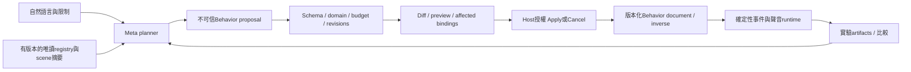

<!-- english-source: {"path":"docs/08-ai/MUSE_SOUND_BEHAVIOR_INTEGRATION.md","sha256":"28a20bd91f69202216ee63ada38740e2ed8f818656c7fa6b946ddec54d3bb41b","translated_at":"2026-10-27T03:39:17Z","executor":"Codex","model_id":null,"links":"english-relative"} -->
<!-- english-notice:start -->
> English translation of [`docs/08-ai/MUSE_SOUND_BEHAVIOR_INTEGRATION.md`](../../08-ai/MUSE_SOUND_BEHAVIOR_INTEGRATION.md). Source SHA-256: `28a20bd91f69202216ee63ada38740e2ed8f818656c7fa6b946ddec54d3bb41b`. Executor: Codex; model ID unavailable. Translation is not new implementation or validation evidence. Canonical sources and shared task/contract/result files retain their authority. Verbatim technical examples may retain their original language.
<!-- english-notice:end -->

<!-- english-original-anchor --> 
# Muse Agent: Sound Behavior Proposals and Experiments

Checked: 2026-10-27, Asia/Taipei. Status: **DESIGN_READY / PRODUCT_IMPLEMENTATION_PENDING / META_LIVE_NOT_RUN**. Codex is the primary development agent; Muse Code is only an optional coding tool. The Muse Agent here is a product feature executed through the **Meta Model API**; a change in coding executor does not mean switching it to a Codex model and passing that off as Muse. The user has confirmed that the development Muse quota is unavailable; product Meta API credits/account capabilities are separately UNKNOWN, and the spending budget remains 0.

This document extends the [original Experiment Agent](AI_EXPERIMENT_AGENT.md), [original 12-tool contract](AI_TOOL_SCHEMAS.md), and [original scene transactions](AI_SCENE_CONTROL.md). It does not rewrite the old tool enum or claim that the host executor or provider is complete. The authoritative source for sound behavior data is the [Behavior Schema](../10-sound-behaviors/BEHAVIOR_SCHEMA.md); the authoritative source for physics events is the [Event Model](../10-sound-behaviors/EVENT_MODEL.md).

<!-- english-original-anchor --> 
## Substantive Work Within the Product

The Agent's design responsibility is to turn natural language into inspectable rules and versioned bindings, using object, material, asset, and trigger IDs actually returned by the current registry. It can propose sound effects, layers, input-to-gain/pitch mappings, experimental independent variables, and comparison steps; all physics, DSP, and acoustic numbers come from code and artifacts. The production implementation must let users without an API manually edit through the same Inspector/domain commands; the model cannot be a prerequisite for playback or the physics loop.

<!-- english-original-anchor --> 
## Machine Contract and Candidate Tools

The new draft is [sound-behavior-ai.schema.json](../../../schemas/sound-behavior/sound-behavior-ai.schema.json), and the data document is [behavior-document.schema.json](../../../schemas/sound-behavior/behavior-document.schema.json). The model proposal envelope contains `schemaVersion:"1.0.0"`, `proposalId`, `sceneId`, `expectedSceneRevision`, `expectedBehaviorRevision`, and `operations`. The host creates `transactionId`, authorization, the preview digest, Apply/Undo, and result IDs; the model cannot approve itself.

| Only mutation operations | Main data and semantics |
| --- | --- |
| `CreateProfile` | `profile`; a new ID must not overwrite an existing one. |
| `ReplaceProfile` | `profileId,expectedProfileRevision,profile`; a complete, constrained replacement that preserves stable rule IDs. |
| `DeleteProfile` | `profileId,expectedProfileRevision`; reject if a binding still uses it after the candidate transaction completes; no hidden cascade. |
| `AssignBinding` | `binding` contains objectId/objectGeneration, profileId/profileRevision, and permitted overrides. |
| `RemoveBinding` | `bindingId`; remove only the specified binding. |

These five operations form a new **draft local model**, not operations already supported by the existing `ai-scene-change-set.schema.json`. They must not be mixed directly into the old 32-mutation transaction. A future host must provide a version-controlled Behavior transaction adapter that checks scene/behavior document/profile/registry revisions, applies the entire package under a lock, and produces an inverse; any failure preserves the original data. Undo creates a new revision; it cannot erase sounds already played or reverse API costs.

Profile replacement must not leave bindings pointing to an old revision that no longer exists. When migration is required, explicitly rebind every affected object in the same candidate proposal, or reject it. Until the host provides a version-retention/migration policy, the model cannot assume that upgrading a shared preset will safely update all objects automatically.

The tool names in the user requirements can use the following smaller surface without rebuilding a separate runtime for every Inspector control:

| Candidate name | Compilation/execution |
| --- | --- |
| CreateSoundBehavior | `CreateProfile`, followed by explicit `AssignBinding`; do not silently change the object's material. |
| AddBehaviorRule, UpdateTrigger | The host reads a fixed profile revision and produces a complete `ReplaceProfile` candidate; arbitrary JSON Pointer patches are not accepted. |
| SetSoundAsset, SetParameterMapping, ConfigureSoundLayer, EnableBehavior | Asset/mapping/layer changes require a complete, constrained profile replacement; bindings allow local overrides only for enabled, gainLinear, and pitchSemitones. Bindings affected by a new profile version must appear in the diff. |
| PreviewSoundBehavior | A read-only staged preview, not a commit operation; asset auditions do not enter the experiment trace. |
| RunExperiment | Call the original `RunSimulation` only for supported items → after success, call `CaptureExperiment`; queued does not mean complete. |
| CompareAudioResults | A candidate product name; existing acoustic metrics can use the original Analyze/Compare, while timbre/behavior A/B requires a separate analysis contract. New metrics cannot be inserted into the old enum. |

“Create five zero-gravity balls” first goes through the existing scene proposal/preview/Apply path. After the host returns committed object IDs and a new registry snapshot, a Behavior transaction is proposed. These are currently separate design contracts; do not claim that the existing schema provides a globally atomic transaction across scene/behavior documents. The MVP can initially configure Behavior only on existing objects to reduce recovery and demonstration risks.

<!-- english-original-anchor --> 
## Required Host Validation

| Check | Rejection or handling |
| --- | --- |
| Scene/object | The scene must be authorized; expected revisions, objectGeneration, and object IDs must match so an object deleted and recreated under the same name does not receive an old proposal. |
| Profile/rules | profile/rule/mapping/binding IDs must be unique; trigger/condition/generator use only closed enums. Reject unknown fields, JavaScript, and arbitrary graphs/function code. |
| Audio Asset | `{assetId,revision,sha256}` must identify an authorized, available registry asset; the model cannot provide file paths/URLs, invent a piano asset, or download sound effects. The host separately handles import/decoding/license review. |
| Material | material-pair must resolve against the actual physics/acoustic registries; choosing a creative asset does not change friction/restitution/absorption coefficients or label a sound effect as a measurement of natural vibration. |
| Mapping | The input must apply to the trigger; curves are bounded, x is strictly increasing, clamp is explicit, inputs are finite, and units are correct. The model does not guess OnImpact closing speed/normal impulse numbers. |
| Spatial routing | World sounds must pass through a controlled emitter/Acoustic Core; the model may not add a bypass connected directly to master, duplicate HRTF, or add a second distance attenuation. |
| Budget | Apply the stricter of the draft document limits and session/voice/simulation/provider limits; the model cannot raise limits. The preview must show the possible instance count, missing assets, and the source of performance estimates. |
| Recording | Save proposals/operations/before-after revisions/profile versions/asset hashes/seed/trace refs; keep AI-generated explanations separate from computed results. |

Registry descriptions, asset labels, and user text are all treated as data and cannot change the tool allowlist, provider, or budget; code-like text in labels must not be evaluated or executed as HTML. The product Agent has no shell/OS/repository/private-file permissions. Errors return only constrained field paths and actionable reasons, without secrets or internal stacks.

The draft data limits are 64 profiles, 256 bindings/asset pins, 32 rules/32 material-pair overrides per profile, 8 conditions/8 mappings per rule, 2–16 points per curve, and 64 operations per proposal. These are candidate format and policy limits, not measured capacity; they do not relax the original AI session's tool-call/mutation limits or the [canonical performance budgets](../06-validation/PERFORMANCE_BUDGET.md). The schema is authoritative for actual values.

Under the draft, mapping inputs use `sourceSpeedMetresPerSecond` and `angularSpeedRadiansPerSecond`; impact additionally has `normalImpulseNewtonSeconds`/`closingSpeedMetresPerSecond`/`tangentSpeedMetresPerSecond`, and contact loops additionally have `slipSpeedMetresPerSecond`/`contactSupportForceNewtons`. `gainLinear`, `pitchSemitones`, and `filterCutoffHz` are sound-generation parameters; they must not be labeled Pa or dB SPL.

<!-- english-original-anchor --> 
## Meta API Adapter Boundary

Official tool calling has the host execute functions. The initial product version uses function tools and schedules mutations one by one; `tool_choice` currently supports only `auto`, so it must handle the model returning ordinary text without calling a tool. `parallel_tool_calls:false` can limit parallel function calls per turn, but the host still limits total turns/client function calls; `max_tool_calls` is not the total client-function quota. [Official Tool calling](https://dev.meta.ai/docs/tool-calling)

The Responses API uses flat tool definitions and `function_call_output/call_id`; Chat Completions uses a `function` wrapper and the complete assistant tool_calls message, returning each matching `tool_call_id` individually. Validate and stage only after parsing complete arguments; do not mutate production data while receiving a string. [Official cookbook](https://dev.meta.ai/docs/cookbook/tool-function-calling)

Unions/refs in the local schema cannot be passed off directly as provider strict parameters. The adapter must separate the five operations into plain-object functions, expand nonrecursive refs, and check depth; only lower-level unions whose semantics have been proven equivalent may be converted to a provider-supported form, and local AJV and domain validation must still run again. The official strict subset requires every object to be closed and every property to be required, and does not support `oneOf/allOf` or recursive refs; structured output and function `strict` provide different guarantees and cannot replace scene semantics and authorization. [Official Structured output](https://dev.meta.ai/docs/structured-output)

At this stage, a **provider-specific schema adapter has not been generated or validated**, and the Meta API has not been called. SDK-compatible examples are not evidence of account access/model availability/tool execution; model IDs are specified by verified host configuration, without hard-coding the latest version here.

<!-- english-original-anchor --> 
## Controlled Experiments Suitable for Demonstration

1. The user selects an existing ball and available assets, requesting a grab sound, a throw whoosh, a synthesized flight loop, and a creative impact sample. The model can propose OnGrab/OnThrow/OnImpact one-shots and a WhileAirborne gate; the preview lists the semantics of possible restarts after bouncing. Airborne is not equivalent to throw; OnThrow must reference a player-command event.
2. If the registry has no mechanical sample, list available candidates or offer an explicitly identified simple synthesizer candidate; an oscillator cannot be named as an acquired piano recording. Every pitch/gain is a creative setting, not an acoustic measurement.
3. The user reviews the diff/preview and then applies it; the runtime executes using saved physics events and persistent sound instances, with no model inside the audio callback.
4. Save one motion/contact trace; versions A and B change only explicitly identified Behavior/asset/mapping independent variables. Physics materials, motion, listener, acoustic model, and solver settings stay fixed; changing mass/friction, etc. requires a different type of experiment and cannot be treated as the same physical conditions.
5. **Keep Behavior A/B separate from acoustic/material A/B**: the former allows changes in sound-generation settings/assets, while the latter often requires the same source. The source-hash equality condition in the old comparison specification cannot be silently applied or removed; comparison types and allowed independent variables first require a versioned host analysis contract. Timbre assessments without measurement/analysis tools can only be labeled as subjective user or AI commentary.

The precise requirement “start the loop on OnThrow, stop after the first OnImpact, and remain stopped until the next throw” requires a latch and cannot be replaced equivalently by state-gated `WhileAirborne`. The P1 draft starts with a discrete trigger and uses the rule's `lifecycle:{mode:"latched",stopOn,retriggerPolicy,maxDurationSeconds}` to control stopping/restarting/deadlines; the generator must be a loop. The host controls input event ID deduplication, tick/sequence ordering, and epoch/mode/deletion cancellation; JavaScript or arbitrary Graphs are not exposed. Execution is allowed only when the host explicitly supports the P1 latch capability. There is currently no product runtime, so the Agent cannot claim execution; if the capability is missing, return `CAPABILITY_UNSUPPORTED` and list acceptable alternatives.

The draft `$defs.SoundBehaviorComparison` already distinguishes `comparisonKind:acoustic|behavior` and independent variables, using `physicsEventTraceHash` to fix physics/player input; the sound-trigger/voice trace may naturally change and cannot serve as an input trace that must be identical. Analysis execution is still unimplemented.

The most valuable demonstration is “language → inspectable rules → explicit event timeline → comparison with the same physics trace,” rather than unverified AI-generated RT60/sound-pressure results. This is an engineering demonstration recommendation, not an additional competition eligibility requirement; see [HACKATHON_RULES](../01-compliance/HACKATHON_RULES.md) for the public-rules recheck.

<!-- english-original-anchor --> 
## Failures and Acceptance

Distinguish Meta API 401/403, billing, and 429/transient failures; apply bounded retries only to retryable categories. For a mutation with an unknown outcome, check the request/proposal ledger first so resubmission does not apply it twice; model failure does not block the manual Inspector. Insufficient live credits stop only the Meta branch; label offlineFixture/recorded-response provenance explicitly, and do not substitute a Codex model and then claim Meta validation is complete. [Official Error handling](https://dev.meta.ai/docs/error-handling)

| Scenario | Expected result/evidence scope at this stage |
| --- | --- |
| Valid profile/binding proposal | Schema and registry/domain fixtures can be validated offline; actual host preview/Apply/Undo remain NOT RUN. |
| Invalid trigger, unknown or stale asset pin, incorrect mapping units | Reject, leaving the original document hash unchanged; passing strict JSON alone does not justify acceptance. |
| Shared profile change, stale objectGeneration/revision | The preview lists all affected bindings; reject conflicts rather than overwrite subsequent edits. |
| Excessive rules/voices, arbitrary JS/URL/path | Schema/policy rejection; do not automatically raise limits. |
| Malformed/truncated/multiple tool calls, unknown request outcome, API quota | Parse completely and then validate sequentially; bounded loop, ledger deduplication, preserved errors, and a manual path. Provider testing remains NOT RUN. |
| A/B missing a trace or claiming an uncomputed metric | Return not comparable/unavailable, value=null; the model must not fill in a value. |
| Real Meta integration and competition demonstration | Require an authorized real Meta response/model ID, redacted tool trace, preview/Apply, actual runtime results, and provenance. Currently BLOCKED/NOT RUN. |

Test commands and each layer's PASS/FAIL/BLOCKED/NOT RUN are centrally indexed by [Sound Behavior validation](../10-sound-behaviors/SOUND_BEHAVIOR_VALIDATION.md). Record schema/offline fixtures, host runtime, provider, audio quality, and scientific numerical results separately; passing any one layer does not imply that the entire product is complete.

<!-- english-original-anchor --> 
## Trusted Pins and v1 Apply Addendum

The validator can derive required asset pins from a trusted catalog on a clone, returning derivedAssetPins for Preview to display; it does not directly modify the original document. The host must atomically commit operations together with pins and save the inverse; Undo cannot depend on the model reconstructing it. v1 Apply/deletion first pauses and fades/drains old voices, then switches revision/runtime epoch; seamless multiversion live authoring/tombstones are not yet supported. These are host implementation requirements; passing the validator does not mean Apply/audio has executed.
