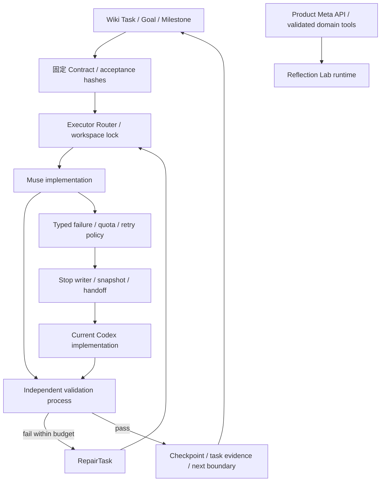

<!-- english-source: {"path":"docs/09-agents/MULTI_AGENT_ARCHITECTURE.md","sha256":"e084f52a01e0099d763bd702a05bda9816a243cd8f4716f5fd3897f4ab2bb5e6","translated_at":"2026-10-27T03:44:09.357453Z","executor":"Codex","model_id":null,"links":"english-relative"} -->
<!-- english-notice:start -->
> English translation of [`docs/09-agents/MULTI_AGENT_ARCHITECTURE.md`](../../09-agents/MULTI_AGENT_ARCHITECTURE.md). Source SHA-256: `e084f52a01e0099d763bd702a05bda9816a243cd8f4716f5fd3897f4ab2bb5e6`. Executor: Codex; model ID unavailable. Translation is not new implementation or validation evidence. Canonical sources and shared task/contract/result files retain their authority. Verbatim technical examples may retain their original language.
<!-- english-notice:end -->

<!-- english-original-anchor --> 
# Development Agent Architecture

> **Current policy as of 2026-10-27: Codex leads; Muse Code is optional.** See [ADR-013](../02-architecture/adr/013-codex-primary-development.md). The Muse-preferred workflow below is retained as an Optional Harness / Phase3 historical profile. It is not a prerequisite for normal development, and restored quota does not automatically switch the project back.

This is currently development infrastructure; the production product has not yet been implemented. Under [ADR-012](../02-architecture/adr/012-development-harness.md), Codex is responsible for objectives, Task Contracts, resource policy, independent acceptance, and the Wiki; Muse Code is the preferred implementer. When Muse cannot continue, the existing Codex Orchestrator enters Implementation Mode. The automated runner's acceptance result determines completion, rather than the executor's exit 0 or completion report.

<!-- english-original-anchor --> 
## Persistent State

`knowledge/tasks/*.json` is the sole authority for work; the macro states BACKLOG?DONE retain the original Wiki contract. `schemas/agents/task.schema.json` fixes a task's execution scope / acceptance / policy. Run State stores detailed executor state, attempts, Git / content snapshots, model provenance, and resources. The Wiki's `agent_execution` is a projection with artifact hashes; criteria cannot be promoted to verified merely because the executor claims success.

Task ID, wiki_task_id, milestone_id, goal_id, and contract hash remain unchanged during takeover. `goal_id` is a reference field; it does not mean that the runner can create / resume an arbitrary Codex product's `/goal`. The original thread's Goal is still managed by that session; rebuilding progress from the Wiki / handoff in a new chat must be labeled accurately. See [Codex capabilities](CODEX_CAPABILITIES.md).

<!-- english-original-anchor --> 
## Isolation and Validation

The control directory stores state / events / acceptance copies / snapshots, while the executor receives only the designated workspace and prompt. Worktrees are preferred, but without HEAD a worktree with history cannot be created, so this phase tests with isolated fixtures. Empty `git diff` output is not evidence of no changes to untracked files. A cooperative lock is not an OS sandbox; see the [security policy](AGENT_SECURITY.md).

What the tests can establish: Mock Runner validates control flow; actual Muse echo validates the CLI output protocol; actual model edits, live quota exhaustion / recovery, and product Meta connectivity require separate live artifacts. Full execution results and Gate A?I are in the [report](PHASE3_REPORT.md).

<!-- english-original-anchor --> 
## Product Boundary

Muse Code development subscriptions / Meta API keys, Codex ChatGPT usage, and product Meta API credits each have their own sources and limits and cannot offset one another. The product Agent can call only validated domain tools and has no repo / shell / private-file permissions. Mock numbers cannot serve as evidence of a Meta model or physics solution; see the [Runtime contract](../08-ai/PHASE3_RUNTIME_AGENT.md).
