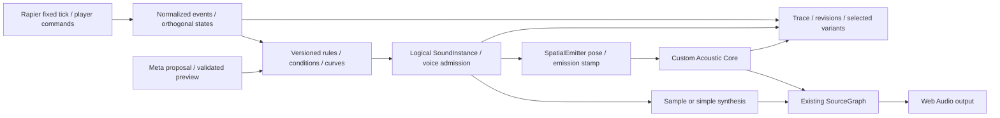

<!-- english-source: {"path":"docs/10-sound-behaviors/SOUND_BEHAVIOR_ARCHITECTURE.md","sha256":"8aff3bb47639ea5599936aaa9f23ed709b6882710edb3381d5f528872b11c8aa","translated_at":"2026-10-29T05:29:36Z","executor":"Codex","model_id":null,"links":"english-relative"} -->
<!-- english-notice:start -->
> English translation of [`docs/10-sound-behaviors/SOUND_BEHAVIOR_ARCHITECTURE.md`](../../10-sound-behaviors/SOUND_BEHAVIOR_ARCHITECTURE.md). Source SHA-256: `8aff3bb47639ea5599936aaa9f23ed709b6882710edb3381d5f528872b11c8aa`. Executor: Codex; model ID unavailable. Translation is not new implementation or validation evidence. Canonical sources and shared task/contract/result files retain their authority. Verbatim technical examples may retain their original language.
<!-- english-notice:end -->

<!-- english-original-anchor --> 
# Sound Behavior Architecture and Integration Boundaries

2026-10-29: The architecture is accepted, and the production evaluator / bridge / Inspector / Audio integration now have implementations and component evidence; the complete V1 remains unfinished. The design below includes events without producers and future capabilities; the whole plan must not be read as implemented. See the [research](../12-architecture-review/SOUND_BEHAVIOR_RESEARCH.md) for current code / tests / gaps; the [Closing Report](SOUND_BEHAVIOR_REPORT.md) retains only its original research / draft scope. See [ADR-014](../02-architecture/adr/014-sound-behavior-system.md) for the decision. Events / schemas / UX retain their single formal sources, without duplicating thresholds or tokens.

<!-- english-original-anchor --> 
## Layers and Responsibilities

| Layer | Authority / Editable Content | Must Not Be Responsible For |
| --- | --- | --- |
| Physics / Player | Actual pose/contact, successful Grab/Throw intent, fixed-step stamp | Changing mass/friction based on a sample, inferring a player throw from velocity |
| Event / State | Pair episodes, support and motion classification, stable IDs/deduplication | Fabricating substep precision or treating contact force as an impact on every occasion |
| Behavior | Profiles/bindings/overrides, conditions, curves, cooldown, instance intent | Executing arbitrary JS, connecting directly to master, or modifying the solver |
| Generation | Sample/oscillator, envelope/filter, creative gain/pitch | Claiming sample selection represents actual modal vibration or SPL calibration |
| Propagation | Existing AcousticFrame output based on emitter/listener, geometry/medium/revisions | Synthesizing nonexistent reflection paths based on a rule name |
| Renderer | Direct/early/late for the same emission, spatialization, headroom, lifecycle | Recalculating distance/delay/Doppler/HRTF a second time |
| AI / Recorder | Valid candidates, preview/undo, traces and references to actual results | Blocking the audio callback, arbitrary shell commands, LLM-fabricated measurements |

The existing Rapier world, Scene command host, AcousticFrame, audio clocks, and domain IDs remain authoritative. The addition is a behavior authoring/event bridge layer. The main application is not yet implemented; passing the draft validator does not produce a playable product.

<!-- english-original-anchor --> 
## Event Rules + Orthogonal States, Rather Than a Single FSM or Large Graph

Held, Moving, Airborne, Rolling/Sliding, Sleeping, and body mode are different dimensions. A held object may still move and hit a wall; AlwaysOn should not stop because OnImpact changes state. Rules evaluate independently and may hold continuous and one-shot instances at the same time. Profiles share definitions; runtime state is separate for each object binding, never sharing cooldowns/playheads.

See [Event Model](EVENT_MODEL.md), [Physics Bridge](PHYSICS_AUDIO_BRIDGE.md), and [Schema](BEHAVIOR_SCHEMA.md) for exact rule/classification IDs, conditions, and available data. Throws and natural drops are not interchangeable. Fixed/no-gravity/pause/teleport are explicit transitions; instantaneous velocity cannot fabricate intent.

“Start a loop after a throw, stop after the first Impact, and restart only on the next Throw” needs a bounded latch. WhileAirborne cannot substitute for it (an object may become airborne again after bouncing). The draft can describe a P1 latch; return CAPABILITY_UNSUPPORTED when the host has not declared support, without a silent approximation. A full Node Graph remains P2; it would require typed nodes, cycle rules/bounded feedback, a compiler, and a debugger. These burdens are not added now.

<!-- english-original-anchor --> 
## Definitions, Bindings, and Live State

A Profile is a versioned immutable definition. Multiple objects reference the same revision through bindings; overrides allow only fields listed in the schema. Before editing a shared preset, show the affected scope, then commit a new revision; do not rewrite historical runs. Rules/assets/instances/emitters all have stable domain IDs; a Rapier handle serves only as a temporary lookup inside an adapter.

The current SceneSpec version does not directly gain unknown fields. The draft behavior document connects externally to existing Scene/asset registries using IDs and revisions. Formal host integration requires a separate migration/reference validation/atomic command/inverse; a draft schema cannot be treated as completed save/load. Deduplicate repeated requests, reject stale revisions, and leave no partial Profile or bindings after failure.

The v1 draft validates runtime state only against the current document/profile/binding revisions and has no retired revision/tombstone support yet. The safe design for author Apply/delete is therefore pause → fade/drain old voices → atomically commit the new revision → create a new runtime epoch; seamless live editing across multiple versions cannot be promised. Runtime updates to pose and inputs for existing mappings do not change a profile and must not recreate AlwaysOn. A slider/audition during editing is a draft preview, not a silent commit to a running profile.

SoundInstance is a logical lifecycle; AudioBufferSourceNode is only the backend resource for its current playback. Continuous retains its running loop/oscillator and playhead; leaving the gate fades out and releases it. The restart/resume policy on re-entry must be recorded. A one-shot creates a new source node and reuses a decoded AudioBuffer; a stopped BufferSource cannot restart. These are specified capabilities; actual continuity and device effects remain NOT RUN. [Web Audio REC](https://www.w3.org/TR/2021/REC-webaudio-20210617/), [AudioBufferSourceNode](https://developer.mozilla.org/en-US/docs/Web/API/AudioBufferSourceNode)

<!-- english-original-anchor --> 
## Positioning and Unified Propagation

| Emission | Intended Anchor / Lifecycle | Key Limitation |
| --- | --- | --- |
| AlwaysOn / Held / movement loop | Object pose + explicit local offset | Do not assume the object origin is its COM; grabbing does not recreate the loop |
| Whoosh / throw content | Optional follow-object emitter | Creative content; actual Doppler belongs to propagation, so avoid duplicate compensation from velocity pitch |
| Impact / bounce one-shot | Valid representative contact point at emission time; short tail remains fixed | Does not fly back to the object center with the ball; after object removal, an independent instance may finish the tail safely |
| Rolling / sliding | Contact anchor for that pair episode, updated stably | Fragmented contacts require aggregation/hysteresis; do not classify all translation as rolling |
| Multiple contacts / multiple layers | Bounded representative points or a finite set of emitters | Do not first mix all different positions into COM; both sides' rules must not duplicate playback of the same impact |

The same unordered collision pair first produces one normalized event. Deduplicate identical rule/event combinations; explicit multiple layers retain separate layer identities. How profiles on both objects are handled is a visible policy: P0 uses a pair owner/selects one material-pair content; P1 permits explicit layers from both sides. Arbitrary callback order must not decide this.

3D generators can obtain only the SourceGraph emitter entry point, never the master destination for direct bypass. Acoustic material, physics friction/restitution, and sound-content pairing are read separately; even a shared material ID does not mean changing a sound file can change all three. A Physical-inspired sample is a perceptual approximation; Creative/Hybrid still use the same propagation. Measured/Derived/Tuned/Synthetic labels remain; sample categories cannot pass as measured surface coefficients.

All direct/reflection routes share the same emission and the defined delay/gain responsibilities: HRTF once per arrival route, distance attenuation once. A reflection direction is its final arrival segment, not the straight-line source direction. The existing [Audio Runtime](../02-architecture/AUDIO_RUNTIME.md) is the formal authority for clocks/routing. When a backend lacks a capability, return unavailable/declare a degradation; do not silently connect dry audio directly while claiming complete acoustics.

Gravity0 changes only mechanics; vacuum is a separate medium setting. Collisions and logical events still exist in a vacuum. This version does not simulate structure-borne sound; the airborne acoustic route must not treat “air with no attenuation” as vacuum. Independent dry audition may be used to edit content, but it must carry a visible label and stay out of 3D experiments/scientific metrics.

<!-- english-original-anchor --> 
## Three Time Domains and Recording/Replay

Physics events have only the time precision supported by fixed steps. Behavior evaluates sorted tick/sequence and retains profile/binding versions and seed/selected variant. The audio scheduler maps emission time to AudioContext using the existing epoch, then adds path delay **once**. Audible device time also includes output latency; AudioContext cannot serve as a microphone measurement clock.

Pause follows Freeze-and-fade, retains logical offsets and queues of arrivals still pending, and cancels scheduling from the old epoch. Resume schedules each pending arrival only once. Seek/reset/scene revision creates a new runEpoch and checks all latch/continuous states, without replaying already processed impacts. Paused audition belongs to a separate domain and does not advance the physics cursor.

Record two layers: the normalized physics/player trace and the behavior decision trace. The former supports comparisons with identical motion; the latter includes rule/asset revisions, variant, playback and voice admission/steal/drop reasons, emitter positions, and acoustic result references. Authoritative replay may re-evaluate new behavior; the two behaviors must not be required to have identical decision traces. See [Record Replay](../07-experiments/RECORD_REPLAY.md) and [A/B Modes](../07-experiments/AB_COMPARISON.md).

<!-- english-original-anchor --> 
## Performance, Import, and Validation

Formal numerical budgets are maintained only in [Performance Budget](../06-validation/PERFORMANCE_BUDGET.md). Rules, logical voices, active emitters, paths per emitter/total paths, queues, and decoded bytes each have bounds; a voice limit cannot substitute for a solver source limit. Provisional profile/schema limits are not measured capacity. P0 starts with a small number of emitters and does not assume that a large voice count can all use full propagation.

Preloading/decoding/file-rights checks run outside the audio thread. Import limits cover bytes/duration/channels/sample rate and decoding errors. The registry retains source/license/original-file and decoded-version hashes; the model cannot supply arbitrary URLs or nonexistent IDs. Bus headroom and steal/fade require OfflineAudioContext/device validation; peak-value mathematical fixtures alone cannot establish the absence of clicks/pops.

The callback does not wait for physics/geometry/AI/network. It receives only bounded control frames and preallocated data and processes the actual block length. Measurement determines whether AudioWorklet is needed; the first version may use native nodes without adding unnecessary DSP merely to “have a Worklet.” 128-frame is only an existing benchmark profile and cannot be hardcoded for every render block. [AudioWorklet process](https://developer.mozilla.org/en-US/docs/Web/API/AudioWorkletProcessor/process)

See [audio sources](../../../research/sound-behaviors/audio-sources.json) for primary-source metadata/claim status. Draft schema, risk spikes, and browser/hearing/Meta live statuses are separate; the [Validation Plan](SOUND_BEHAVIOR_VALIDATION.md) does not mean everything has been run.
