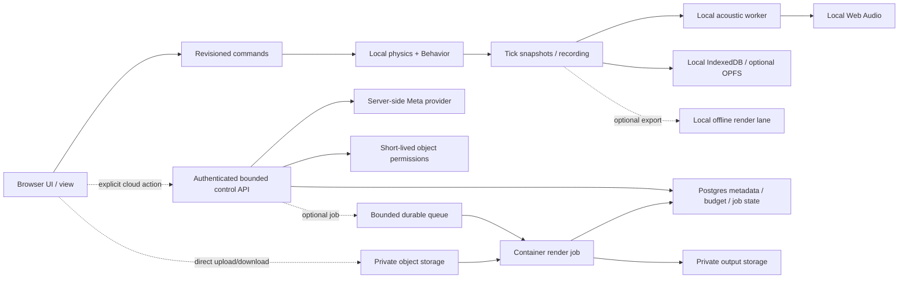

<!-- english-source: {"path":"docs/12-architecture-review/HYBRID_CLOUD_ARCHITECTURE.md","sha256":"5159261047f91c8891df0d0be33c7b2b130ecfa7b9412ae4d934e8f5960a9d1a","translated_at":"2026-10-29T05:26:39.087Z","executor":"Codex","model_id":null,"links":"english-relative"} -->
<!-- english-notice:start -->
> English translation of [`docs/12-architecture-review/HYBRID_CLOUD_ARCHITECTURE.md`](../../12-architecture-review/HYBRID_CLOUD_ARCHITECTURE.md). Source SHA-256: `5159261047f91c8891df0d0be33c7b2b130ecfa7b9412ae4d934e8f5960a9d1a`. Executor: Codex; model ID unavailable. Translation is not new implementation or validation evidence. Canonical sources and shared task/contract/result files retain their authority. Verbatim technical examples may retain their original language.
<!-- english-notice:end -->

<!-- english-original-anchor --> 
# Client-first and Optional Cloud Architecture

Status: **PROPOSED; research candidates only; no deployment, accounts, buckets, databases or queues have been created**. Review date: 2026-10-29. Code baseline: `c210ca882ca8503b322c28884bf1e9f6e9fe126d`. This document does not amend ADR-010/011/013/014 or formal acceptance. Even minimal integration may be called implemented only when accompanied by its actual diff and tests. The existing boundaries remain: a default cost of 0 and disabled Meta networking.

<!-- english-original-anchor --> 
## Recommended direction and current state

Keep the product client-first: interactive physics, acoustics, Behavior, view, replay and real-time audio run on the user's device; local projects and recordings remain usable offline. Cloud services handle only voluntary synchronization/sharing, the server-side Meta control plane and longer optional output jobs. **Neither local offline WAV rendering nor cloud rendering currently has a formal product workflow**. Current exports are project/recording JSON; OfflineAudioContext is used for asset decoding and tests. The diagram below must not be described as an existing deployment.

The [browser research](BROWSER_PERFORMANCE_RESEARCH.md) checks the actual limitations: physics still runs in the main RAF, and recording `onTick` also calls solveAcoustics synchronously. The ordinary interactive AcousticService uses a real worker and has a bounded in-flight policy. Establish local scheduling and data-flow evidence before deciding whether to move physics to a worker. Cloud services do not replace the low-latency interactive input-to-sound chain, and this proposal does not promise cloud support for 10,000 simultaneous real-time simulations.

<!-- english-original-anchor --> 
## The current server cannot directly serve as a public multitenant service

`server/app.ts:createAgentServer` uses Node `createServer`. It accepts only localhost/127.0.0.1 Host values and the configured Origins. The default body limit is 256KiB; the server closure rejects concurrency when `active>=1`. `MetaProvider` stores its call count, reserved USD and active request in process memory. By default, network=false, API key/model/pricing are unset, and the maximum estimated cost is 0. The existing single-machine live-validation ledger and product cloud multitenant authorization are separate concerns.

If a cloud phase is separately authorized later, first extract the HTTP handler/provider interface while retaining the same schemas and proposal → validation → preview → Apply/undo semantics. Vercel, Workers and Cloud Run adapters are candidates. **Do not simply remove the local Host protection and expose the original server**. A public API needs at least authentication, per-user/project authorization, same-origin/CSRF handling, bounded requests and responses, idempotency keys, timeout/cancel behavior, durable per-user and global budgets/reservations, and rate/concurrency leases. CORS/Origin allowlists are browser boundaries and cannot serve as authentication.

Multiple instances cannot use `let active` or an in-memory cost ledger as a global limit. They need an atomic database reserve → dispatch → settle/uncertain workflow. Preserve uncertain transport outcomes as uncertain; restarting, resending or releasing a lease must not erase their possible cost. The Meta key remains a server secret and must not appear in public bundles, project exports or logs. Provider/model/version/usage/result provenance still belongs in experiment metadata. The research scenarios' AI request rates do not establish verified account quotas.

<!-- english-original-anchor --> 
## Platform comparison: resource fit and checked limits

| Candidate | Suitable responsibilities | Verified limits/costs and the decision for this proposal |
|---|---|---|
| Cloudflare Pages + Workers | Pages serves the static Vite app; Workers handles short control APIs, signed object permissions and queue dispatch | Pages static requests are uncharged; each asset is limited to 25MiB, so larger audio files cannot be bundled into the static site. Workers has 128MB per isolate, including WASM and concurrent requests sharing that isolate. Paid CPU time can reach 5min, but this is not an arbitrary Linux runtime. This is the main candidate used for reproducible cost calculations, not an existing deployment. [Pages pricing](https://developers.cloudflare.com/pages/functions/pricing/), [Pages limits](https://developers.cloudflare.com/pages/platform/limits/), [Workers limits](https://developers.cloudflare.com/workers/platform/limits/) |
| Vercel | Static app, Node-compatible HTTP adapter and AI control API, convenient for the existing TypeScript code | Function requests/responses are limited to 4.5MB; recordings/audio should go directly to object storage. Flat Rate CDN has existed since 2026-09, so old CDN prices cannot be treated as current. Full container rendering should not be squeezed into an ordinary function. This round does not change the framework or deploy anything. [Functions limits](https://vercel.com/docs/functions/limitations), [Flat Rate CDN announcement](https://vercel.com/blog/introducing-flat-rate-cdn), [Pro](https://vercel.com/docs/plans/pro-plan) |
| Supabase Postgres/Auth | Ownership, project versions, asset manifests, experiment metadata, jobs, durable budgets/leases, and optional Auth | A paid organization starts at Pro $25/month plus the compute difference; each project has separate Postgres. Micro's 1GB RAM and 60 direct/200 pooler connections are configuration limits, not capacity for 200 users. Frontend access uses Data API/RLS without exposing database connection passwords. Serverless access uses a transaction pool; actual client pool limits still need validation. [Pricing](https://supabase.com/pricing), [Connection guide](https://supabase.com/docs/guides/database/connecting-to-postgres) |
| R2 Standard | Private encoded assets, recordings and content-addressed blobs | Egress is free, but storage and Class A/B operations are charged. R2 is not a SQL database, browser origin disk or a guarantee of free cross-service traffic. Google may still charge network fees when sending outputs to R2. [R2 pricing](https://developers.cloudflare.com/r2/pricing/) |
| Cloud Run Jobs + GCS in the same region | Pinned Linux containers, browser or DSP offline rendering, explicit CPU/RAM allocation, with results in GCS | Each task supports up to 8vCPU/32GiB. Each instance has a minimum charge of 60 seconds and is billed for its full lifetime. Task timeout can reach 168h, but this product should impose a separate limit. `parallelism` limits only a single execution and cannot cap aggregate concurrency across all users. Regional quotas and measured cold starts/browser sandbox behavior still need validation. [Pricing](https://cloud.google.com/run/pricing/), [Quotas](https://docs.cloud.google.com/run/quotas), [Parallelism](https://docs.cloud.google.com/run/docs/configuring/parallelism) |
| Cloudflare Containers (another candidate) | Linux container output jobs coordinated with Workers, potentially reducing cross-provider control complexity | This is a **separate container product**; Workers' 128MB limit cannot be applied to it. standard-3 has 2vCPU/8GiB. CPU, provisioned RAM/disk, Durable Objects/Workers and egress are separate charges. Browser/DSP runtime support must be tested. It is not used in the main estimate, avoiding double-counting two render options. [Pricing](https://developers.cloudflare.com/containers/platform/pricing/), [Limits](https://developers.cloudflare.com/containers/platform/limits/) |

Additional resource limits (none is a product throughput guarantee): Pages Free allows 500 builds/month, one concurrent build, a 20-minute build timeout, and 20,000 files. Workers Free allows 100k requests/day and 10 ms CPU/invocation; Paid HTTP defaults to 30 seconds of CPU and can be configured up to 300 seconds. Vercel Fluid Hobby has a 2 GB/1 vCPU maximum and 300 seconds; Pro has a 4 GB/2 vCPU maximum, with an 800-second GA duration limit. The 1800-second extended duration is a Beta with runtime requirements, not the default for every plan. Cloud Run Jobs allows at most 10,000 tasks per execution and 1,000 running executions per region. The Jobs Run API defaults to 180 calls per 60 seconds per project/region. Tasks default to three retries, with a maximum of ten. Cost-scenario factors such as 1.05 describe expected additional attempts, not an already configured provider policy. Before enablement, verify retry policy, global leases, and remaining regional CPU/RAM quotas together. [Vercel limits](https://vercel.com/docs/functions/limitations), [Run quotas](https://docs.cloud.google.com/run/quotas), [Run retries](https://docs.cloud.google.com/run/docs/configuring/max-retries)

The official Vercel documentation tool, Supabase's official `search_docs`, and its pricing/connection/RLS pages were read. The Supabase changelog index provides no evidence that these research recommendations have become deployed capabilities. No private projects/bills were queried and no SQL was executed. Cloudflare/Google information comes from official documentation. Detailed unit prices, shared free tiers and alternative queues are in the [cost model](CLOUD_COST_MODEL.md).

<!-- english-original-anchor --> 
## Storage responsibilities and minimal data contracts (design draft)

Postgres holds only bounded metadata and references: `project_id / owner_id / revision / scene_hash / manifest_hash`; asset encoded-byte hashes/licenses/sizes/object keys; experiment run/tick ranges, fixedDt, physics/solver/Behavior versions; and job state/budget reservations/leases. Do not write recording traces, original audio or PCM into Postgres frame by frame, and do not broadcast 60Hz poses through Realtime. Each experiment's manifest remains portable and pinned. A sharing link does not mean all original materials can be relicensed.

All project reads/writes need owner/membership predicates; enable RLS on exposed schemas. `TO authenticated` alone does not establish ownership, and user-editable metadata must not drive authorization. Keep service/secret keys on the server. Read-only shares need separately revocable permissions; guessing an object key must not allow downloading. Commit versions with an expected revision/CAS. Do not claim cross-service atomicity between metadata and blobs: upload temporary bytes and verify hashes → commit the manifest → mark readable. Clean failed temporary data using bounded retention. [Supabase RLS](https://supabase.com/docs/guides/database/postgres/row-level-security)

A candidate blob key is `owner/project/sha256`, but authorization cannot rely only on prefixes. Preserve the existing distinction between encodedBytesSha256, canonicalRecordingArtifactSha256 and utf8JsonBytesSha256. Direct uploads first require short-lived permissions and server-side size/type budgets; verify actual bytes/hashes after completion before listing them in a manifest. A presigned URL is a bearer token and must not enter analytics/referrers. R2's S3 presigned domain differs from a custom domain; restrict CORS origins/methods/headers. Downloads use short-lived GET permissions or a verified private gateway. Only public materials may separately use cacheable public immutable URLs. [R2 presigned URLs](https://developers.cloudflare.com/r2/api/s3/presigned-urls/)

R2 location hints are best effort and cannot establish that data is stored in Taiwan; jurisdiction options constrain particular legal jurisdictions. Supabase, Google and R2 have separate cross-provider backup/retention/deletion boundaries. Decide using explicit regions, retention, deletion propagation and necessary data notices; encryption cannot replace authorization design. Do not automatically upload local recordings/private audio or send them to models without authorization. [R2 data location](https://developers.cloudflare.com/r2/reference/data-location/)

<!-- english-original-anchor --> 
## Queue and render lifecycle

Candidate states: `created → reserved → queued → leased → running → uploading → completed`; other terminal states are `cancelled / failed / uncertain / expired`. A descriptor contains only the job ID, owner/project revision, manifest hash, object references, render settings, engine/container version and cost/time/byte caps. **It contains no original audio or secrets**. The API returns 202 plus a job ID early. The browser may leave; progress/status is queried separately. Offer a download only after the output manifest is complete and hashes agree.

Cloudflare Queues provides at-least-once delivery. Write/read/delete usually require three operations, with retries charged separately. Use an idempotency key and job attempt ID. Acquire leases atomically in the database; define global/per-user concurrency caps, expiry/heartbeat and cancellation semantics. Expiry does not mean the old job has stopped; avoid duplicate compute and dispatch. After user cancellation, the container should stop and incomplete output must not be published. Preserve costs already incurred. Output uploads may be retried, but do not unconditionally rerun the entire render. [Queues delivery](https://developers.cloudflare.com/queues/reference/delivery-guarantees/)

A queue consumer or authorized dispatcher starts Cloud Run Jobs through the Jobs API. A job is not an endpoint that can directly receive arbitrary HTTP requests. OAuth/least-privilege bridging needs separate implementation and costing; do not put long-lived Google service-account keys in the frontend. If using Google Cloud Tasks instead, let the task start the job and then finish. The HTTP handler's maximum of 30min does not mean it can wait for a 168h job. Pub/Sub is another event-stream option, more suitable for multiple consumers; it is not a required dependency here. [Cloud Tasks](https://docs.cloud.google.com/tasks/docs/creating-http-target-tasks), [Execute Run jobs](https://docs.cloud.google.com/run/docs/execute/jobs)

Rendering uses an immutable recording, with pinned sample rate, source phase, backend/model class, spatialization, quality, asset hashes and environment manifest. Do not claim sample-identical output between local native Web Audio and a headless browser/custom DSP without validation. If using headless Chromium, pin browser/container digests and GPU/CPU mode; test runtime permissions/audio features separately. If using another native backend, show its separate backend/approximation and do not present it as equivalent to the current Web solver. Retry, cancel, partial output and missing-asset behavior should be independently reproducible.

<!-- english-original-anchor --> 
## Later phases and acceptance boundaries

1. **Reversible engineering available now**: clarify mode/clock/capture hot paths, bounded telemetry and revision contracts; retain zero local cost and all historical FAIL results. The research cost script performs only offline arithmetic.
2. **Validate local output first**: pinned recording → short OfflineAudioContext render → PCM oracle → pause/cancel/missing assets/RAM limits; measure ordinary laptops and high-end machines. Do not create a “cloud functionality complete” status before a local product renderer exists.
3. **If a cloud phase is separately authorized**: first complete the HTTP/auth/budget adapter, private blobs and metadata, then test tenant isolation/quota/revision conflicts/purging. Add the queue/container renderer afterward. The baseline remains the same pinned run and acoustic oracle.
4. **Only then validate capacity and cost**: the 100/1000/10000 scenarios estimate workload. API/provider quotas, DB QPS, job-start limits, worker memory and container throughput each require load tests. When caps are exceeded, show queue/wait/reject behavior without automatically increasing budgets or provider plans.

This round includes no deployment, spending, new Meta calls, cloud provisioning or measured cloud capacity. General browser gates, R17 performance, Worklet, cross-device checks and human listening remain separately judged under the original acceptance requirements. Research reports cannot complete the overall V1.
