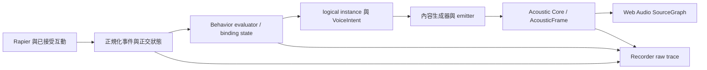

<!-- english-source: {"path":"docs/12-architecture-review/SOUND_BEHAVIOR_RESEARCH.md","sha256":"5b7944dd25c9c27faf271047719086a25c090bf90ae6c433b8c31b4609737213","translated_at":"2026-10-29T05:25:21Z","executor":"Codex","model_id":null,"links":"english-relative"} -->
<!-- english-notice:start -->
> English translation of [`docs/12-architecture-review/SOUND_BEHAVIOR_RESEARCH.md`](../../12-architecture-review/SOUND_BEHAVIOR_RESEARCH.md). Source SHA-256: `5b7944dd25c9c27faf271047719086a25c090bf90ae6c433b8c31b4609737213`. Executor: Codex; model ID unavailable. Translation is not new implementation or validation evidence. Canonical sources and shared task/contract/result files retain their authority. Verbatim technical examples may retain their original language.
<!-- english-notice:end -->

<!-- english-original-anchor --> <a id="sound-behavior-架構研究"></a>
# Sound Behavior Architecture Research

Review date: 2026-10-29 (Asia/Taipei). Baseline: `c210ca882ca8503b322c28884bf1e9f6e9fe126d`. Research first consulted the [existing middleware study](../10-sound-behaviors/SOUND_BEHAVIOR_RESEARCH.md), [source metadata](../../../research/sound-behaviors/middleware-sources.json), [Evidence Ledger](../../../research/EVIDENCE_LEDGER.json), latest handoff, and production `src/`. This page adds current status, gaps, and official sources; it does not replace [ADR-014](../02-architecture/adr/014-sound-behavior-system.md), [V1 acceptance](../11-v1/ACCEPTANCE.md), or [amendments](../11-v1/ACCEPTANCE_AMENDMENTS.md).

<!-- english-original-anchor --> <a id="結論與狀態"></a>
## Conclusion and status

Existing Event Rules, orthogonal states, and versioned bindings/profiles can serve this stage without commercial middleware or a new Node Graph. Shared producer-capability authority, corrected status entry points in older documents, and explicit trace/budget/preset semantics are smaller and more testable priorities than adding trigger kinds.

Labels: **VERIFIED-SOURCE** means official body text read in this review; **VERIFIED-CODE** means baseline code and test content read; **VERIFIED-PROBE** means the necessary read-only process below actually executed; **HISTORICAL-TEST** means the original scope of a fixed artifact; **APPROXIMATION** means engineering/perceptual approximation; **PROPOSED** means unaccepted recommendation; **UNVERIFIED/NOT RUN** means no corresponding measurement. Code existence, passing Node domain tests, actual AudioNode graph, browser input, device hearing, and performance do not substitute for each other. Full V1 remains incomplete; R17 performance FAIL and physical/device-hearing gaps are retained.

<!-- english-original-anchor --> <a id="現行責任鏈"></a>
## Current responsibility chain



| Layer | Existing code/validation | Authority and boundary |
| --- | --- | --- |
| Physics/Player producer | [PhysicsWorld](../../../src/physics/physics-world.ts), [InteractionHost](../../../src/interaction/interaction-host.ts) | Actual poses/contacts, successful Grab/Throw; no player-intent inference from samples or speed |
| Normalization | [physics-behavior](../../../src/app/physics-behavior.ts) | Enumerates accepted discrete producers; fixed tick/sequence, generation, and contact provenance; missing force is null, never Ns relabeled N |
| Behavior | [audio-behavior](../../../src/audio-behavior/index.ts), [registry](../../../src/audio-behavior/profile-registry.ts), [types](../../../src/audio-behavior/types.ts) | Schema/domain/trusted registry; conditions, curves, cooldown, latch, logical admission. No AudioNode, physics solver, or arbitrary JS |
| App host | [runtime](../../../src/app/runtime.ts), [behavior editor](../../../src/app/behavior-editor.ts) | Pause/drain, atomic revision/epoch/Undo; pending voices wait for valid routes; behavior/native rejections recorded |
| Content/renderer | [AudioEngine](../../../src/audio/engine.ts), [PathRoute](../../../src/audio/routes.ts), [late reverb](../../../src/audio/late-reverb.ts) | Samples/oscillators and stable path routes; content gain/pitch separate from propagation; reverb labeled Synthetic/perceptual approximation |
| Record/reprocess | [recorder](../../../src/experiments/recorder.ts), [reprocess](../../../src/experiments/reprocess.ts), [replay audio](../../../src/app/replay-audio.ts) | Original physics/motion separate from derived decisions; bounded snapshots, no serialized Rapier/AudioNode |

VERIFIED-CODE: a continuous instance is not replaced by a separate OnImpact. Every binding of a shared profile owns an independent cursor/cooldown/instances. A sample one-shot creates a new BufferSource and reuses decoded AudioBuffer; continuous updates retain the running source. [Domain tests](../../../tests/audio-behavior/runtime.test.ts), [engine tests](../../../tests/audio-runtime/engine.test.ts), and existing native/browser receipts validate their respective scopes. Node fake-context tests are not actual hearing evidence.

<!-- english-original-anchor --> <a id="trigger-狀態全表"></a>
## Complete trigger status table

Every rule also requires Active lifecycle, effective binding/rule enabled state, legal assets/revisions, conditions, mappings, and budget. Preview/Staged do not emit. Continuous is a level and Discrete an edge; getters do not advance physics hysteresis. A producer in this table means baseline code, not human hearing approval for every scenario.

| Trigger | Current producer/evaluation semantics | Anchor/main limit | Status |
| --- | --- | --- | --- |
| AlwaysOn | Active and enabled; sleep/Held/Moving/NoGravity do not independently stop it | Object pose plus explicit offset; persistent instance | VERIFIED-CODE |
| WhileHeld | Held state after successful Grab; Held can still move and hit walls | Object/grip offset | VERIFIED-CODE |
| OnGrab | Successful `grab` command, not hover or a key alone | Object; command ID required | VERIFIED-CODE |
| OnRelease | Successful Drop/Throw shares a command ID; focus loss/mode invalidation does not impersonate release | Object; separate OnDrop/OnThrow rules may deliberately layer | VERIFIED-CODE |
| OnThrow | Explicit successful throw with bounded impulse | Object; high speed, being struck, and natural falling are not Throw | VERIFIED-CODE |
| OnDrop | Successful Drop removes the controller and retains solver velocity/gravity mode | Object; freefall is not Drop | VERIFIED-CODE |
| WhileMoving | World-frame linear-speed hysteresis | Object; Tuned thresholds, not movement relative to a platform | VERIFIED-CODE/APPROXIMATION |
| WhileAirborne | Dynamic without valid support; evaluator additionally requires held=false | Object; stationary zero-gravity bodies can be airborne; moving can be an AND condition | VERIFIED-CODE/APPROXIMATION |
| OnImpact | New contact episode, J+closing speed+cooldown, not support force every step | Contact one-shot, fixed at emission position | VERIFIED-CODE/APPROXIMATION |
| OnBounce | Evaluator accepts legal physics-normalized input; current bridge does not generate it | Requires parent impact, bounded outgoing normal reversal/separation evidence; Impact or restitution cannot substitute | PRODUCER_UNSUPPORTED; disabled in UI |
| WhileRolling | Supported sphere, support-relative velocity/angular velocity, low slip and hysteresis | Contact; arbitrary mesh/compound unsupported, null retains unknown | VERIFIED-CODE/APPROXIMATION |
| WhileSliding | Actual relative contact-point slip above hysteresis thresholds | Contact; wall scraping qualifies, COM translation alone does not | VERIFIED-CODE/APPROXIMATION |
| WhileSpinning | Angular-speed rad/s hysteresis independent of Moving/support | Object; spin is not rolling | VERIFIED-CODE/APPROXIMATION |
| OnStartMoving | Moving false→true fixed-step edge using the same speed basis | Object; not action started/Awake/teleport | VERIFIED-CODE |
| OnStopMoving | Moving true→false with exit band and two stable steps | Object; Pause does not create an edge | VERIFIED-CODE |
| OnSleep/OnWake | Dynamic sleep-state edge, not an input key | Object; initial baseline/mode change should not be interpreted as new player behavior | VERIFIED-CODE; producer tests govern details |
| OnEnterZone/OnExitZone | Evaluator handles valid zone input; current product context has zoneIds=[], with no bridge occupancy producer | Zone; deletion/load baseline does not invent traversal | PRODUCER_UNSUPPORTED; disabled in UI |

Exact thresholds remain in [MOTION_HYSTERESIS](../11-v1/MOTION_HYSTERESIS.md); this report creates no second numerical authority. Sphere Rolling/Sliding are Derived/Tuned engineering classifications. Contact J and point speed are not actual object vibration, sound power, or calibrated SPL.

<!-- english-original-anchor --> <a id="cooldown去重與三種預算"></a>
## Cooldown, deduplication, and three budgets

| Policy | Current scope/behavior | Reproduction evidence entry |
| --- | --- | --- |
| Raw impact suppression | Physics pair-episode onset plus pair cooldown across episodes; no audible candidate does not deny physical contact | [physics-world tests](../../../tests/physics/physics-world.test.ts), [contact projection](../../../tests/physics/contact-projection.test.ts) |
| Rule cooldown | `bindingState(bindingId).cooldowns[ruleId]`; `ceil(seconds/fixedDt)` ticks, independent of render FPS | [runtime cooldown/shared-profile tests](../../../tests/audio-behavior/runtime.test.ts) |
| Duplicate inputs | Bounded event-ID cache plus monotonic input cursor; evicted IDs still cannot replay earlier same-tick sequence | Same tests; reset/seek changes epoch |
| Logical admission | maxVoices/maxPerObject/rule voiceLimit, including fading tails. Candidates for one input are ordered by priority and stable binding/rule ID. Logical policy explicitly rejects rather than abruptly steals | [voice-admission](../../../src/audio-behavior/voice-admission.ts), [active-rule tests](../../../tests/audio-behavior/active-rule-projection.test.ts) |
| Native voice resources | AudioEngine separately counts active/retiring/pending/frozen resources; lower-priority native voices may fade/steal, with different admission/cleanup outcomes | [engine](../../../src/audio/engine.ts), [restore cursor](../../../tests/audio-runtime/restore-cursor.test.ts), [pause regressions](../../../tests/audio-runtime/pause-regressions.test.ts) |
| Solver/paths/assets | Independent bounds for sources, source-frame cache, per-voice/total paths, decoded bytes, concurrent decodes, pending events, and late sends | [AudioBudget](../../../src/audio/types.ts), [control](../../../src/audio/control.ts), [asset bounds](../../../tests/audio-runtime/asset-bounds.test.ts) |

A logical start/active rule does not establish playback. Later native rejection, unavailable/stale routes, Mute, unready samples, and overload have different reasons; UI should not label them all “rule did not trigger.” [Behavior diagnostics](../../../tests/app/behavior-diagnostics.test.ts) includes a real Rapier cooldown case retaining raw impact/contact, COOLDOWN decision, contact position, and replay provenance. It neither removes raw events nor invents a COM emitter.

FMOD cooldown is a start interval between instances of the same event. UE concurrency can use owner or shared-asset scope. Neither equals this project's binding+rule scope. Borrowing the concept does not justify global cooldown or using middleware voices as solver capacity. [FMOD macros](https://www.fmod.com/docs/2.04/studio/event-macro-controls-reference.html), [UE concurrency](https://dev.epicgames.com/documentation/unreal-engine/sound-concurrency-reference-guide?lang=en-US) (VERIFIED-SOURCE, 2026-10-29).

<!-- english-original-anchor --> <a id="統一-sourcegraph-與-preset-邊界"></a>
## Unified SourceGraph and preset boundaries

[PathRoute](../../../src/audio/routes.ts) creates one DelayNode and PannerNode per stable path. Panner `rolloffFactor=0`; solver band-pressure ratios own distance gain. Propagation applies `AcousticFrame.absoluteDelayS` once. HRTF direction comes from the last segment's arrival direction rather than the straight source direction. Band-filter banks and path birth/death are smoothed, with convolver normalize=false. Content pitch is authored; physical Doppler caused by changing delay must not receive another identical compensation.

Raw/Simulated are monitor routes for the same emission. Dry audition is a visibly separate editing domain excluded from experiment metrics. These legitimate routes do not prove all 3D acoustic behavior validated. Late reverb is Synthetic/perceptual approximation, with no direct sound in its IR and explicit normalization/send responsibility; its tail is not a measured real room.

| Preset/authoring capability | Current behavior | Minimum labeling and boundary |
| --- | --- | --- |
| Default continuous tone | [defaults](../../../src/app/defaults.ts) `profile.continuous-tone`, procedural 220 Hz | Procedural test tone, not natural vibration |
| Default interactive | `profile.interactive-tone`, OnImpact/OnGrab/OnThrow; impact gain maps closing speed | Creative tones, not Measured materials |
| physical/creative/hybrid/procedural | Schema labels; `setPreset` changes presetKind without turning existing rules into a vibration solver | `physical` means an authored physical-inspired preset, not modal synthesis; a category-label change does not change physics/acoustics |
| Material-pair override | Selects a generator for the same rule by material pair, retaining contact and finite lifetime/budget | Content-material pairing cannot overwrite acoustic A/R/T/bands or Rapier mass/friction |
| Shared-preset editing | Profile revision/binding pin; local editing clones a shared profile and preserves relevant binding overrides | Frozen versions, Undo/Redo/CAS; no rewriting historical runs |
| Variants/Graph/modal synthesis | Production evaluator has no variants, arbitrary JS, DSP graph, or modal synthesis | P2/not implemented; presence of a seed field does not establish all these capabilities |

Existing [editor tests](../../../tests/app/behavior-editor.test.ts) cover shared-profile isolation, curves/overrides, stale drafts, and Undo/Redo. [Scene-source projection](../../../tests/app/scene-source-behaviors.test.ts) synchronizes legacy sources and rules. Retain these regression surfaces. New samples still require trusted ID/revision/SHA, READY/APPROVED status, decoding/duration/memory checks; a model cannot provide arbitrary paths/URLs.

<!-- english-original-anchor --> <a id="必要唯讀-probeproducer-能力沒有共用權威"></a>
## Necessary read-only probe: producer capability lacks shared authority

**VERIFIED-PROBE, 2026-10-29, exit 0.** Baseline UI [unsupportedTriggerReasons](../../../src/ui/behavior-options.ts) disables OnBounce/OnEnterZone/OnExitZone, but the [offline planner](../../../src/ai/offline-sound-planner.ts) proposes OnBounce for a bounce-sound request. `SoundProposalHost.stage` passes strict document validation and creates an awaitingApproval preview. This establishes acceptance at preview of a rule legal for the schema/evaluator but unavailable from the current producer. It does not establish an apply/audible-execution defect.

Reproduction code (repository root, executed with `node --import tsx --input-type=module`):

```javascript
import { createDefaultScene, createDefaultBehaviors, makeBehaviorContext } from "./src/app/defaults.ts";
import { OfflineSoundPlanner } from "./src/ai/offline-sound-planner.ts";
import { SoundProposalHost } from "./src/ai/sound-host.ts";
import { unsupportedTriggerReasons } from "./src/ui/behavior-options.ts";
const scene = createDefaultScene();
const document = createDefaultBehaviors(scene);
const context = makeBehaviorContext(scene, scene.objects.map(o => ({ objectId: o.id, generation: 1 })));
const state = { sceneId: scene.sceneId, sceneRevision: scene.sceneRevision, document, context };
const plan = new OfflineSoundPlanner().plan("ball bounce sound", state, { selectedObjectId: "ball" });
const host = new SoundProposalHost({
  getState: () => state,
  commit: () => { throw new Error("COMMIT_MUST_NOT_RUN"); }
});
const preview = await host.stage(plan.proposal, plan.provenance);
console.log({
  uiUnsupported: unsupportedTriggerReasons.OnBounce,
  previewState: preview.state,
  hasBounce: preview.candidate.profiles.some(p => p.rules.some(r => r.trigger.type === "OnBounce"))
});
```

Observed output from the equivalent executed command: the UI reason states that the bridge does not produce OnBounce and recommends OnImpact; both planned and candidate triggers contain OnBounce; previewState=`awaitingApproval`. The probe's commit adapter would throw and was never called. Only a local deterministic proposal/preview was made, without apply, AudioContext activation, network, or paid API. No production fixture was created; hard-coded telemetry fields are not treated as measurements.

**PROPOSED smallest repair:** extract a domain producer-capability map/query with `triggerId`, evaluatorSupported, producerStatus, reason, applicable shapes, and required observations, consumed by UI, AI context, and preview diagnostics. Retain generic schema, existing project import, and legal external evaluator inputs. First give explicit warnings or `CAPABILITY_UNSUPPORTED` for new authoring/AI proposals according to product policy; never silently replace Bounce with OnImpact. A UI-only check is insufficient, and imported rules must not be destructively deleted.

<!-- english-original-anchor --> <a id="官方成熟工具新增查核與可借鑑範圍"></a>
## Official mature tools: new checks and transferable scope

Official text and official repositories were used, all accessed **2026-10-29**. Only original summaries/metadata were retained. No FMOD/Wwise/UE SDK was installed or run, no latency/voices/memory benchmark was performed, and no commercial assets were downloaded.

| Claim/version/status | Official direct support | Project inference/no extrapolation | Source |
| --- | --- | --- | --- |
| SND26-F01, FMOD 2.04, VERIFIED-SOURCE | Shared Events support independent instances, 3D poses, and local parameters; global parameter values are shared | Useful reference for separating Profile/binding state; same Event does not automatically mean same physical contact | [Events](https://www.fmod.com/docs/2.04/studio/authoring-events.html), [Parameters](https://www.fmod.com/docs/2.04/studio/parameters.html) |
| SND26-F02, FMOD 2.04, VERIFIED-SOURCE | Max Instances, stealing/virtualization, and cooldown; official example uses frequently colliding debris to explain instance limiting | Audio budget does not classify real impact or replace physics episodes; do not copy its scope unchanged | [Event Macros §§19.6–19.9](https://www.fmod.com/docs/2.04/studio/event-macro-controls-reference.html) |
| SND26-U01, UE 5.8 docs, VERIFIED-SOURCE | MetaSounds DSP dataflow with reusable Source/Patch/Preset; a Preset inherits a read-only parent graph, overrides inputs, and receives parent updates. Triggers support within-block sample timing; outputs connected to non-audio-rate types may be block-rate | Does not increase Rapier fixed-step observation precision; frozen profile revisions should not copy live parent propagation | [MetaSounds Reference](https://dev.epicgames.com/documentation/en-us/unreal-engine/metasounds-reference-guide-in-unreal-engine) |
| SND26-U02, UE 5.8 docs, VERIFIED-SOURCE | Concurrency includes Max Count, owner scope, Retrigger Time, and voice-steal fade; active silent components count; shared assets can share state | Silence does not imply no resource cost. Keep logical/native/solver budgets separate rather than transplant UE counting rules | [Sound Concurrency](https://dev.epicgames.com/documentation/unreal-engine/sound-concurrency-reference-guide?lang=en-US) |
| SND26-U03, UE 5.8 docs, VERIFIED-SOURCE | Gameplay speed can map wind-sound gain; Sound Attenuation separately lists distance, spatialization, air absorption, reverb, and occlusion | Speed mapping is content design, not aerodynamic simulation/measured acoustic material; attenuation curves are not this project's measurement reference | [Quick Start](https://dev.epicgames.com/documentation/unreal-engine/metasounds-quick-start?lang=en-US), [Attenuation](https://dev.epicgames.com/documentation/en-us/unreal-engine/sound-attenuation-in-unreal-engine) |
| SND26-W01, Wwise 2017.2.0 build6500, VERIFIED-SOURCE-LEGACY | Official headers expose PostEvent/Playing ID and object/global/playing RTPC scope; spatial geometry/emitter layers; indirect-path query may take a global lock | Historical principles only, not a 2026 current-API check; do not put blocking queries into audio callbacks | [SoundEngine](https://raw.githubusercontent.com/audiokinetic/WwiseIncludes/master/SDK/include/AK/SoundEngine/Common/AkSoundEngine.h), [Query](https://raw.githubusercontent.com/audiokinetic/WwiseIncludes/master/SDK/include/AK/SoundEngine/Common/AkQueryParameters.h), [Spatial](https://raw.githubusercontent.com/audiokinetic/WwiseIncludes/master/SDK/include/AK/SpatialAudio/Common/AkSpatialAudio.h) |
| SND26-W02, current Wwise, UNVERIFIED API | Current edge SDK/Help official entries remained unreadable; access failure retained | Unreadability does not establish missing features, and legacy headers/search snippets do not become current API verification | [Events, failed access](https://www.audiokinetic.com/en/library/edge/?source=SDK&id=soundengine__events.html), [Limiting, failed access](https://www.audiokinetic.com/en/library/edge/?id=limitingsoundinstances.html&source=Help) |

FMOD/MetaSounds/Wwise are mature-principle references, not evidence that Reflection Lab invented events, procedural audio, or natural-language authoring. Web Audio and Rapier primitives suffice for this stage. A complete DSP Graph/commercial middleware adds deployment, rights, and validation scope and is not the smallest proposal in this review.

<!-- english-original-anchor --> <a id="重要-gap最小建議與驗證"></a>
## Important gaps, minimum recommendations, and validation

| Priority | Gap/status | Minimum recommendation and reproducible validation |
| --- | --- | --- |
| High | Producer capability is UI-only; read-only probe proves AI preview accepts OnBounce without a producer | Shared read-only capability projection; test consistent visibility through UI/AI/manual authoring/import while retaining generic evaluator schema |
| High | Earlier status text in [architecture](../10-sound-behaviors/SOUND_BEHAVIOR_ARCHITECTURE.md), [event model](../10-sound-behaviors/EVENT_MODEL.md), [bridge](../10-sound-behaviors/PHYSICS_AUDIO_BRIDGE.md), and ADR-014 still says unimplemented | Add current status/evidence entry points while retaining historical draft results; research does not mark tasks DONE |
| Medium | Physics pair identity/cooldown generation and churn-cleanup risk | See [physics research](PHYSICS_AND_MOTION_RESEARCH.md); establish a negative fixture first, without changing raw-trace semantics merely to add a sound |
| Medium | Missing Bounce/zone producers; incomplete persistent-contact rearm/compound patches | Capability unavailable first. If separately tasked, validate parent impact/separation/bounded window and multi-patch fixtures; every ContactEnd is not Bounce |
| Medium | `physical` preset may be mistaken for natural vibration; changing category does not create another physical model | Explicit physical-inspired UI/docs; test that presets do not change mass/friction/A/R/T/same-motion trace |
| Medium | Shared presets differ from vendor live inheritance | Immutable revisions and binding pins; no cross-object cooldown/playhead contamination, no rewriting historical runs |
| Retained | Hi-x65/D3V hearing, physical FPS/IME, complete delivery/Worklet deadline remain incomplete; R17 performance FAIL | Follow [Human Test Guide](../11-v1/HUMAN_TEST_GUIDE.md) and original long-run gates independently; no promotion from research |

Within the sound review, only the necessary silent preview probe was executed. A separate physics generation/cooldown probe is recorded in the physics report. The root agent will run complete check/runtime/benchmark; these suites were **not rerun**, nor were browser/hearing/paid-model tests. Existing regression entry points below are **not claimed PASS in this review**:

```powershell
node --import tsx --test tests/audio-behavior/runtime.test.ts tests/audio-behavior/active-rule-projection.test.ts tests/app/behavior-diagnostics.test.ts tests/app/behavior-editor.test.ts
node --import tsx --test tests/audio-runtime/engine.test.ts tests/audio-runtime/pause-regressions.test.ts tests/audio-runtime/restore-cursor.test.ts tests/app/replay-audio.test.ts tests/experiment-runtime/reprocess.test.ts tests/experiment-runtime/source-phase.test.ts
```

The first group covers AlwaysOn/one-shot coexistence, independent shared-profile state, cooldown/voice limits/latches, authoring revisions/overrides, and raw diagnostics. The second includes Node fake-context graph/cursor/reprocessing tests, not actual PCM hearing. Native reference commands/fixed outputs are in [audio-runtime README](../tests/audio-runtime/README.md); original/failing results must remain. Existing [R17 functional receipt](../../../artifacts/v1/r17-browser-verification-20261029/verification.json), [R17 requirement review](../../11-v1/REQUIREMENT_EVIDENCE_20261029-r17.json), and [performance](../11-v1/BROWSER_PERFORMANCE.md) retain their respective success/failure/NOT RUN scopes.

New tests should target actual changes: incompatible producer cases for the shared capability authority, independent binding cooldown, silent/retiring/pending resources not escaping budgets, and preset labels not changing physics/acoustics. Do not create table-mirroring tests solely for new research documents.

<!-- english-original-anchor --> <a id="錄放ab-與未來-motion-的接點"></a>
## Recording, A/B, and future Motion integration

Recorded-output replay plays captured decisions/VoiceIntents. Behavior reevaluation fixes original motion/raw physics/listener/geometry/physics/solver/medium while changing declared profile/generator/asset/gain/pitch; new decisions may legitimately differ. Acoustic A/B fixes emitted content; changing to piano cannot establish improved wall RT. Source-phase evidence distinguishes logical intent/native epoch/silent/missing; timestamps or source cursors are not hardware PCM.

Future Move To/Move & Release completion/blocking/cancellation belongs in Motion receipts. Physical OnStartMoving/OnStopMoving remain real speed edges. Programmed moves do not fabricate OnGrab/OnThrow; any new release sound fanout needs an explicit product contract. The sound evaluator does not infer player intent from trajectory names/speed, and audio callbacks do not wait for Motion/geometry/AI. This is a PROPOSED boundary, with no new Motion producer or sound rule.

Delivery limits: reviewable research and minimal proposals, not middleware licensing approval, full-product completion, a physical vibration model, or a new performance baseline. The root agent owns task/Wiki/English-currentness/integration validation; this report does not directly modify the shared source manifest.


