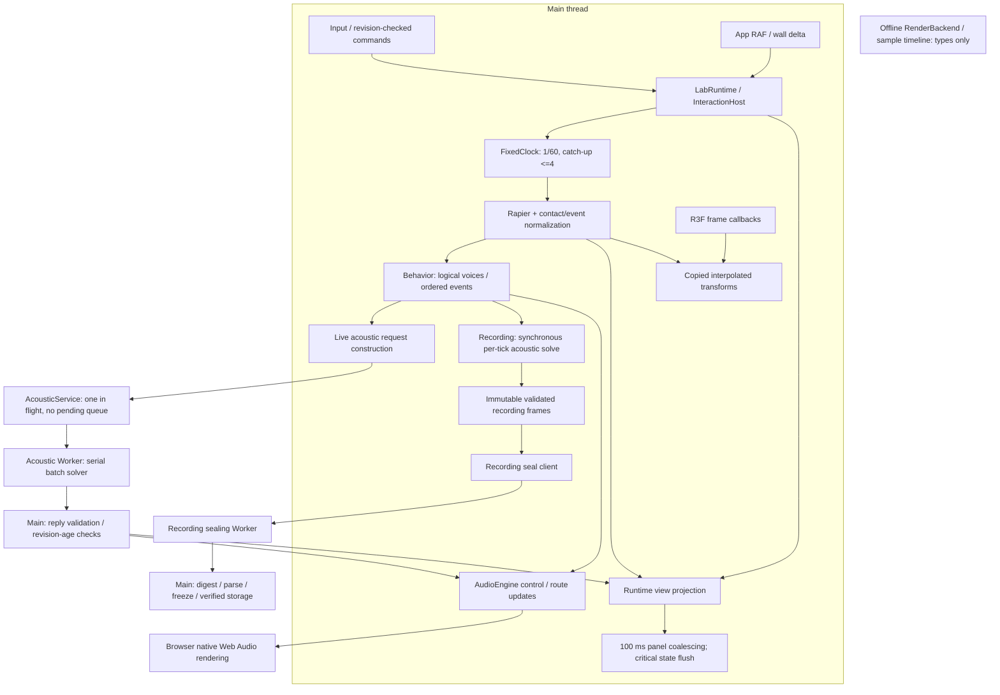

<!-- english-source: {"path":"docs/13-performance-review/CURRENT_RUNTIME_AUDIT.md","sha256":"0dbd7968c8234b2f84e49c649ee759a10c8e97d4c9280e32f8d353f4e26de186","translated_at":"2026-11-01T08:32:24.189Z","executor":"Codex","model_id":null,"translation_lineage":"Existing translations retained where unchanged; research additions and metadata refreshed by Codex","links":"english-relative"} -->
<!-- english-notice:start -->
> English translation of [`docs/13-performance-review/CURRENT_RUNTIME_AUDIT.md`](../../13-performance-review/CURRENT_RUNTIME_AUDIT.md). Source SHA-256: `0dbd7968c8234b2f84e49c649ee759a10c8e97d4c9280e32f8d353f4e26de186`. Executor: Codex; model ID unavailable. Translation is not new implementation or validation evidence. Canonical sources and shared task/contract/result files retain their authority. Verbatim technical examples may retain their original language.
<!-- english-notice:end -->

<!-- english-original-anchor --> 
# Current Runtime Audit

Status: research audit. **CODE FACT** means behavior read in the specified Git version; **HYPOTHESIS** means an unmeasured potential cost; **PROPOSED** means a change that has not been accepted or implemented. This review changes no product code, introduces no clock, runs no product tests, and claims no performance pass.

Baseline: `05d40fd2d52f4b737f6acac61fa00356403c0038` on the Claude development line, not the old workspace's `a5f2a909`. All source paths and line references below refer to this baseline. Later dirty R21 work, earlier research branches, and public snapshot results must not be mixed into it. This page uses no dirty R21 supplement. Requirements and targets remain in [Acceptance](../11-v1/ACCEPTANCE.md), [Amendments](../11-v1/ACCEPTANCE_AMENDMENTS.md), and [Performance Budget](../06-validation/PERFORMANCE_BUDGET.md). This research neither resumes nor completes the original product goal.

Live acoustic submission interval: solve ≥50 ms between submissions; this is an admission interval, not minimum solver compute time.

<!-- english-original-anchor --> 
## PERF-RT-001: Execution environments and dependencies

The main thread currently handles RAF advancement, Rapier, behavior, acoustic request construction, audio control, recording evaluation at each tick, and view projection. Browser native Web Audio renders sound; ordinary live acoustic solving uses a module Worker, and recording sealing uses another Worker. These are separate execution environments, not a dedicated thread for every subsystem. An independent R3F reconciler does not imply an independent CPU thread. [bootstrap](../../../src/app/bootstrap.ts) L280, 315–327; [runtime](../../../src/app/runtime.ts) L774–838, 935–978, 1894–1903.

Arrows describe data or call dependencies. They claim neither simultaneous execution, zero copying, nor a hardware real-time deadline. Recording solving and the live Worker are distinct paths. A sealing Worker does not automatically move the synchronous solver used during capture.

<!-- english-original-anchor --> 
## PERF-RT-002: Per-module scheduling, queues, and overload matrix

Limits below are implementation or contract limits, never measured capacity. See [Clock Review](CLOCK_AND_SCHEDULING_REVIEW.md) for the seven clocks and [Acoustic Worker Review](ACOUSTIC_WORKER_REVIEW.md) for the acoustic state machine.

| Module / baseline location | Thread / clock / trigger rate | Queue / backpressure / overload |
| --- | --- | --- |
| `app/bootstrap.ts:37,242,315` | Main; RAF timestamp supplies delta; panels every 100 ms | One pending latest view; critical state and ordinary commands may flush earlier; no accumulating panel snapshot queue |
| `ui/viewport/SceneEntities.tsx:98`, `CameraRig.tsx:130` | Main R3F render frame, through separate useFrame callbacks | Reads controller poses/camera; not another physics step queue |
| `app/runtime.ts:774,821,830` | Main; app wall-delta accumulator, physics callbacks, live solving at intervals ≥50 ms, view on tick or ≥100 ms | Skips live sampling while busy; replay processes at most four frames per RAF and retains its accumulator; transaction busy rejects ordinary concurrent commands |
| `physics/fixed-clock.ts:91` | Caller thread; default fixed dt 1/60 | Default catch-up four; interactive discards whole-step wall debt without skipping logical ticks; recording retains debt and pauses |
| `physics/physics-world.ts:321,603,1176` | Main, every fixed tick | Own pending events cap 2048 and command deduplication IDs cap 4096, with explicit failure; Rapier EventQueue drains each step, with no measurement of its internal capacity |
| `app/physics-behavior.ts:55` | Main; post-step snapshot to behavior frame | No asynchronous queue; maps accepted interaction/physics/state events rather than inferring Throw/Impact from speed |
| `audio-behavior/index.ts:184,493,632` | Main; evaluates physics ticks without its own timer | Runtime selects 16 logical voices and eight per object; frame ≤1024 objects / 4096 events; bounded deduplication, cooldown and lifetime; rejection reasons retained |
| `app/acoustic-input.ts:39` | Main; each live request, capture solve, or reevaluation | At most 16 explicit sources / 256 poses; rejects complete geometry over budget rather than silently removing bodies |
| `app/acoustic-service.ts:415` | Main control; one batch promise | One in flight, no waiting batch; busy returns SOLVER_BUSY; at most 32 sources, 256 total requested paths, 2 MiB; timeout ≤5 s and cancellation terminates |
| `app/acoustic-worker.ts:10` | Module Worker, per message | One synchronous handler; sources solved serially in map order; no pool, yield, or internal cancellation polling |
| `acoustics/solver.ts:220,417`, `geometry.ts:50` | Caller environment: live in Worker, capture and some reevaluation on main | Explicit surface/path/segment-test/propagation budgets; incomplete visibility fails closed with budgetExceeded; not a deadline scheduler |
| `audio/engine.ts:206,778,1048`, `audio/control.ts:3` | Main control with AudioContext epoch; browser native DSP rendering | Separate native voice, emitter, path, pending arrival, and decoded byte budgets; logical and native admission are separate decisions |
| `app/recording-host.ts:79,116,264` | Main; tick append and explicit finalize/replay/A-B commands | One pending host operation; B reevaluation yields a task every 32 processed frames, not a background queue for per-tick capture |
| `experiments/recorder.ts:468`, `hash.ts:80` | Main capture on the recorded tick timeline | Validates, canonically clones/freezes and counts bytes per frame; frame/byte/event budgets bound recording length and interrupt overflow instead of marking a partial run captured |
| `experiments/recording-worker-client.ts:17` | Main client plus dedicated sealing Worker | One sealing job, timeout ≤120 s; terminates Worker after completion; main still sends, digests, decodes/parses/freezes |
| `app/runtime.ts:1262,1734` | Main; AI/authoring actions are nonperiodic and not an audio clock | Transaction busy gate; safe input and cancel/blur take earlier branches; tool serial quotas/timeouts do not make the audio callback wait for AI |
| `audio/render-contract.ts:28` | **Types only**, planned integer sample timeline | No implemented RenderBackend; job/output budgets are type contracts, not a current renderer or throughput |

<!-- english-original-anchor --> 
## PERF-RT-003: Ownership, copying/GC, ordering, and telemetry matrix

| Module group | Current copying / allocation / possible blocking: CODE FACT | Ordering / consistency | Existing telemetry / gaps |
| --- | --- | --- | --- |
| bootstrap / R3F / runtime | Coalesces the latest view reference; runtime still builds dynamic object/path/rule projections; getPose caches by latest snapshot plus alpha and returns copied poses | No correctness guarantee based on app RAF versus R3F callback order; rendering reads interpolation only | Publication policy is inspectable; no complete per-stage p95/p99 attribution |
| FixedClock / PhysicsWorld | Pre-step history and COM/v/ω maps, post-step copied pose/event DTOs; snapshot reads allocate; grab/placement perform synchronous shape queries | Control, pre-cache, Rapier step, contact drain/aggregation, motion edges, then event stamps; n+1 is post-step, not an exact CCD contact instant | Dropped wall time, overrun, accumulator and ticks; no built-in segmented physics histogram |
| physics-behavior / behavior | Copies contacts; each step clones rollback state/metadata/cursor, results and trace | Input tick/sequence/eventId ordering and deduplication; logical ticks drive continuous/latch lifetimes, not native onended | Bounded decisions/trace; no stage-specific CPU/GC attribution |
| acoustic-input | Validates scene per call; call-local box cache; later sources clone faces; clones material/atmosphere per source; no geometry cache across ticks | Sources/objects sorted by stable ID; excludes source-owner faces; moving bodies are snapshot occluders | No request-build time, cache-reuse byte, or allocation counters |
| acoustic-service / worker | Request preflight walk plus JSON encoding; postMessage has no transfer list; reply known-shape validation plus JSON encoding | Pins scalar identity; reply must match batch/source/listener/revision/tick; one source error rejects the batch | 128 timing samples, bytes, pending age, round-trip/compute/delivery p95 and reject/cancel/timeout/restart counters; service timing does not cover the full chain |
| solver / geometry | Prepares/copies/sorts surfaces and material map per source; reflection candidates, segment scans, path arrays/sort | Stable path IDs exclude coordinates/rank; sorted surfaces stabilize budgeted evaluation order; finite first-order model only | Segment tests, candidates, dropped paths and budgetExceeded; not CPU/memory timing |
| AudioEngine | JS control creates/updates native graphs, routes, filters and path state; native DSP is not a project JS callback | Epoch maps emission time; absolute delay once; old frame/revision rejected; logical lifetime and native cleanup separated | Voice/path/pending/late/stale/byte/device latency fields; no inference of native DSP p99 or ear arrival latency |
| capture / sealing | Synchronous capture solver and immutable canonical parse/freeze; sealing Worker moves some recalculation, while main digest/parse/freeze remain | Seals accepted consecutive ticks; publishes after bytes/hash/identity checks; failures publish no partial result | Recorder frame/event/byte/state fields and seal timeout; full capture/serialization/GC segmentation unmeasured |
| authoring / AI | Candidate validation, world construction, asset decode, storage and network await do not automatically move CPU work into the background | Rechecks revision/generation after await; swaps on success; cancelled/stale work cannot apply older results | Host operation/run state; not evidence of live models, multiuser capacity, or audio deadlines |

References: [runtime](../../../src/app/runtime.ts) L421–438, 458–487, 503–572, 839–978, 1034–1084, 2060–2375; [physics](../../../src/physics/physics-world.ts) L346–600, 1176–1288; [behavior](../../../src/audio-behavior/index.ts) L632–845; [input](../../../src/app/acoustic-input.ts) L39–135; [service](../../../src/app/acoustic-service.ts) L243–323, 415–567. Source inspection establishes copies, not GC pause frequency, duration, or the actual bottleneck.

<!-- english-original-anchor --> 
## PERF-RT-004: Hot paths to investigate first

| Finding | Confirmed fact | Unproven inference / required measurement |
| --- | --- | --- |
| PERF-RT-004A | Capture solves synchronously per tick, with up to four catch-up callbacks in one RAF | May amplify frame tails; separate wall CPU and GC for physics-only, behavior, record evaluation and append, without assuming the solver dominates |
| PERF-RT-004B | Scene/geometry construction, cloning, bounded walking and JSON encoding precede the Worker; validation/audio/view consumers follow it | Worker compute p95 can pass while main exceeds budget; needs end-to-end stage traces |
| PERF-RT-004C | maxPaths truncates after candidate generation and sorting | Lower paths may mainly reduce delivery/native graph cost; source/surface/path matrices must establish solver savings |
| PERF-RT-004D | Panel coalescing and authoring projection caches already exist | Changes must improve remaining dynamic projection costs; a generic proposal to add throttling does not locate the problem |
| PERF-RT-004E | Fixed stepping, snapshot observer and capture callback share a call stack | A physics Worker also changes input/query/grab/build/revision/lifecycle boundaries; compare the smaller recording-evaluation boundary first |

<!-- english-original-anchor --> 
## PERF-RT-005: Options requiring research before selection

The first candidate spike should compare the baseline with a bounded, immutable, ordered recording-evaluation lane, without first changing the product. Every accepted tick needs an evaluation/record commit or an explicit failed/interrupted outcome. Capacity exhaustion pauses the producer rather than overwriting experimental ticks with the latest state. Coexistence with main-thread physics requires watermarks, stop/finalize draining, failure recovery and source cursor contracts. See [Recording Review](RECORDING_AND_RENDERING_REVIEW.md).

A physics Worker, cross-tick geometry cache, typed transferable pool, triple buffering, and SAB are all **PROPOSED**. Selection follows segmented costs and equivalence evidence in [Measurement Plan](MEASUREMENT_PLAN.md), not the assumption that more threads are faster. WHATWG specifies a Worker agent/event loop and notes startup costs. Moving CPU work does not remove send/receive/validation. [HTML Workers](https://html.spec.whatwg.org/multipage/workers.html), [HTML Event loops](https://html.spec.whatwg.org/multipage/webappapis.html#event-loops), accessed 2026-11-01, Living Standard dated 2026-10-30.

Acceptance must retain interactive wall-time dropping, recording pause/debt, separate source/voice/path caps, finite-path scientific limitations, single propagation delay, stable path IDs, recording/A-B fingerprints, and authoring atomicity/undo. [ADR-015](../02-architecture/adr/015-client-first-and-render-contract.md) is the existing accepted boundary. This page accepts no new ADR.

<!-- english-original-anchor --> 
## Evidence limits

This page is a static audit of the specified version, not measured capacity or a new PASS. Existing R17 negative performance results and human/device limits remain under [Performance Budget](../06-validation/PERFORMANCE_BUDGET.md) and [Browser Performance](../11-v1/BROWSER_PERFORMANCE.md). Targets are maintained only in the formal budget. Historical unimplemented sections in older documents do not mean all current src is unimplemented, and one successful functional Worker fixture does not establish whole-product performance.
